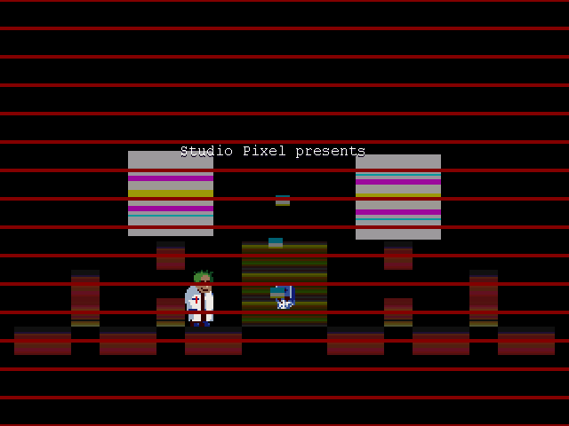
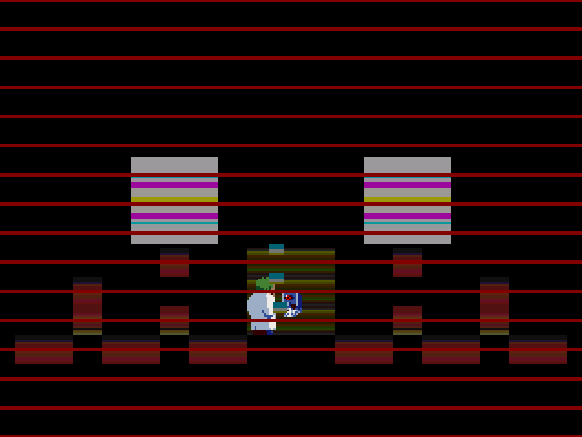
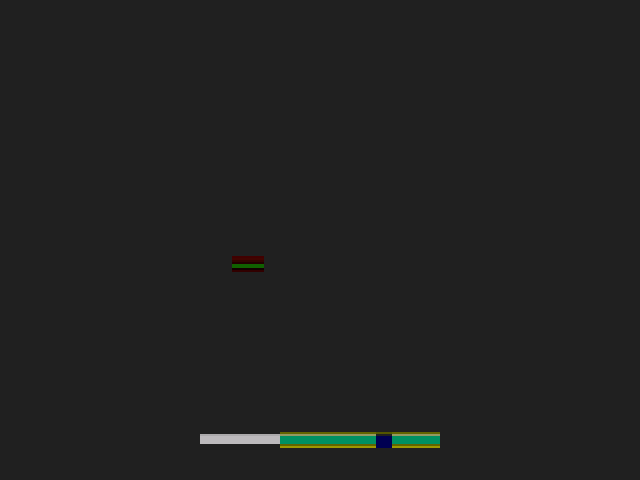

<div align="center">


# GameReComp

**Windows games → editable C source → native Linux/macOS builds**

Recompile legacy Windows PC games using [PCRecomp](https://github.com/sp00nznet/pcrecomp), [rev.ng](https://github.com/revng/revng), and reusable runtime shims.

[](LICENSE)
[](#quick-start)
[](#what-it-does)
[](#proof--gameplay)
[](https://github.com/heaven-hm/GameReComp/issues)

[**Quick start**](#quick-start) · [**Screenshots & proof**](#proof--gameplay) · [**Roadmap**](#game-roadmap) · [**Toolchain**](#toolchain) · [**Contribute**](#contributing)

</div>

## What it does

```text
Windows game.exe → recover & lift → generate C → compile → run → verify
```

- Generates a rebuildable **C source project** and **native executable** with Windows API shims.
- Uses **rev.ng** for higher-level source recovery; preserves a low-level fallback where needed.
- Records build provenance, execution results, and verification evidence. **Currently supports PE32 (x86) inputs.**

## Proof & gameplay

**Cave Story (Doukutsu.exe)** — the rebuilt game reaches its frame loop and renders. **143/143 imports** bind; the run is classified **partial**, not independently verified playable gameplay.

<table>
<tr>
<td align="center"><br><sub>Intro frame</sub></td>
<td align="center"><br><sub>Animation</sub></td>
<td align="center"><br><sub>Later captured frame</sub></td>
</tr>
</table>

| Evidence | Current result |
| --- | --- |
| Independently **verified playable games** | **0** (requires original-Windows scenario oracle) |
| **Running native macOS arm64 ports** | **92 / 115** measured Windows PE32 apps & games compile and run natively on macOS `arm64` (**89** with 0 unresolved imports; see [Game matrix](docs/GAME_MATRIX.md) and [table.md](table.md)) |
| Cave Story | Rendering/frame loop observed; **partial** (143/143 imports bound) |
| Interactive Win32/GDI apps (macOS Cocoa/Metal) | **74+ Win32/GDI apps & puzzles** (`gconv.exe`, `cube.exe`, `pq.exe`, PuTTY, BusyBox, CLI games, etc.) boot & run natively |
| Source recovery | **18/955** rev.ng provider functions with scoped differential certifications in the documented experiment |

**Evidence:** [Game matrix](docs/GAME_MATRIX.md) · [Verification methodology](docs/VERIFICATION.md) · [Reports](reports/). Captured frames demonstrate rendering, **not** gameplay equivalence. Upstream PCRecomp game successes are documented separately in the [matrix](docs/GAME_MATRIX.md) and are not counted as GameReComp-verified ports.

<details>
<summary><b>Measured ports (auto-updated from <code>docs/GAME_MATRIX.md</code>)</b></summary>

<!-- GAME-MATRIX:BEGIN -->
| Name | OS | Arch | Port details | Working status |
| --- | --- | --- | --- | --- |
| BusyBox (busybox-w32.exe) | Windows | i386 (PE32) | 6989 fns recovered; 24 units / 181.3 MiB C; binary busybox_w32 42887 KiB; 311 imports bound [macOS arm64 (native)]; low-level 6989/ high-level verified 0 | PARTIAL - launches, no scenario oracle - process launched and exited 0; no oracle supplied |
| Cannonball | Windows | x86-64 | inspect failed: PE32+ is not supported by the PE32 backend yet (machine x86-64); fail-closed instead of guessing | NOT RUN |
| Cave Story (DoConfig.exe) | Windows | i386 (PE32) | 458 fns recovered; 2 units / 4.2 MiB C; binary DoConfig 1933 KiB [macOS arm64 (native)]; 90 imports bound; low-level 458/ high-level verified 0 | PARTIAL - launches, no scenario oracle - process launched and exited 1; no oracle supplied |
| Cave Story (Doukutsu.exe) | Windows | i386 (PE32) | 3317 fns recovered; 8 units / 51.0 MiB C; binary Doukutsu 10404 KiB [macOS arm64 (native)]; 143 imports bound; low-level 3310/ high-level verified 7 | PARTIAL - launches, no scenario oracle - process launched and stayed alive until the 10s timeout; no crash observed, no oracle |
| Cave Story (OrgView.exe) | Windows | i386 (PE32) | 603 fns recovered; 2 units / 5.6 MiB C; binary OrgView 2729 KiB [macOS arm64 (native)]; 122 imports bound; low-level 603/ high-level verified 0 | FAIL - rebuilt process cannot boot - rebuilt process crashed (exit -11) |
| Data (file0001.exe) | Windows | None | inspect failed: PEFormatError | NOT RUN |
| Data (file0002.exe) | Windows | None | inspect failed: PEFormatError | NOT RUN |
| Data (helpme.exe) | Windows | None | inspect failed: PEFormatError | NOT RUN |
| Data (netarena.exe) | Windows | None | inspect failed: PEFormatError | NOT RUN |
| Data (netipx.exe) | Windows | None | inspect failed: PEFormatError | NOT RUN |
| Data (netmodem.exe) | Windows | None | inspect failed: PEFormatError | NOT RUN |
| Data (netterm.exe) | Windows | None | inspect failed: PEFormatError | NOT RUN |
| Data (order.exe) | Windows | None | inspect failed: PEFormatError | NOT RUN |
| Data (rtm.exe) | Windows | None | inspect failed: PEFormatError | NOT RUN |
| Data (setup.exe) | Windows | None | inspect failed: PEFormatError | NOT RUN |
| Data (shipedit.exe) | Windows | None | inspect failed: PEFormatError | NOT RUN |
| Data (tyrian.exe) | Windows | None | inspect failed: PEFormatError | NOT RUN |
| Downloads (idman643build18.exe) | Windows | i386 (PE32) | 605 fns recovered; 2 units / 6.6 MiB C; binary idman643build18 14228 KiB [macOS arm64 (native)]; 95 imports bound, 9 unresolved; low-level 605/ high-level verified 0 | FAIL - rebuilt process cannot boot - rebuilt process boot-failed (exit 2) |
| GeneRally | Windows | i386 (PE32) | 2582 fns recovered; 46 units / 374.0 MiB C; binary GeneRally 91801 KiB [macOS arm64 (native)]; 148 imports bound, 58 unresolved; low-level 2582/ high-level verified 0 | FAIL - rebuilt process cannot boot - rebuilt process boot-failed (exit 2) |
| GeneRally (TrackEditor.exe) | Windows | i386 (PE32) | 312 fns recovered; 2 units / 7.0 MiB C; binary TrackEditor 2894 KiB [macOS arm64 (native)]; 147 imports bound; low-level 312/ high-level verified 0 | PARTIAL - launches, no scenario oracle - process launched and exited 0; no oracle supplied |
| Gunroar (gr.exe) | Windows | i386 (PE32) | 3318 fns recovered; 5 units / 19.8 MiB C; binary gr 9048 KiB [macOS arm64 (native)]; 136 imports bound; low-level 3318/ high-level verified 0 | FAIL - rebuilt process cannot boot - rebuilt process aborted on an unhandled guest C++ exception (exit 3); guest SEH unwinding is not implemented |
| Hero Core (herocore gm5.exe) | Windows | i386 (PE32) | 17053 fns recovered; 19 units / 66.4 MiB C; binary herocore_gm5 24744 KiB [macOS arm64 (native)]; 495 imports bound, 18 unresolved; low-level 17053/ high-level verified 0 | FAIL - rebuilt process cannot boot - rebuilt process boot-failed (exit 2) |
| Hero Core (herocore gm7.exe) | Windows | i386 (PE32) | 21674 fns recovered; 24 units / 87.0 MiB C; binary herocore_gm7 30408 KiB [macOS arm64 (native)]; 506 imports bound, 26 unresolved; low-level 21674/ high-level verified 0 | FAIL - rebuilt process cannot boot - rebuilt process boot-failed (exit 2) |
| IGI (IGI-Injector.exe) | Windows | i386 (PE32) | 2687 fns recovered; 7 units / 41.9 MiB C; binary IGI_Injector 10759 KiB [macOS arm64 (native)]; 108 imports bound, 17 unresolved; low-level 2687/ high-level verified 0 | FAIL - rebuilt process cannot boot - rebuilt process boot-failed (exit 2) |
| IGI | Windows | i386 (PE32) | 7325 fns recovered; 16 units / 114.9 MiB C; binary igi 0 KiB [macOS arm64 (native)]; 128 imports bound; low-level 7325/ high-level verified 0 | PARTIAL - launches, no scenario oracle - process launched and exited 1; no oracle supplied |
| Ikachan (dxIka.exe) | Windows | i386 (PE32) | 545 fns recovered; 3 units / 9.8 MiB C; binary dxIka 2921 KiB [macOS arm64 (native)]; 97 imports bound; low-level 543/ high-level verified 2 | PARTIAL - launches, no scenario oracle - process launched and exited 1; no oracle supplied |
| NES_GameGenie (NES_GameGenieEncoder.exe) | Windows | i386 (PE32) | 84 fns recovered; 2 units / 0.3 MiB C; low-level 84/ high-level verified 0; compile failed: build failed (see /Users/haseeb-mir/Documents/Code/GameReComp/projects/NES_GameGenieEncoder/logs/com | NOT RUN |
| Noiz2sa | Windows | i386 (PE32) | 6615 fns recovered; 14 units / 94.3 MiB C; binary noiz2sa 22293 KiB [macOS arm64 (native)]; 69 imports bound; low-level 6615/ high-level verified 0 | PARTIAL - launches, no scenario oracle - process launched and stayed alive until the 10s timeout; no crash observed, no oracle |
| OpenTyrian | Windows | x86-64 | no report.json | NOT RUN |
| PSFTP (psftp-w32.exe) | Windows | i386 (PE32) | 6093 fns recovered; 24 units / 180.2 MiB C; binary psftp_w32 48990 KiB; 149 imports bound [macOS arm64 (native)]; low-level 6093/ high-level verified 0 | PARTIAL - launches, no scenario oracle - process launched and exited 0; no oracle supplied |
| Pageant (pageant-w32.exe) | Windows | i386 (PE32) | 2996 fns recovered; 6 units / 34.2 MiB C; binary pageant_w32 8258 KiB; 194 imports bound [macOS arm64 (native)]; low-level 2996/ high-level verified 0 | PARTIAL - launches, no scenario oracle - process launched and exited 1; no oracle supplied |
| Parsec47 (p47.exe) | Windows | i386 (PE32) | 3932 fns recovered; 7 units / 38.8 MiB C; binary p47 10769 KiB [macOS arm64 (native)]; 58 imports bound; low-level 3932/ high-level verified 0 | FAIL - rebuilt process cannot boot - rebuilt process aborted on an unhandled guest C++ exception (exit 3); guest SEH unwinding is not implemented |
| Pixeltetris | Windows | x86-64 | inspect failed: PE32+ is not supported by the PE32 backend yet (machine x86-64); fail-closed instead of guessing | NOT RUN |
| Progress Quest (pq.exe) | Windows | i386 (PE32) | 9689 fns recovered; 11 units / 35.5 MiB C; binary pq 12387 KiB; 448 imports bound [macOS arm64 (native)]; low-level 9689/ high-level verified 0 | PARTIAL - launches, no scenario oracle - process launched and stayed alive until the 10s timeout; no crash observed, no oracle |
| PuTTY (putty-w32.exe) | Windows | i386 (PE32) | 8077 fns recovered; 51 units / 407.4 MiB C; binary putty_w32 110390 KiB; 340 imports bound [macOS arm64 (native)]; low-level 8077/ high-level verified 0 | PARTIAL - launches, no scenario oracle - process launched and exited 0; no oracle supplied |
| Resource_Convertor (gconv.exe) | Windows | i386 (PE32) | 3441 fns recovered; 6 units / 38.7 MiB C; binary gconv 10392 KiB; 78 imports bound [macOS arm64 (native)]; low-level 3441/ high-level verified 0 | PARTIAL - launches, no scenario oracle - process launched and exited 0; no oracle supplied |
| Snake (snake-windows-x86_64.exe) | Windows | x86-64 | inspect failed: PE32+ is not supported by the PE32 backend yet (machine x86-64); fail-closed instead of guessing | NOT RUN |
| Snake | Windows | i386 (PE32) | 223 fns recovered; 2 units / 1.4 MiB C; binary snake 1309 KiB; 46 imports bound [macOS arm64 (native)]; low-level 223/ high-level verified 0 | PARTIAL - launches, no scenario oracle - process launched and exited 0; no oracle supplied |
| Torus Trooper (tt.exe) | Windows | i386 (PE32) | 4367 fns recovered; 7 units / 40.8 MiB C; binary tt 11644 KiB [macOS arm64 (native)]; 58 imports bound; low-level 4367/ high-level verified 0 | FAIL - rebuilt process cannot boot - rebuilt process aborted on an unhandled guest C++ exception (exit 3); guest SEH unwinding is not implemented |
| Tumiki Fighters (tf.exe) | Windows | i386 (PE32) | 3768 fns recovered; 7 units / 37.6 MiB C; binary tf 9987 KiB [macOS arm64 (native)]; 58 imports bound; low-level 3768/ high-level verified 0 | FAIL - rebuilt process cannot boot - rebuilt process aborted on an unhandled guest C++ exception (exit 3); guest SEH unwinding is not implemented |
| Warning Forever (wf.exe) | Windows | i386 (PE32) | 2815 fns recovered; 6 units / 34.8 MiB C; binary wf 8540 KiB [macOS arm64 (native)]; 147 imports bound; low-level 2815/ high-level verified 0 | PARTIAL - launches, no scenario oracle - process launched and exited 0; no oracle supplied |
| arith-calc | Windows | i386 (PE32) | 33 fns recovered; 2 units / 0.8 MiB C; binary arith_calc 946 KiB [macOS arm64 (native)]; 3 imports bound; low-level 33/ high-level verified 0 | PARTIAL - launches, no scenario oracle - process launched and exited 0; no oracle supplied |
| base64 | Windows | i386 (PE32) | 255 fns recovered; 2 units / 3.4 MiB C; binary base64 1682 KiB [macOS arm64 (native)]; 44 imports bound; low-level 255/ high-level verified 0 | PARTIAL - launches, no scenario oracle - process launched and exited 0; no oracle supplied |
| blackbox | Windows | i386 (PE32) | 834 fns recovered; 3 units / 11.0 MiB C; binary blackbox 3545 KiB; 189 imports bound [macOS arm64 (native)]; low-level 834/ high-level verified 0 | PARTIAL - launches, no scenario oracle - process launched and exited 0; no oracle supplied |
| bridges | Windows | i386 (PE32) | 1143 fns recovered; 4 units / 18.4 MiB C; binary bridges 4414 KiB; 190 imports bound [macOS arm64 (native)]; low-level 1143/ high-level verified 0 | PARTIAL - launches, no scenario oracle - process launched and exited 0; no oracle supplied |
| cube | Windows | i386 (PE32) | 852 fns recovered; 3 units / 11.2 MiB C; binary cube 4192 KiB; 192 imports bound [macOS arm64 (native)]; low-level 852/ high-level verified 0 | PARTIAL - launches, no scenario oracle - process launched and exited 0; no oracle supplied |
| dominosa | Windows | i386 (PE32) | 1152 fns recovered; 4 units / 19.5 MiB C; binary dominosa 4754 KiB [macOS arm64 (native)]; 190 imports bound; low-level 1152/ high-level verified 0 | PARTIAL - launches, no scenario oracle - process launched and exited 0; no oracle supplied |
| dominosasolver | Windows | i386 (PE32) | 781 fns recovered; 3 units / 15.0 MiB C; binary dominosasolver 2929 KiB; 61 imports bound [macOS arm64 (native)]; low-level 781/ high-level verified 0 | PARTIAL - launches, no scenario oracle - process launched and exited 1; no oracle supplied |
| fifteen | Windows | i386 (PE32) | 818 fns recovered; 3 units / 10.2 MiB C; binary fifteen 3512 KiB; 189 imports bound [macOS arm64 (native)]; low-level 818/ high-level verified 0 | PARTIAL - launches, no scenario oracle - process launched and exited 0; no oracle supplied |
| fifteensolver | Windows | i386 (PE32) | 411 fns recovered; 2 units / 3.8 MiB C; binary fifteensolver 1687 KiB; 58 imports bound [macOS arm64 (native)]; low-level 411/ high-level verified 0 | PARTIAL - launches, no scenario oracle - process launched and exited 1; no oracle supplied |
| filling | Windows | i386 (PE32) | 957 fns recovered; 3 units / 13.6 MiB C; binary filling 3873 KiB; 190 imports bound [macOS arm64 (native)]; low-level 957/ high-level verified 0 | PARTIAL - launches, no scenario oracle - process launched and exited 0; no oracle supplied |
| fillingsolver | Windows | i386 (PE32) | 553 fns recovered; 2 units / 7.4 MiB C; binary fillingsolver 2129 KiB; 59 imports bound [macOS arm64 (native)]; low-level 553/ high-level verified 0 | PARTIAL - launches, no scenario oracle - process launched and exited 0; no oracle supplied |
| flip | Windows | i386 (PE32) | 953 fns recovered; 3 units / 13.3 MiB C; binary flip 4083 KiB; 189 imports bound [macOS arm64 (native)]; low-level 953/ high-level verified 0 | PARTIAL - launches, no scenario oracle - process launched and exited 0; no oracle supplied |
| flood | Windows | i386 (PE32) | 822 fns recovered; 3 units / 9.8 MiB C; binary flood 3464 KiB; 189 imports bound [macOS arm64 (native)]; low-level 822/ high-level verified 0 | PARTIAL - launches, no scenario oracle - process launched and exited 0; no oracle supplied |
| fuzzpuzz | Windows | i386 (PE32) | 11889 fns recovered; 50 units / 390.3 MiB C; binary fuzzpuzz 50130 KiB; 85 imports bound [macOS arm64 (native)]; low-level 11889/ high-level verified 0 | PARTIAL - launches, no scenario oracle - process launched and exited 1; no oracle supplied |
| galaxies | Windows | i386 (PE32) | 1139 fns recovered; 4 units / 17.4 MiB C; binary galaxies 4462 KiB; 190 imports bound [macOS arm64 (native)]; low-level 1139/ high-level verified 0 | PARTIAL - launches, no scenario oracle - process launched and exited 0; no oracle supplied |
| galaxieseditor | Windows | i386 (PE32) | 1073 fns recovered; 4 units / 16.2 MiB C; binary galaxieseditor 4249 KiB; 190 imports bound [macOS arm64 (native)]; low-level 1073/ high-level verified 0 | PARTIAL - launches, no scenario oracle - process launched and exited 0; no oracle supplied |
| galaxiespicture | Windows | i386 (PE32) | 773 fns recovered; 3 units / 13.6 MiB C; binary galaxiespicture 2977 KiB; 63 imports bound [macOS arm64 (native)]; low-level 773/ high-level verified 0 | PARTIAL - launches, no scenario oracle - process launched and exited 1; no oracle supplied |
| galaxiessolver | Windows | i386 (PE32) | 726 fns recovered; 3 units / 11.0 MiB C; binary galaxiessolver 2637 KiB; 60 imports bound [macOS arm64 (native)]; low-level 726/ high-level verified 0 | PARTIAL - launches, no scenario oracle - process launched and stayed alive until the 10s timeout; no crash observed, no oracle |
| game2048 | Windows | i386 (PE32) | 219 fns recovered; 2 units / 1.3 MiB C; binary game2048 1309 KiB; 46 imports bound [macOS arm64 (native)]; low-level 219/ high-level verified 0 | PARTIAL - launches, no scenario oracle - process launched and exited 0; no oracle supplied |
| grapheditor | Windows | i386 (PE32) | 878 fns recovered; 3 units / 10.6 MiB C; binary grapheditor 3595 KiB; 192 imports bound [macOS arm64 (native)]; low-level 878/ high-level verified 0 | PARTIAL - launches, no scenario oracle - process launched and exited 0; no oracle supplied |
| guess | Windows | i386 (PE32) | 847 fns recovered; 3 units / 10.2 MiB C; binary guess 3805 KiB; 190 imports bound [macOS arm64 (native)]; low-level 847/ high-level verified 0 | PARTIAL - launches, no scenario oracle - process launched and exited 0; no oracle supplied |
| guess_game_x86 | Windows | i386 (PE32) | 221 fns recovered; 2 units / 1.4 MiB C; binary guess_game_x86 1390 KiB; 46 imports bound [macOS arm64 (native)]; low-level 221/ high-level verified 0 | PARTIAL - launches, no scenario oracle - process launched and stayed alive until the 3s timeout; no crash observed, no oracle |
| hangman_x86 | Windows | i386 (PE32) | 221 fns recovered; 2 units / 1.4 MiB C; binary hangman_x86 1390 KiB; 48 imports bound [macOS arm64 (native)]; low-level 221/ high-level verified 0 | PARTIAL - launches, no scenario oracle - process launched and exited 0; no oracle supplied |
| inertia | Windows | i386 (PE32) | 976 fns recovered; 5 units / 24.4 MiB C; binary inertia 4955 KiB; 193 imports bound [macOS arm64 (native)]; low-level 976/ high-level verified 0 | PARTIAL - launches, no scenario oracle - process launched and exited 0; no oracle supplied |
| keen | Windows | i386 (PE32) | 1235 fns recovered; 5 units / 24.9 MiB C; binary keen 5241 KiB; 190 imports bound [macOS arm64 (native)]; low-level 1235/ high-level verified 0 | PARTIAL - launches, no scenario oracle - process launched and exited 0; no oracle supplied |
| keensolver | Windows | i386 (PE32) | 882 fns recovered; 4 units / 20.7 MiB C; binary keensolver 3773 KiB; 61 imports bound [macOS arm64 (native)]; low-level 882/ high-level verified 0 | PARTIAL - launches, no scenario oracle - process launched and exited 1; no oracle supplied |
| lightup | Windows | i386 (PE32) | 984 fns recovered; 3 units / 13.0 MiB C; binary lightup 3842 KiB; 189 imports bound [macOS arm64 (native)]; low-level 984/ high-level verified 0 | PARTIAL - launches, no scenario oracle - process launched and exited 0; no oracle supplied |
| lightupsolver | Windows | i386 (PE32) | 581 fns recovered; 2 units / 6.7 MiB C; binary lightupsolver 2066 KiB; 59 imports bound [macOS arm64 (native)]; low-level 581/ high-level verified 0 | PARTIAL - launches, no scenario oracle - process launched and exited 1; no oracle supplied |
| loopy | Windows | i386 (PE32) | 1679 fns recovered; 5 units / 29.9 MiB C; binary loopy 7938 KiB; 194 imports bound [macOS arm64 (native)]; low-level 1679/ high-level verified 0 | PARTIAL - launches, no scenario oracle - process launched and exited 0; no oracle supplied |
| loopysolver | Windows | i386 (PE32) | 1432 fns recovered; 5 units / 26.4 MiB C; binary loopysolver 6927 KiB; 72 imports bound [macOS arm64 (native)]; low-level 1432/ high-level verified 0 | PARTIAL - launches, no scenario oracle - process launched and exited 1; no oracle supplied |
| magnets | Windows | i386 (PE32) | 1037 fns recovered; 3 units / 14.3 MiB C; binary magnets 3877 KiB; 189 imports bound [macOS arm64 (native)]; low-level 1037/ high-level verified 0 | PARTIAL - launches, no scenario oracle - process launched and exited 0; no oracle supplied |
| magnetssolver | Windows | i386 (PE32) | 658 fns recovered; 3 units / 8.4 MiB C; binary magnetssolver 2247 KiB; 61 imports bound [macOS arm64 (native)]; low-level 658/ high-level verified 0 | PARTIAL - launches, no scenario oracle - process launched and exited 0; no oracle supplied |
| map | Windows | i386 (PE32) | 1042 fns recovered; 4 units / 20.5 MiB C; binary map 4796 KiB; 189 imports bound [macOS arm64 (native)]; low-level 1042/ high-level verified 0 | PARTIAL - launches, no scenario oracle - process launched and exited 0; no oracle supplied |
| mapsolver | Windows | i386 (PE32) | 653 fns recovered; 3 units / 15.4 MiB C; binary mapsolver 3198 KiB; 58 imports bound [macOS arm64 (native)]; low-level 653/ high-level verified 0 | PARTIAL - launches, no scenario oracle - process launched and exited 1; no oracle supplied |
| mineobfusc | Windows | i386 (PE32) | 1617 fns recovered; 6 units / 37.4 MiB C; binary mineobfusc 8210 KiB; 72 imports bound [macOS arm64 (native)]; low-level 1617/ high-level verified 0 | PARTIAL - launches, no scenario oracle - process launched and exited 1; no oracle supplied |
| mines | Windows | i386 (PE32) | 1870 fns recovered; 7 units / 40.9 MiB C; binary mines 9545 KiB [macOS arm64 (native)]; 196 imports bound; low-level 1870/ high-level verified 0 | PARTIAL - launches, no scenario oracle - process launched and exited 0; no oracle supplied |
| mosaic | Windows | i386 (PE32) | 897 fns recovered; 3 units / 10.6 MiB C; binary mosaic 3548 KiB; 190 imports bound [macOS arm64 (native)]; low-level 897/ high-level verified 0 | PARTIAL - launches, no scenario oracle - process launched and exited 0; no oracle supplied |
| netgame | Windows | i386 (PE32) | 1237 fns recovered; 6 units / 36.4 MiB C; binary netgame 6063 KiB; 192 imports bound [macOS arm64 (native)]; low-level 1237/ high-level verified 0 | PARTIAL - launches, no scenario oracle - process launched and exited 3; no oracle supplied |
| netslide | Windows | i386 (PE32) | 1003 fns recovered; 4 units / 17.1 MiB C; binary netslide 4537 KiB; 189 imports bound [macOS arm64 (native)]; low-level 1003/ high-level verified 0 | PARTIAL - launches, no scenario oracle - process launched and exited 0; no oracle supplied |
| nullgame | Windows | i386 (PE32) | 732 fns recovered; 3 units / 8.4 MiB C; binary nullgame 3250 KiB; 189 imports bound [macOS arm64 (native)]; low-level 732/ high-level verified 0 | PARTIAL - launches, no scenario oracle - process launched and exited 0; no oracle supplied |
| palisade | Windows | i386 (PE32) | 997 fns recovered; 3 units / 15.3 MiB C; binary palisade 4230 KiB; 192 imports bound [macOS arm64 (native)]; low-level 997/ high-level verified 0 | PARTIAL - launches, no scenario oracle - process launched and exited 0; no oracle supplied |
| pattern | Windows | i386 (PE32) | 973 fns recovered; 3 units / 14.6 MiB C; binary pattern 3954 KiB; 191 imports bound [macOS arm64 (native)]; low-level 973/ high-level verified 0 | PARTIAL - launches, no scenario oracle - process launched and exited 0; no oracle supplied |
| patternpicture | Windows | i386 (PE32) | 583 fns recovered; 3 units / 8.9 MiB C; binary patternpicture 2308 KiB; 64 imports bound [macOS arm64 (native)]; low-level 583/ high-level verified 0 | PARTIAL - launches, no scenario oracle - process launched and exited 1; no oracle supplied |
| patternsolver | Windows | i386 (PE32) | 585 fns recovered; 3 units / 8.4 MiB C; binary patternsolver 2195 KiB; 61 imports bound [macOS arm64 (native)]; low-level 585/ high-level verified 0 | PARTIAL - launches, no scenario oracle - process launched and exited 1; no oracle supplied |
| pearl | Windows | i386 (PE32) | 1746 fns recovered; 7 units / 42.8 MiB C; binary pearl 8425 KiB; 193 imports bound [macOS arm64 (native)]; low-level 1746/ high-level verified 0 | PARTIAL - launches, no scenario oracle - process launched and exited 0; no oracle supplied |
| pearlbench | Windows | i386 (PE32) | 1347 fns recovered; 6 units / 36.5 MiB C; binary pearlbench 6697 KiB; 65 imports bound [macOS arm64 (native)]; low-level 1347/ high-level verified 0 | PARTIAL - launches, no scenario oracle - process launched and stayed alive until the 10s timeout; no crash observed, no oracle |
| pearlsolver | Windows | i386 (PE32) | 1361 fns recovered; 7 units / 42.6 MiB C; binary pearlsolver 7295 KiB; 65 imports bound [macOS arm64 (native)]; low-level 1361/ high-level verified 0 | PARTIAL - launches, no scenario oracle - process launched and exited 1; no oracle supplied |
| pegs | Windows | i386 (PE32) | 911 fns recovered; 3 units / 12.3 MiB C; binary pegs 3742 KiB; 189 imports bound [macOS arm64 (native)]; low-level 911/ high-level verified 0 | PARTIAL - launches, no scenario oracle - process launched and exited 0; no oracle supplied |
| prime-gen | Windows | i386 (PE32) | 236 fns recovered; 2 units / 2.1 MiB C; binary prime_gen 1600 KiB [macOS arm64 (native)]; 45 imports bound; low-level 236/ high-level verified 0 | PARTIAL - launches, no scenario oracle - process launched and stayed alive until the 3s timeout; no crash observed, no oracle |
| puzzles | Windows | i386 (PE32) | 12063 fns recovered; 50 units / 392.6 MiB C; binary puzzles 51058 KiB; 208 imports bound [macOS arm64 (native)]; low-level 12063/ high-level verified 0 | PARTIAL - launches, no scenario oracle - process launched and exited 0; no oracle supplied |
| rRootage (rr.exe) | Windows | i386 (PE32) | 6788 fns recovered; 14 units / 99.5 MiB C; binary rr 23801 KiB [macOS arm64 (native)]; 69 imports bound; low-level 6788/ high-level verified 0 | PARTIAL - launches, no scenario oracle - process launched and exited 2; no oracle supplied |
| range | Windows | i386 (PE32) | 931 fns recovered; 3 units / 11.3 MiB C; binary range 3646 KiB; 189 imports bound [macOS arm64 (native)]; low-level 931/ high-level verified 0 | PARTIAL - launches, no scenario oracle - process launched and exited 0; no oracle supplied |
| rect | Windows | i386 (PE32) | 1105 fns recovered; 6 units / 38.3 MiB C; binary rect 6557 KiB; 189 imports bound [macOS arm64 (native)]; low-level 1105/ high-level verified 0 | PARTIAL - launches, no scenario oracle - process launched and exited 0; no oracle supplied |
| samegame | Windows | i386 (PE32) | 856 fns recovered; 4 units / 17.7 MiB C; binary samegame 4159 KiB; 189 imports bound [macOS arm64 (native)]; low-level 856/ high-level verified 0 | PARTIAL - launches, no scenario oracle - process launched and exited 0; no oracle supplied |
| signpost | Windows | i386 (PE32) | 943 fns recovered; 3 units / 11.8 MiB C; binary signpost 3744 KiB; 193 imports bound [macOS arm64 (native)]; low-level 943/ high-level verified 0 | PARTIAL - launches, no scenario oracle - process launched and exited 0; no oracle supplied |
| signpostsolver | Windows | i386 (PE32) | 560 fns recovered; 2 units / 5.5 MiB C; binary signpostsolver 2017 KiB; 64 imports bound [macOS arm64 (native)]; low-level 560/ high-level verified 0 | PARTIAL - launches, no scenario oracle - process launched and exited 0; no oracle supplied |
| singles | Windows | i386 (PE32) | 1191 fns recovered; 4 units / 16.9 MiB C; binary singles 4336 KiB; 189 imports bound [macOS arm64 (native)]; low-level 1191/ high-level verified 0 | PARTIAL - launches, no scenario oracle - process launched and exited 0; no oracle supplied |
| singlessolver | Windows | i386 (PE32) | 798 fns recovered; 3 units / 10.8 MiB C; binary singlessolver 2624 KiB; 60 imports bound [macOS arm64 (native)]; low-level 798/ high-level verified 0 | PARTIAL - launches, no scenario oracle - process launched and exited 1; no oracle supplied |
| sixteen | Windows | i386 (PE32) | 817 fns recovered; 3 units / 10.3 MiB C; binary sixteen 3544 KiB; 189 imports bound [macOS arm64 (native)]; low-level 817/ high-level verified 0 | PARTIAL - launches, no scenario oracle - process launched and exited 0; no oracle supplied |
| slant | Windows | i386 (PE32) | 966 fns recovered; 4 units / 18.6 MiB C; binary slant 4503 KiB; 189 imports bound [macOS arm64 (native)]; low-level 966/ high-level verified 0 | PARTIAL - launches, no scenario oracle - process launched and exited 0; no oracle supplied |
| slantsolver | Windows | i386 (PE32) | 571 fns recovered; 3 units / 13.3 MiB C; binary slantsolver 2904 KiB; 59 imports bound [macOS arm64 (native)]; low-level 571/ high-level verified 0 | PARTIAL - launches, no scenario oracle - process launched and exited 1; no oracle supplied |
| solo | Windows | i386 (PE32) | 1410 fns recovered; 9 units / 61.5 MiB C; binary solo 9684 KiB; 190 imports bound [macOS arm64 (native)]; low-level 1410/ high-level verified 0 | PARTIAL - launches, no scenario oracle - process launched and exited 0; no oracle supplied |
| solosolver | Windows | i386 (PE32) | 911 fns recovered; 8 units / 55.7 MiB C; binary solosolver 8130 KiB; 60 imports bound [macOS arm64 (native)]; low-level 911/ high-level verified 0 | PARTIAL - launches, no scenario oracle - process launched and exited 1; no oracle supplied |
| tents | Windows | i386 (PE32) | 1108 fns recovered; 5 units / 30.9 MiB C; binary tents 5380 KiB; 189 imports bound [macOS arm64 (native)]; low-level 1108/ high-level verified 0 | PARTIAL - launches, no scenario oracle - process launched and exited 0; no oracle supplied |
| tentssolver | Windows | i386 (PE32) | 701 fns recovered; 5 units / 25.9 MiB C; binary tentssolver 3829 KiB; 59 imports bound [macOS arm64 (native)]; low-level 701/ high-level verified 0 | PARTIAL - launches, no scenario oracle - process launched and exited 1; no oracle supplied |
| tetris | Windows | i386 (PE32) | 767 fns recovered; 2 units / 4.8 MiB C; binary Tetris 2156 KiB [macOS arm64 (native)]; 57 imports bound, 42 unresolved; low-level 767/ high-level verified 0 | FAIL - rebuilt process cannot boot - rebuilt process boot-failed (exit 2) |
| tetris | Windows | i386 (PE32) | 767 fns recovered; 2 units / 4.8 MiB C; binary Tetris 2156 KiB [macOS arm64 (native)]; 57 imports bound, 42 unresolved; low-level 767/ high-level verified 0 | PARTIAL - launches, no scenario oracle - process launched and exited 0; no oracle supplied |
| tictactoe | Windows | i386 (PE32) | 216 fns recovered; 2 units / 1.3 MiB C; binary tictactoe 1293 KiB; 43 imports bound [macOS arm64 (native)]; low-level 216/ high-level verified 0 | PARTIAL - launches, no scenario oracle - process launched and exited 0; no oracle supplied |
| towers | Windows | i386 (PE32) | 1219 fns recovered; 4 units / 21.5 MiB C; binary towers 4724 KiB; 189 imports bound [macOS arm64 (native)]; low-level 1219/ high-level verified 0 | PARTIAL - launches, no scenario oracle - process launched and exited 0; no oracle supplied |
| towerssolver | Windows | i386 (PE32) | 833 fns recovered; 4 units / 16.9 MiB C; binary towerssolver 3222 KiB; 60 imports bound [macOS arm64 (native)]; low-level 833/ high-level verified 0 | PARTIAL - launches, no scenario oracle - process launched and exited 1; no oracle supplied |
| tracks | Windows | i386 (PE32) | 1125 fns recovered; 3 units / 15.1 MiB C; binary tracks 4317 KiB; 191 imports bound [macOS arm64 (native)]; low-level 1125/ high-level verified 0 | PARTIAL - launches, no scenario oracle - process launched and exited 0; no oracle supplied |
| trackssolver | Windows | i386 (PE32) | 725 fns recovered; 3 units / 8.9 MiB C; binary trackssolver 2588 KiB; 61 imports bound [macOS arm64 (native)]; low-level 725/ high-level verified 0 | PARTIAL - launches, no scenario oracle - process launched and exited 1; no oracle supplied |
| twiddle | Windows | i386 (PE32) | 803 fns recovered; 3 units / 9.7 MiB C; binary twiddle 3415 KiB; 193 imports bound [macOS arm64 (native)]; low-level 803/ high-level verified 0 | PARTIAL - launches, no scenario oracle - process launched and exited 0; no oracle supplied |
| undead | Windows | i386 (PE32) | 1054 fns recovered; 4 units / 24.0 MiB C; binary undead 4894 KiB; 190 imports bound [macOS arm64 (native)]; low-level 1054/ high-level verified 0 | PARTIAL - launches, no scenario oracle - process launched and exited 0; no oracle supplied |
| unequal | Windows | i386 (PE32) | 1174 fns recovered; 4 units / 17.2 MiB C; binary unequal 4238 KiB; 189 imports bound [macOS arm64 (native)]; low-level 1174/ high-level verified 0 | PARTIAL - launches, no scenario oracle - process launched and exited 0; no oracle supplied |
| unequalsolver | Windows | i386 (PE32) | 822 fns recovered; 3 units / 12.4 MiB C; binary unequalsolver 2802 KiB; 60 imports bound [macOS arm64 (native)]; low-level 822/ high-level verified 0 | PARTIAL - launches, no scenario oracle - process launched and stayed alive until the 10s timeout; no crash observed, no oracle |
| unruly | Windows | i386 (PE32) | 868 fns recovered; 3 units / 10.5 MiB C; binary unruly 3514 KiB; 189 imports bound [macOS arm64 (native)]; low-level 868/ high-level verified 0 | PARTIAL - launches, no scenario oracle - process launched and exited 0; no oracle supplied |
| unrulysolver | Windows | i386 (PE32) | 501 fns recovered; 2 units / 5.0 MiB C; binary unrulysolver 1853 KiB; 61 imports bound [macOS arm64 (native)]; low-level 501/ high-level verified 0 | PARTIAL - launches, no scenario oracle - process launched and exited 0; no oracle supplied |
| untangle | Windows | i386 (PE32) | 946 fns recovered; 3 units / 14.0 MiB C; binary untangle 4083 KiB; 192 imports bound [macOS arm64 (native)]; low-level 946/ high-level verified 0 | PARTIAL - launches, no scenario oracle - process launched and exited 0; no oracle supplied |
<!-- GAME-MATRIX:END -->

</details>

## Game roadmap

Planned targets, **not verified playable ports**. Priorities and supported games will evolve based on progress, contributions, and **community requests**. Suggest a title in [GitHub Issues](https://github.com/heaven-hm/GameReComp/issues).

| Series | Planned games | Priority |
| --- | --- | --- |
| **Project I.G.I.** | [Project I.G.I. (2000)](https://github.com/heaven-hm/GameReComp/issues/15) | **P0** |
| **Hitman** | [Codename 47](https://github.com/heaven-hm/GameReComp/issues/16), [Hitman 2: Silent Assassin](https://github.com/heaven-hm/GameReComp/issues/19), [Contracts](https://github.com/heaven-hm/GameReComp/issues/20), [Blood Money](https://github.com/heaven-hm/GameReComp/issues/21) | P1–P2 |
| **Max Payne** | [Max Payne](https://github.com/heaven-hm/GameReComp/issues/17), [Max Payne 2](https://github.com/heaven-hm/GameReComp/issues/18) | P1 |
| **TrackMania** | [Nations ESWC](https://github.com/heaven-hm/GameReComp/issues/22), [Nations Forever](https://github.com/heaven-hm/GameReComp/issues/23), [United Forever](https://github.com/heaven-hm/GameReComp/issues/24) | P2–P3 |

[Full game test matrix](docs/GAME_MATRIX.md) · [Request another game](https://github.com/heaven-hm/GameReComp/issues/new)

## Toolchain

```text
Windows PE32 game
   ↓
PE analysis + Capstone / PCRecomp lifting ── rev.ng (higher-level C recovery)
   ↓
Generated C (rev.ng also works with LLVM IR)
   ↓
ABI bridge + recomp32 / win32hle runtime shims (SDL2, DirectDraw, DirectSound)
   ↓
CMake + C compiler (Clang or GCC)
   ↓
Native executable → runtime checks + Unicorn differential tests → reports
```

| Component | Role |
| --- | --- |
| [PCRecomp](https://github.com/sp00nznet/pcrecomp) / [Capstone](https://github.com/capstone-engine/capstone) | Function discovery and executable-oriented x86-to-C lifting |
| [rev.ng](https://github.com/revng/revng) / [LLVM](https://llvm.org/) | Higher-level C recovery and LLVM-based lifting infrastructure |
| `recomp32` + `win32hle` / [SDL2](https://github.com/libsdl-org/SDL) | Guest execution model, Win32 and game runtime shims |
| [CMake](https://cmake.org/) + [Clang](https://clang.llvm.org/) / GCC | Native project generation and compilation |
| [Unicorn](https://github.com/unicorn-engine/unicorn) | Differential testing of machine-code behavior |

**Note:** The current executable path is **PCRecomp-generated C → C compiler**. rev.ng-based readable-source replacement and multi-lifter fallback are being developed; LLVM IR is not currently the required build artifact. [Architecture](docs/ARCHITECTURE.md) · [Lifter fallback roadmap](https://github.com/heaven-hm/GameReComp/issues/25)

## Quick start

**Requirements:** Rust stable for the CLI; Python 3.10+, Capstone 5, CMake
3.16+, a C compiler, pkg-config, SDL2, and SDL2_ttf for conversion runs.

```bash
git clone https://github.com/heaven-hm/GameReComp.git
cd GameReComp
python3 -m pip install capstone
cargo build --release

./GameReComp --version
./GameReComp /path/to/game.exe
./GameReComp /path/to/game.exe --interactive
```

The CLI shows a weighted progress bar over the eight pipeline stages on a
terminal (plain stage lines in pipes/CI), and is explicit about what it will
do before it does it: `--dry-run` prints the resolved plan and builds nothing.

Generated files: `projects/<game>/src/` (C), `build/` (binary), `reports/` (evidence). Supply your own legally obtained game executable and assets. [Installation & troubleshooting →](docs/GETTING_STARTED.md)

<details>
<summary><b>More commands</b></summary>

```bash
# Output shape
./GameReComp /path/to/game.exe --out-mode source   # C project only
./GameReComp /path/to/game.exe --out-mode binary   # add native binary, no run/verify
./GameReComp /path/to/game.exe --stages inspect,recover,translate
./GameReComp --list-stages

# Target (host builds only; anything else is refused, not mislabeled)
./GameReComp /path/to/game.exe --target-os host --target-arch host

# Working directory and evidence
./GameReComp /path/to/game.exe --assets-dir /path/to/game/assets
./GameReComp /path/to/game.exe --timeout 60 --json

# Plan without running, and without the bar
./GameReComp /path/to/game.exe --dry-run
./GameReComp /path/to/game.exe --no-progress --verbose
./GameReComp batch /path/to/flat-win32-directory --timeout 10 --clean-objects --verify-standalone
sh verify.sh --fast
```

Exit codes: `0` verified/success, `2` a stage failed, `3` ran but unverified,
`4` unsupported target requested.

</details>

The complete beta release checklist, platform asset names, recursive Win32
corpus command, cleanup rules, and verification sequence are in
[docs/RELEASE_0.0.1.md](docs/RELEASE_0.0.1.md). The measured executable list
is maintained in [docs/GAME_MATRIX.md](docs/GAME_MATRIX.md).

## Contributing

Contributions to binary lifting, readable C recovery, runtime shims, and reproducible gameplay tests are welcome. Check [open issues](https://github.com/heaven-hm/GameReComp/issues), run `sh verify.sh --fast`, then open a pull request with test evidence. **Do not commit proprietary game binaries or assets.**

[Issues](https://github.com/heaven-hm/GameReComp/issues) · [Contributors](CONTRIBUTORS.md) · [Architecture](docs/ARCHITECTURE.md)

## License

**[MIT](LICENSE)** · [Third-party notices](NOTICE) · [Dependency licenses](docs/LICENSES.md)
