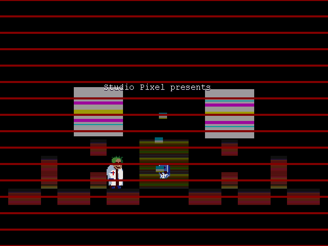
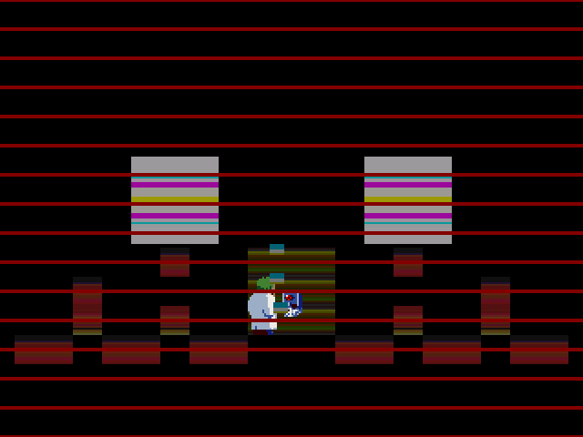
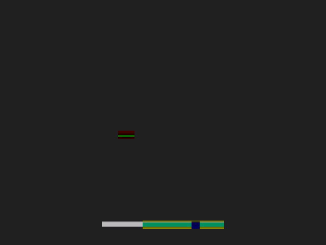

# GameReComp

<p align="center">
  
</p>

**Turn old Windows PC games into playable, moddable, portable games with genuinely human-readable source code — automatically.**

**GameReComp** is a game-focused preservation, reconstruction, modding,
and native-porting platform. Its long-term mission is **broad compatibility
across legacy Windows PC games**, not one hand-reconstructed game at a time.
Given a game executable and assets you legally own, the intended unattended
workflow reconstructs understandable, editable C/C++ source, builds a native
executable **from that exact source**, checks gameplay against the original,
and packages the result for preservation, modding, and platform ports.

### What the product is designed to deliver

- **Playable and independently verified:** Rebuilt games should pass
  reproducible original-vs-rebuilt gameplay scenarios, not merely compile or
  display a title screen. Verification reports distinguish tested coverage
  from unverified behaviour.
- **Actually human-readable C/C++:** Recover meaningful types, identifiers,
  structs, functions, and natural control flow, not just `eax`/`esp`
  register-transfer C or prettier pseudocode. Unrecovered functions remain
  explicitly labelled low-level fallbacks; original developer naming cannot
  generally be guaranteed from stripped binaries.
- **Moddable at the source level:** Developers should be able to change game
  logic, rebuild the native executable, and demonstrate the modification
  working in-game.
- **Portable and maintainable:** Reuse a common compatibility runtime and
  platform backends so recovered game logic can target modern operating
  systems without a bespoke rewrite for each game.
- **Broad automated compatibility:** Support many older Windows PC games,
  engines, executable formats, and middleware through reusable infrastructure
  and honest compatibility reporting—not a promise that every game works today.
- **Unattended, non-AI-first processing:** PCRecomp supplies recompilation
  and Windows-game runtime foundations; rev.ng is the intended primary
  high-level structural-source provider. Deterministic analysis comes first;
  AI is **optional** for extra semantic readability. No manual per-function
  reconstruction should be required by the intended workflow. The desktop
  GUI is planned over this same backend.

**Differentiator:** Not another decompiler or game-specific recompilation
script. GameReComp aims to make **verified native game ports with genuinely
modifiable, human-readable source** reproducible across a large catalogue of
legacy Windows games.

The current implementation is an early CLI vertical slice; human-readable
source, verified gameplay, broad native ports, and the GUI described above are
**product goals, not completed features**.

> **Status: v0.1.0 — first vertical slice. Zero verified playable games.**
> The pipeline runs end to end and has measured 19 executable test rows: some
> compile, some partially launch, some fail, and PE32+ is refused. The gates
> below are product goals, not completed features, and this README does not
> claim them.
>
> What has changed since that sentence was first written, and is measured:
> eleven games now bind **every** import; **Cave Story (Doukutsu.exe) reaches a
> frame loop and renders** — 192,303 blits, 8,399 message-pump iterations and
> 0 failed indirect calls in 12 seconds, with frames captured; and typed,
> readable C is compiled into a rebuilt game for two functions, each shown
> equivalent to its mechanical body by a differential harness. Binding every
> import is not the bar — Ikachan binds 97 of 97 and exits 1 — and 480 of its
> 482 functions are still `LOW_LEVEL_FALLBACK` register-transfer C. See
> [Development status](#development-status), which is deliberately not a
> supported-games list.

---

## Built on pcrecomp

This project stands on **[pcrecomp](https://github.com/sp00nznet/pcrecomp)** by
[Ned Heller (@sp00nznet)](https://github.com/sp00nznet) and its contributors —
the x86-16/32/64 disassemblers and lifters, the PE/NE/LE/Mach-O tooling, and the
`recomp32`/`win32hle` runtime model this product's generated code links against.
Thank you; the hard, unglamorous reverse-engineering groundwork is theirs.

Everything in [`docs/UPSTREAM_TOOLBOX.md`](docs/UPSTREAM_TOOLBOX.md) documents
that toolbox as it exists in this tree. Pinned versions, per-file obligations and
licence texts are in [`docs/LICENSES.md`](docs/LICENSES.md) and [`NOTICE`](NOTICE).
Where this repository extends upstream code, the file keeps its upstream notice
and the change is recorded in [`CHANGELOG.md`](CHANGELOG.md).

## What GameReComp adds

pcrecomp is a toolbox: many tools, each doing one job well, driven per project by
that project's own `run_lift.py`. GameReComp is the **automated,
game-focused product built around that toolbox**: one reproducible workflow
for recovering readable source, compiling it into a native game, verifying
actual gameplay, and enabling source-level modifications and ports across
many legacy Windows titles. Source readability and verified moddability—not
merely producing a binary—are the intended distinguishing deliverables.

| | pcrecomp (toolbox) | GameReComp (product) |
| --- | --- | --- |
| Entry point | per-project `run_lift.py` drivers, tools called one at a time | `./RevEng game.exe` — inspect → recover → translate → project → compile → run → verify → report |
| Output bias | lifted C that reproduces CPU state | the same, **plus** a labelled source-quality split (`HIGH_LEVEL_VERIFIED` / `HIGH_LEVEL_UNVERIFIED` / `LOW_LEVEL_FALLBACK` / `UNRESOLVED`) and a gate that refuses to relabel anything without evidence |
| Verification | `difftest` against Unicorn, per lifter | a fail-closed per-run verdict — `not-run` / `compile-failed` / `launch-failed` / `trace-diverged` / `partial` / `scenario-pass` / `verified-playable-scope` — in a JSON+HTML evidence bundle with hashes and oracle gaps |
| Scope of a run | one target, one driver | a project directory that is self-contained and rebuildable: generated source, the pinned runtime copy, CMake, logs, reports |
| Games | per-project repositories | a measured corpus with a published matrix, per-input SHA-256, and a score that cannot rise unless the stage actually succeeded |
| Failure | whatever the driver does | a classified, recorded outcome — including `MISSING_INPUT` for a game that is not present, never an invented path |

### Where it is deliberately different

- **Source quality is a first-class output, not a by-product.** Every function
  carries one of four provenance categories and every run reports the split. A
  function is only called readable when a real provider produced it and a gate
  accepted it; register-transfer C is never described as "human-readable C"
  merely because it is syntactically valid C.
- **Fail-closed everywhere.** PE32+ is refused at inspect rather than attempted
  and reported vaguely. An unresolved function aborts instead of silently doing
  nothing. A stage that did not run cannot score. A binary that never boots
  cannot earn the run stage's points. A shim that cannot do the work returns
  failure rather than success — no dummy-success Win32 stubs on the critical
  path.
- **No hidden delegation.** The rebuilt executable is built from the generated
  project's source and nothing else. The original PE is mapped read-only as the
  guest's data image; every guest instruction executed is generated C dispatched
  through `recomp_lookup`. No emulator, no Wine path. Audited, not asserted —
  see [`reports/audit-2026-10-30.md`](reports/audit-2026-10-30.md).
- **A measured corpus, published honestly.** [`docs/GAME_MATRIX.md`](docs/GAME_MATRIX.md)
  carries every game with what the port produced and its working status;
  failures and missing inputs are rows, not footnotes.

## What works today

```text
Windows PE32 game + user-supplied assets
  inspect    parse headers, imports, resources, entry point; refuse PE32+ loudly
  recover    discover functions and instructions (Capstone)
  translate  each function -> C register-transfer unit, address-tagged
  project    generate a self-contained CMake project that vendors the runtime
  compile    cmake + native C compiler, one shared adaptive deadline
  run        launch the rebuilt binary headless (SDL dummy drivers) or --interactive
  verify     fail-closed status, naming the exact unresolved imports when it stops
  report     report.json + report.html: hashes, timings, provenance, oracle gaps
```

- One command: `./RevEng path/to/game.exe`
- Byte-capped source units (1000 functions or 8 MiB per unit, whichever closes
  first) with `recomp_units.json` mapping original address → function → unit
- Adaptive build deadline: `600 s + 5 s/MiB` of generated source, capped at 3600 s
- `--fresh-build` for when a moved system dependency (a Homebrew keg) leaves a
  stale `CMakeCache.txt` behind; `--reuse-build` to adopt a build whose recorded
  source digest still matches
- Exit codes: `0` scenario-pass, `2` a stage failed, `3` built/ran but unverified
- Game database and matrix generated from measured runs:
  [`table.md`](table.md), [`docs/GAME_MATRIX.md`](docs/GAME_MATRIX.md).
  These are diagnostic results, **not** a list of working games.

## Development status

Measured facts about the current build. **This is not a supported-games list**
and nothing here is a claim of a working port — the bar for that is in
[Verified working games](#verified-working-games), and nothing has met it yet.
The full per-game table is [docs/GAME_MATRIX.md](docs/GAME_MATRIX.md).

### Cave Story (Doukutsu.exe) — reaches a frame loop and renders

The furthest any game has been taken. It is listed here as *evidence of what the
pipeline can now do*, not as a working port: there is no deterministic input
replay and no comparison against the original Windows game, so it cannot meet
the showcase bar.

| | |
| --- | --- |
| Original | `Doukutsu.exe`, i386 PE32, 1,478,656 bytes |
| Imports | 143 of 143 bound, 0 unresolved |
| Run | reached a frame loop and kept rendering and pumping until the deadline |
| Measured (12 s) | 371,144 import dispatches — 192,303 `IDirectDrawSurface::Blt`, 8,399 `PeekMessageA`, 8,398 `IDirectInputDevice::Poll`, 8,398 `GetDeviceState`, 8,427 `GetTickCount`, 7,855 `Sleep`, **0 failed indirect calls** |
| Rendered | 640×480, 46–48 colours, 21 distinct screens in the first 22 s: a fade in from black through ~20 animated frames, then a static screen |
| Verification status | `partial` — process-level only |





Frames captured headless by `RECOMP_SCREENSHOT=DIR` (see
[`runtime/win32hle/screenshot.c`](runtime/win32hle/screenshot.c)). They are
640×480 with the palette above and they differ frame to frame. What each screen
*depicts* is not claimed here.

### The source pipeline, measured against the original bytes

This is the part that makes the project a recompiler rather than a translator, and
it is new. Given the original PE, the pipeline now:

1. decompiles it with **rev.ng** (a real install, reached through a container on this
   host — rev.ng publishes Linux x86-64 builds only);
2. extracts **evidence** per function — the imports it calls, the strings it
   references, format strings, the constants it compares against, the global and
   struct-field accesses with their widths, its calling convention taken from its
   own epilogue;
3. **names** identifiers only where that evidence supports the name, and leaves the
   rest mechanical with a recorded reason;
4. emits **typed C** with those names, fusing repeated guest-memory accesses into
   locals;
5. **certifies** the result against the original's machine code, run from the same
   entry state under Unicorn — registers, named memory, and named flags.

Nothing above is a claim that the output is *good* C. It is a claim about what was
measured, and the measurements are deliberately staged because each stage is a
strict subset of the one before it:

| Stage | Doukutsu's 955 provider functions |
| --- | --- |
| provider bodies that parse and satisfy the module model | 50 |
| **certify against the original bytes** | **17** |

Seventeen, not seven, and the reason is a rule rather than a fix. The seven
certified on **registers and named memory**; ten more certify on the **return
value alone** because the original's bytes prove they write no guest memory and
call nothing, so `eax` is their whole contract. Those are different claims and the
table keeps them apart.

**The count was 19 for one commit, and it went down because a rule got stricter.**
A scan for host addresses found one bad module; the invariant — *no `MEMn` may be
emitted whose operand does not provably denote a guest VA* — found two more that
had already certified. Both read guest memory at a host local's value
(`MEM8((var_0 & 0xFFFFFFFFULL))`, `var_0` a host `uint8_t`), and both had been
certified because one seed per case means `MEM8(1)` happens to agree with the
original's table read at index 1 **on the driven inputs**: a true verdict about a
wrong module. Neither was ever dispatched, so exposure was zero while the table was
not. **A count that went down because the rule got stricter is a better number than
a count that went up because the pattern got looser.**

The honest summary: **the pipeline can prove that a generated function equals the
original's code, on the inputs it drove, for 17 of 955 functions** — seven of them
on the strong claim and ten on the weaker one. Naming is the bottleneck, not
certification, and the read-this-instead-of-the-assembly goal is still ahead of it.

Three provider defects were found and named on the way, all one class: rev.ng
recovered a body that returns a constant where the original computes from its
inputs, with a `void f(void)` signature that could not have used them. And the
frame loop's core — `0x00481BB0`, 6.6 million dispatched calls in a 12-second run —
is **refused**, with 180 `undef()` values in its 8,541-byte provider body, which is
the decompiler saying 180 times that it could not determine a value. The low-level
fallback carries it and the game still runs: **the provider failed on the function
that matters most, and a pipeline that could only report the provider's successes
would have called that progress.**

### Other measured outcomes, kept distinct

These are four different results and flattening them would be dishonest. All
eleven games that bind every import were run twice — headless and with a real
video driver — and the two modes gave identical exit codes and profiles for
every one, so none of these is a display requirement:

| Game | Imports | What actually happened |
| --- | --- | --- |
| Cave Story (OrgView.exe) | 122 / 122 | Returns 0 on its own after DirectSound init and two blits — starts, does its work, exits. Not a frame loop. |
| Cave Story (DoConfig.exe) | 89 / 89 | Returns 1 after opening `Config.dat` and building its dialog (406 Button, 139 Static, 23 ComboBox, 11 CheckRadioButton) — it gets as far as its own UI. |
| Warning Forever (wf.exe) | 136 / 136 | Returns 0 after putting up **its own** message box saying DirectDraw7 is unavailable. The game checked a capability, found it lacking and told the user: correct game behaviour meeting an incomplete runtime. |
| Ikachan (dxIka.exe) | 97 / 97 | Returns 1 after opening `Option.bin` and building its UI. The first game to bind everything, and the reason "0 unresolved" is not the bar. |
| Gunroar (gr.exe) | 136 / 136 | SIGBUS after 27 startup shims, **before any SDL call**: a guest NULL dereference at VA 0x28 inside lifted CRT code (`sub_004281FC+744` reads `[[ebp-0x1C]+0xC]`, calls `sub_00428714`, and dereferences the NULL it returns). A missing-import failure would have been named by the loader; this one is not, which is why it needed locating rather than guessing. |

The eleven-row classification, with commands, environments and raw counts, is
[`reports/games/classification.md`](reports/games/classification.md).

**Correction.** An earlier version of this README said Gunroar died at
`SDL_SetVideoMode(SDL_OPENGL)` returning NULL headless, and called it a display
requirement. That was wrong: Gunroar never reaches SDL, and it fails identically
with a real display. It is recorded here as refuted rather than quietly
replaced.

## Verified working games

**None yet.** No GameReComp-generated native game has passed an independently
recorded gameplay scenario against the original Windows game. Compilation,
import binding, launch, title-screen rendering and process-level checks do
**not** qualify as a working-game demonstration.

Only games with the following evidence may appear in this public showcase:

1. A reproducible **native build compiled from the recorded generated source**
   (source/binary hashes, platform and tool versions).
2. A recorded **playable gameplay scenario** with deterministic inputs and an
   independent comparison to the original game, including the exact scope
   tested and a passing result.
3. **Screenshots of the rebuilt game in actual gameplay**, preferably alongside
   an original-game comparison, and supporting logs/artifacts linked from the
   repository. Screenshots alone do not prove equivalence.
4. An honest list of known limitations, game assets required, and reproduction
   instructions. A run that fails or has no gameplay oracle is not “working.”

When a game meets all of these criteria, add a linked proof record here.
Until then this list remains empty—**no unverified games or upstream projects
are advertised as GameReComp successes**.

For development diagnostics, see [the full game test matrix](docs/GAME_MATRIX.md)
and [verification criteria](docs/VERIFICATION.md). The matrix intentionally
retains unsuccessful and partial runs for engineering transparency; it is
**not** a supported-games list. Reported upstream PCRecomp achievements belong
to their respective projects, not to GameReComp's verified-results count.

## Honest limits

- **Most generated functions are `LOW_LEVEL_FALLBACK`.** Register-transfer C:
  compilable, address-traceable, not human-readable. A high-level path now
  exists and is compiled into the game, but it is proven for **two functions**;
  the rest of the corpus is untouched. The pipeline refuses to label a function
  `HIGH_LEVEL_VERIFIED` without `provenance.verified_by`, so the category cannot
  be claimed, only earned.
- **PE32 (i386) only.** PE32+ x86-64 is detected and refused at inspect.
- **No gameplay verification yet.** Oracle checks are process-level (exit code,
  stdout/stderr, launch); frame, input and audio comparison is a recorded oracle
  gap in every report. A game reaching a frame loop is not a game that has
  passed a scenario, and the two are kept apart everywhere in this repository.
- **No independent original-game oracle process yet.** `--oracle` compares the
  rebuilt process against a user-supplied JSON of expected observables; it does
  not run the original Windows binary.
- **The three extra corpus titles** (`igi.exe`, `ac.exe`, `halo.exe`) are not
  present locally and are reported as `MISSING_INPUT`, never invented.
- **GUI deferred.** No desktop application ships in v0.1; the design and its
  contract with the CLI are in [`docs/GUI.md`](docs/GUI.md).
- **Generated projects are build output and are not committed.** `projects/` is
  gitignored; the tracked artifacts are the pipeline, plus the matrix and table
  that record the input hash each row was measured against.

## Supported game showcase policy

The public README lists **only proven working GameReComp ports**, in
[Verified working games](#verified-working-games). The complete set of
attempted, failed, partial and unsupported game tests remains available in
[docs/GAME_MATRIX.md](docs/GAME_MATRIX.md), not duplicated here. Do not
automatically publish test-corpus rows as working games.

[Development status](#development-status) exists for the opposite purpose: it
records what the pipeline currently does, with the measurements behind it, so
progress is auditable without any of it being read as support. It is kept
deliberately separate from this list and is not a showcase.

## Quick start (CLI)

Requirements: Python 3, CMake ≥ 3.16, a C compiler, `pkg-config` with SDL2 and
SDL2_ttf. See [`docs/GETTING_STARTED.md`](docs/GETTING_STARTED.md) for the
step-by-step newcomer guide.

```sh
# point the tools at your own legally obtained corpus (never committed)
export SMALL_GAMES_PATH=/path/to/your/games

./RevEng "$SMALL_GAMES_PATH/cavestory/Doukutsu.exe"
./RevEng game.exe --assets-dir /path/to/game/files   # where the game reads data
./RevEng game.exe --timeout 60 --json                # longer run, machine output
./RevEng game.exe --no-build                         # stop after source generation
./RevEng game.exe --interactive                      # real window/audio, not dummy SDL
./RevEng game.exe --fresh-build                      # discard a stale build cache
```

Each run writes a self-contained project:

```text
projects/<name>/
  src/            generated C units + headers + recomp_units.json
  build/          CMake build tree and the rebuilt executable
  reports/        report.json and report.html (hashes, stages, oracle gaps)
  logs/           per-stage logs
```

## Documentation

| Document | Contents |
| --- | --- |
| [`docs/GETTING_STARTED.md`](docs/GETTING_STARTED.md) | Install, first run, reading the report, troubleshooting |
| [`docs/ARCHITECTURE.md`](docs/ARCHITECTURE.md) | Component map and data flow |
| [`docs/PIPELINE.md`](docs/PIPELINE.md) | Stages, weights, timeouts, recovery loop |
| [`docs/BACKENDS.md`](docs/BACKENDS.md) | Translation backends and their status |
| [`docs/VERIFICATION.md`](docs/VERIFICATION.md) | Verification statuses, oracle gaps, fail-closed rules |
| [`docs/SOURCE_PROVENANCE.md`](docs/SOURCE_PROVENANCE.md) | How every delivered line maps to the input binary |
| [`docs/RUNTIME_COMPAT.md`](docs/RUNTIME_COMPAT.md) | Win32/runtime coverage and known gaps |
| [`docs/GAME_MATRIX.md`](docs/GAME_MATRIX.md) | Every game: OS, arch, port details, working status |
| [`docs/BENCHMARKS.md`](docs/BENCHMARKS.md) | Generated benchmark tables and methodology |
| [`docs/GUI.md`](docs/GUI.md) | The planned desktop application and its CLI contract |
| [`docs/LICENSES.md`](docs/LICENSES.md) | Pinned upstream versions and licences |
| [`docs/UPSTREAM_TOOLBOX.md`](docs/UPSTREAM_TOOLBOX.md) | The pcrecomp toolbox this product is built on |
| [`reports/audit-2026-10-30.md`](reports/audit-2026-10-30.md) | Adversarial audit: delegation, shim honesty, claims vs evidence |
| [`table.md`](table.md) | Generated game database for the measured corpus |
| [`CHANGELOG.md`](CHANGELOG.md) | Release history |

## Roadmap, in the order the evidence supports it

1. **Runtime coverage** — eleven games bind every import and one reaches a frame
   loop. What is left is not more shims but reach: `herocore` and `generally` are
   149-162 names away, and the two editors are two SEH names from complete.
2. **High-level source at scale** — the bridge works and is verified for two
   functions; the next step is a real structural provider (rev.ng) feeding it,
   so functions leave `LOW_LEVEL_FALLBACK` in numbers rather than by hand. The
   harness that turns a claim into evidence already exists
   (`tools/autorecomp/hlverify.py`).
3. **Independent verification** — an original-process oracle, deterministic
   scenario replay and frame/input evidence, so a status above `partial` can be
   earned.
4. **Targets** — Windows x86 → native Windows x64, then the same game on macOS
   ARM64, each as its own verified gate.
5. **Desktop GUI** — project wizard, run dashboard, source explorer and
   verification dashboard over the same backend the CLI drives.


## Planned Windows PC game targets (not verified)

These are **future integration and test targets**, not working GameReComp ports. A title's release year or reported DirectX version **does not prove** its actual API imports; each game issue requires an edition-specific PE/DLL/API census before implementation. The [independently verified working-games list](#verified-working-games) remains empty until original-Windows-vs-native gameplay and source-rebuild gates pass. Planned games are **not** inserted into the measured/generated [game matrix](docs/GAME_MATRIX.md) without a real locally supplied input.

The [PCRecomp project catalogue](https://github.com/sp00nznet/pcrecomp#the-projects-that-built-this) did not list any of these **Windows PC game titles** as dedicated PCRecomp projects at the 2026-10-30 audit. This does **not** mean there is no reusable PCRecomp code: game-specific renderer/loader techniques and shared runtime infrastructure are reused where applicable. **No games, binaries, DLLs or proprietary assets are bundled.**

| Target original Windows PC game | Year | Expected renderer to verify against actual build | Main implementation dependencies | Game-specific issue / current status |
| --- | ---: | --- | --- | --- |
| **Project I.G.I.** | 2000 | Direct3D 7 | [#2 D3D7](https://github.com/heaven-hm/GameReComp/issues/2), [#1 source + oracle](https://github.com/heaven-hm/GameReComp/issues/1) | [#15](https://github.com/heaven-hm/GameReComp/issues/15) — **planned**; existing [issue-2 IGI compatibility branch](https://github.com/heaven-hm/GameReComp/tree/feature/issue-2-igi-compat) under development |
| **Hitman: Codename 47** | 2000 | Direct3D / OpenGL / Glide; select after renderer-DLL audit | [#9 multi-DLL/SEH](https://github.com/heaven-hm/GameReComp/issues/9), [#2](https://github.com/heaven-hm/GameReComp/issues/2), [#6 Glide](https://github.com/heaven-hm/GameReComp/issues/6) | [#16](https://github.com/heaven-hm/GameReComp/issues/16) — **planned** |
| **Max Payne** (original PC) | 2001 | Direct3D 8 | [#3 D3D8](https://github.com/heaven-hm/GameReComp/issues/3), [#9 multi-DLL](https://github.com/heaven-hm/GameReComp/issues/9), [#10 multimedia](https://github.com/heaven-hm/GameReComp/issues/10) | [#17](https://github.com/heaven-hm/GameReComp/issues/17) — **planned**; separate from Xbox recompilation |
| **Hitman 2: Silent Assassin** (2002, not 2018) | 2002 | Direct3D 8 / OpenGL | [#3 D3D8](https://github.com/heaven-hm/GameReComp/issues/3), [#9 multi-DLL](https://github.com/heaven-hm/GameReComp/issues/9) | [#19](https://github.com/heaven-hm/GameReComp/issues/19) — **planned** |
| **Max Payne 2: The Fall of Max Payne** | 2003 | Direct3D 8 | [#3 D3D8](https://github.com/heaven-hm/GameReComp/issues/3), [#9 multi-DLL](https://github.com/heaven-hm/GameReComp/issues/9) | [#18](https://github.com/heaven-hm/GameReComp/issues/18) — **planned** |
| **Hitman: Contracts** | 2004 | Direct3D / OpenGL; pin version and imports | [#3 D3D8](https://github.com/heaven-hm/GameReComp/issues/3), [#9 multi-DLL](https://github.com/heaven-hm/GameReComp/issues/9) | [#20](https://github.com/heaven-hm/GameReComp/issues/20) — **planned** |
| **TrackMania Nations ESWC** | 2006 | Direct3D 9.0c | [#5 D3D9](https://github.com/heaven-hm/GameReComp/issues/5), [#9 runtime](https://github.com/heaven-hm/GameReComp/issues/9) | [#22](https://github.com/heaven-hm/GameReComp/issues/22) — **planned / input-protection gate** |
| **Hitman: Blood Money** | 2006 | Direct3D 9 | [#5 D3D9](https://github.com/heaven-hm/GameReComp/issues/5), [#9 multi-DLL](https://github.com/heaven-hm/GameReComp/issues/9), [#10 multimedia](https://github.com/heaven-hm/GameReComp/issues/10) | [#21](https://github.com/heaven-hm/GameReComp/issues/21) — **planned** |
| **TrackMania Nations Forever** | 2008 | Direct3D 9.0c | [#5 D3D9](https://github.com/heaven-hm/GameReComp/issues/5), [#14 verification](https://github.com/heaven-hm/GameReComp/issues/14) | [#23](https://github.com/heaven-hm/GameReComp/issues/23) — **planned**; verify matching `TmForever.map` |
| **TrackMania United Forever** | 2008 | Direct3D 9.0c | [#5 D3D9](https://github.com/heaven-hm/GameReComp/issues/5), [#14 verification](https://github.com/heaven-hm/GameReComp/issues/14) | [#24](https://github.com/heaven-hm/GameReComp/issues/24) — **planned**, separate binary and asset baseline |

### Codebases to study — references, not game ports to copy

Game-specific issues contain file-level audits and scoped integration tasks. Particularly relevant, verified reference repositories:

- **IGI Direct3D 7:** [HenryKun55/igi-recomp `shim/src/d3d7.c`](https://github.com/HenryKun55/igi-recomp/blob/master/shim/src/d3d7.c), [DirectDraw](https://github.com/HenryKun55/igi-recomp/blob/master/shim/src/ddraw.c), [OpenGL renderer](https://github.com/HenryKun55/igi-recomp/blob/master/shim/src/render_gl.c); compare with [our active D3D7 implementation](https://github.com/heaven-hm/GameReComp/blob/feature/issue-2-igi-compat/runtime/win32hle/d3d7.c) **on the issue-2 branch** before merging, not on current develop.
- **Hitman/Glacier modules:** [0danny/re47](https://github.com/0danny/re47) for Codename 47 DLL and function inventory; [ReGlacier/ReHitman](https://github.com/ReGlacier/ReHitman) for *Blood Money* engine API research. Neither is a drop-in multiplatform Windows PE recompiler; match binary versions and inspect licences.
- **Max Payne:** [phobos665/payne-recomp](https://github.com/phobos665/payne-recomp) documents **Xbox PAL** recompilation only; useful as a behavioural reference, never evidence of Windows PC build support.
- **TrackMania/GBX:** [pixeltris/ModTMNF](https://github.com/pixeltris/ModTMNF) for *Nations Forever* symbol-map and replay research; [BigBang1112/gbx-net](https://github.com/BigBang1112/gbx-net) for GBX format inspection. Do not copy the injector or include commercial map/game data.
- **Other game-specific compatibility precedents (PCRecomp and external):** [Rogue Squadron legacy DirectDraw/3D façade](https://github.com/sp00nznet/rogue-squadron-recomp/blob/main/src/runtime/display.c), [Nocturne legacy rendering ABI study](https://github.com/sp00nznet/nocturne/blob/main/docs/RENDERER_API.md), [X-Wing Alliance legacy-D3D-to-D3D11 backend](https://github.com/sp00nznet/xwa/blob/main/src/hal/d3d11_renderer.c), and [NFS MW D3D9 bridge](https://github.com/codepdbh/nfsmwpc-recompiled/blob/main/android/app/src/main/cpp/d3d9_bridge.cpp). These are **design/code-reuse candidates**, not native cross-platform HLE modules as-is; analyse ABI, portability and per-file licensing before adapting.

**Implementation rule:** game issues **#15–#24** own individual executable, DLL, assets, edition hashes and gameplay fixtures; shared Windows/DirectX/Input/Audio/PE support belongs to existing [#1–#14](https://github.com/heaven-hm/GameReComp/issues). Require actual original-versus-native gameplay evidence and a rebuilt source-level change for every game; never mark a title playable because it compiles, binds imports, renders a menu or because another project claims playability.

## Contributing and licence

MIT — see [`LICENSE`](LICENSE). Third-party notices are in [`NOTICE`](NOTICE) and
[`docs/LICENSES.md`](docs/LICENSES.md); contributors are credited in
[`CONTRIBUTORS.md`](CONTRIBUTORS.md). No game binary or asset is redistributed
here, and none should be committed.
