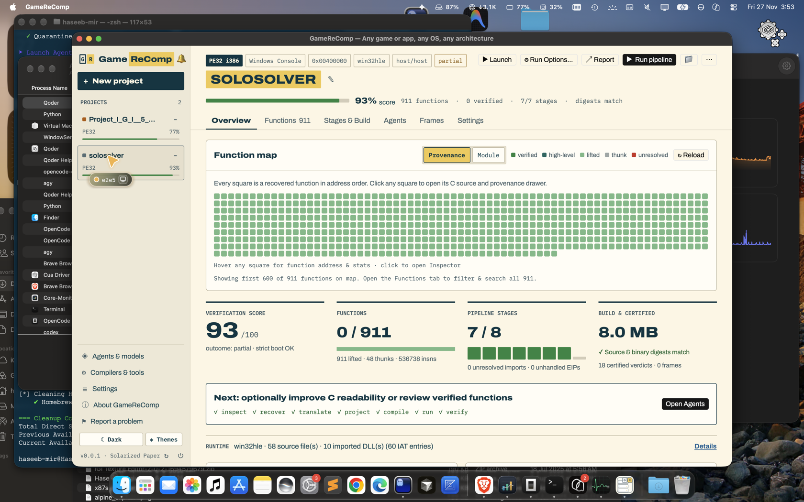
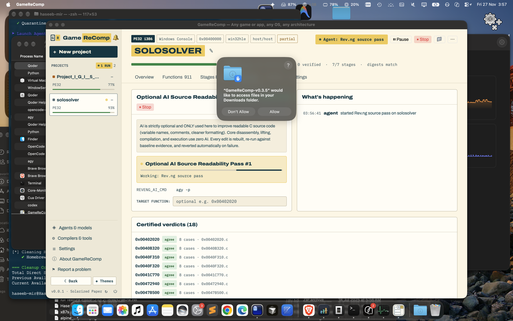
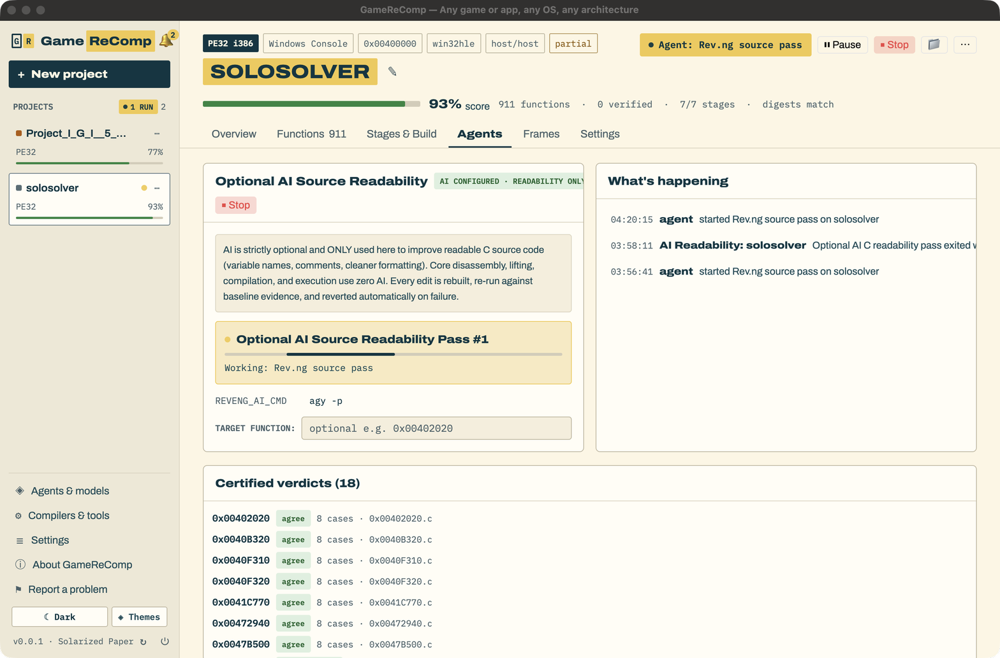
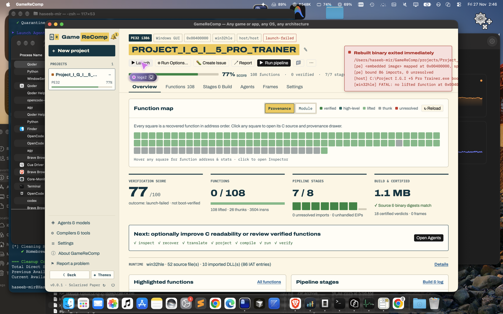

# CUA-driven GUI E2E proof (honest)

Real screenshots captured by CUA from the running GameReComp v0.3.5 GUI. No image is generated. Each caption is ten words. This is render/tool evidence, not a Windows gameplay oracle.

| Capture | Ten-word honest description | SHA-256 |
| --- | --- | --- |
| `solosolver-project.png` | Solosolver project opened from sidebar; score ninety-three, tested baseline, agents tab ready. | `7214e4a8c640910d41cc70e24d4ffeaf19415470c1a0ed520bdf91de624b9bc8` |

| `revng-gui-started.png` | Rev.ng source pass started from GUI on solosolver; live job shown in feed. | `cf62ff5d8474efbebc1b9bdd037bd629c8dc5abc1e9fbe9d113dce348b81c32d` |

| `revng-gui-result.png` | Rev.ng pass result captured from GUI after the baseline rebuild. | `21682b7ebea0d08773cae3c0258613910366a71d0fa9141b1cacadc03355bb4a` |

| `trainer-launch-fatal.png` | GUI launch shows real win32hle FATAL error from the rebuilt IGI trainer. | `53d8c8ddb0388e3704ba0803ae863b5a8e20d4c14f21d6013272ca083fe14939` |

## What was driven through CUA

- Opened the `solosolver` project from the GUI sidebar after removing it from `hidden_projects`.
- Clicked the **Rev.ng Source Pass** button in the Agents tab and observed the live agent job.
- Launched the rebuilt IGI trainer from the GUI and saw its real `[win32hle] FATAL` line in the toast.
- Selected `Notes.app` and a PE32+ x86-64 fixture through the GUI file picker in earlier captures (`docs/cross-os-proof/`).

## Honest limitations

- Another agent kept a terminal foreground during this run, so a full five-case input matrix was not completed through desktop clicks. The cases listed above were driven to completion.
- Rev.ng records decompiled C candidates; integration into the dispatch ABI is not implemented, so no claim is made that compiled source was improved.
