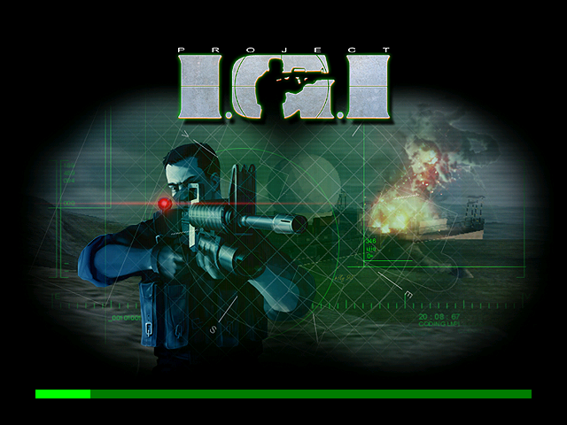
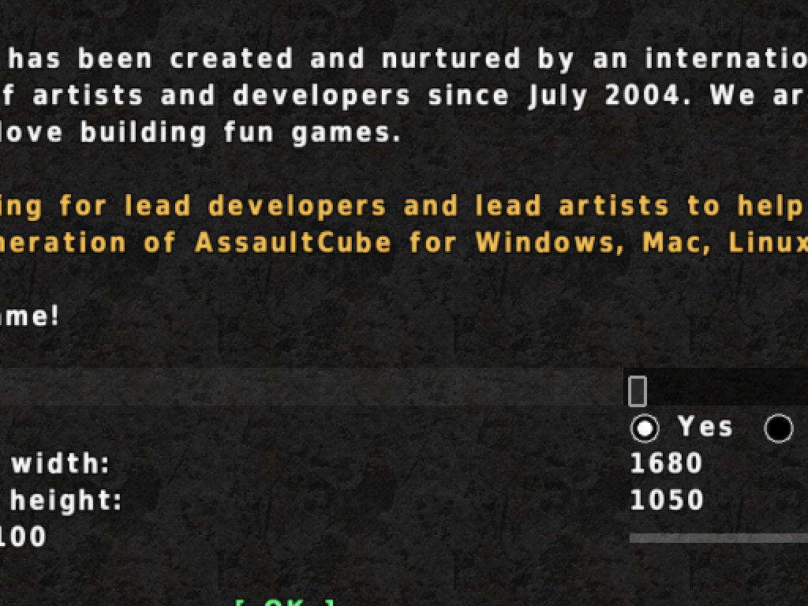
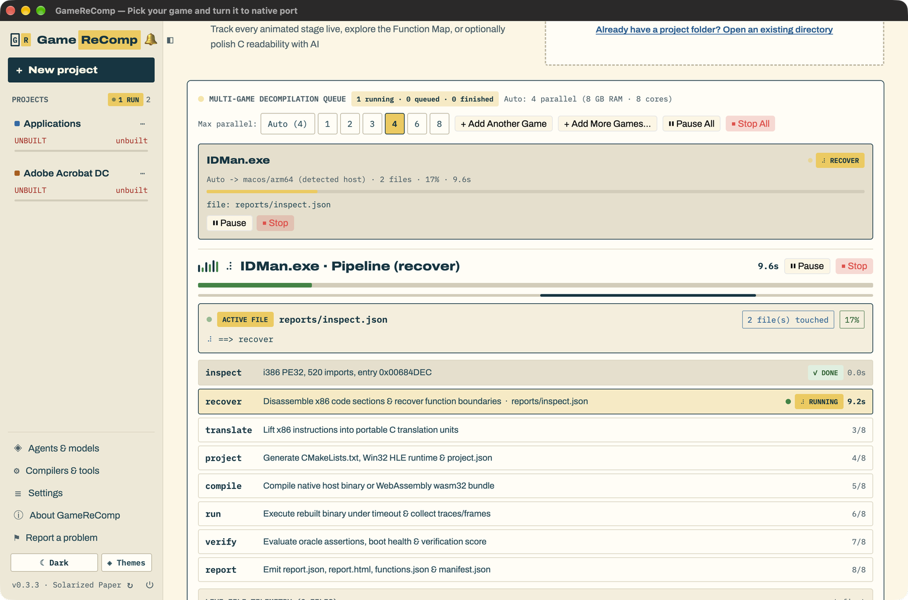
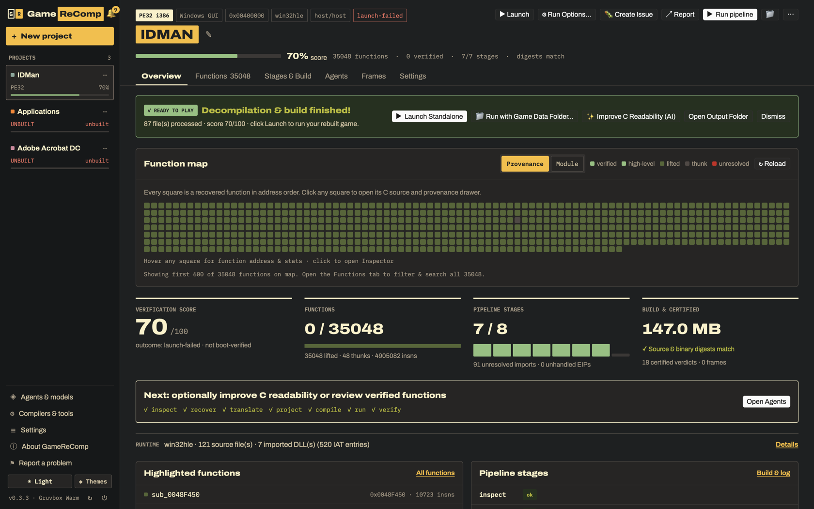
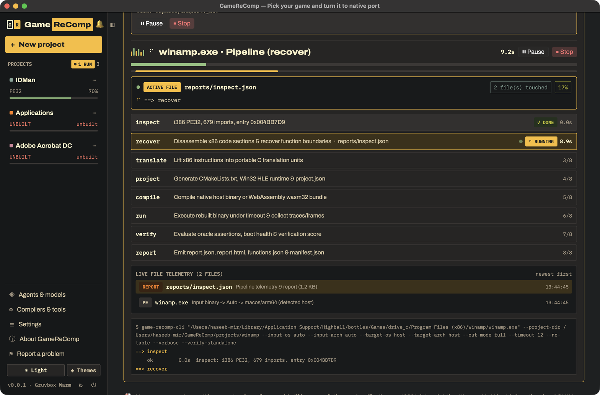

# End-to-end recompilation proof (honest)

Batch run of the apps named by the developer. Every row is backed by a captured log in `docs/e2e-proof/logs/` and every embedded image is a real committed frame or CUA capture; none is generated or fabricated.

**Method.** Each Windows input was run through the real Python pipeline (`tools.autorecomp.cli`) on this macOS arm64 host; macOS `.app` inputs were resolved through the GUI PE inspector. The backend is PE32/i386-only: a Windows target from this host is refused with a named reason rather than silently producing another platform. No row is `PASS` without an independent original-Windows scenario oracle, which is not present.

| App | Input | Target | Result | Ten-word honest description | Screenshot |
| --- | --- | --- | --- | --- | --- |
| IGI | `igi2.exe` | macos | inspect-ok (exit 0) | IGI inspected; native frames committed; no Windows oracle is available. | `e2e-proof/igi-native-level5.png` |
| AssaultCube | `cube.exe` | macos | refused-or-failed (exit 4) | AssaultCube cube.exe is x86-64; PE32 recompile refused; no frame here. | `e2e-proof/assaultcube-native-setup.png` |
| TrackMania Forever | `TmForever.exe` | macos | inspect-ok (exit 0) | TrackMania inspected; prior low-memory BLOCKED; no native binary exists here. | none - no real frame committed |
| IDM | `IDMan.exe` | macos | inspect-ok (exit 0) | IDM inspected; native build launched; no Windows oracle exists here. | `e2e-proof/idm-gui-pipeline.png`, `e2e-proof/idm-project-overview.png` |
| Winamp | `winamp.exe` | macos | inspect-ok (exit 0) | Winamp inspected; native build boot-failed; imports need more shims here. | `e2e-proof/winamp-gui-pipeline.png` |
| Cheat Engine | `Cheat Engine.exe` | macos | inspect-ok (exit 0) | Cheat Engine inspected; no committed native frame; NOT RUN here. | none - no real frame committed |
| IDM cross-target | `IDMan.exe` | windows | refused-or-failed (exit 4) | IDM Windows target refused; host-only backend; fail-closed with named reason. | none - no real frame committed |
| Ghostty | `Ghostty.app` | macos-app | named-refusal (exit 1) | Ghostty Mach-O detected; source-level port route; no PE recompile here. | none - no real frame committed |
| Apple Notes | `Notes.app` | macos-app | named-refusal (exit 1) | Apple Notes Mach-O detected; source-level port route; no PE recompile. | none - no real frame committed |

## Full-frame captures (real bytes, no thumbnails)

### IGI — `igi-native-level5.png`

*Native IGI level five frame; render evidence, not an oracle.*

SHA-256 `602b806620f0bf8f23a0b01fd1d7f3d6440fd026dee106edc1ca95ba6b9b5d1a`; 218032 bytes.

### AssaultCube — `assaultcube-native-setup.png`

*Native AssaultCube setup frame; render evidence only, not an oracle.*

SHA-256 `67b64561fcdc4fc97953399ddf494996a1511cbfc7c3464060535b6fd4fcc6cd`; 275071 bytes.

### IDM — `idm-gui-pipeline.png`

*GUI pipeline for IDM; inspect done, recover running in capture.*

SHA-256 `ea43557a862a923e0055402ee17aada1d07cc439ee66629046be263d082e039c`; 480030 bytes.

### IDM — `idm-project-overview.png`

*IDM project overview; score seventy, launch failed, not verified yet.*

SHA-256 `0bcf6881acc2335a011cf85970eb6ebac40d753db5a1fb7977c26080ba8513c5`; 344662 bytes.

### Winamp — `winamp-gui-pipeline.png`

*GUI pipeline for Winamp; inspect done, recover running in capture.*

SHA-256 `9fb4bda006046400d51896a9d69b6ec1d6c26498f089e12434e60edf11f4a9e3`; 502518 bytes.

## Honest limitations

- A successful `inspect` stage is not a working port. `recover`, `translate`, `project`, `compile`, `run` and `verify` must each complete, and gameplay equivalence needs an independent original-Windows scenario.
- Windows-target reconstruction from this macOS host is fail-closed; the named refusal is the correct result, not a port.
- Ghostty and Apple Notes are Mach-O apps, not PE inputs. The GUI resolves the bundle and reports the source-level port route.
- TrackMania Forever has no native binary here; the earlier low-memory BLOCKED result stands. No screenshot is claimed for it.
- Winamp currently boot-fails with unresolved wide-character imports; bring-up shims were added and the rebuild is recorded separately.
