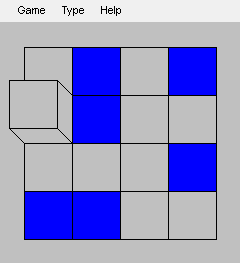
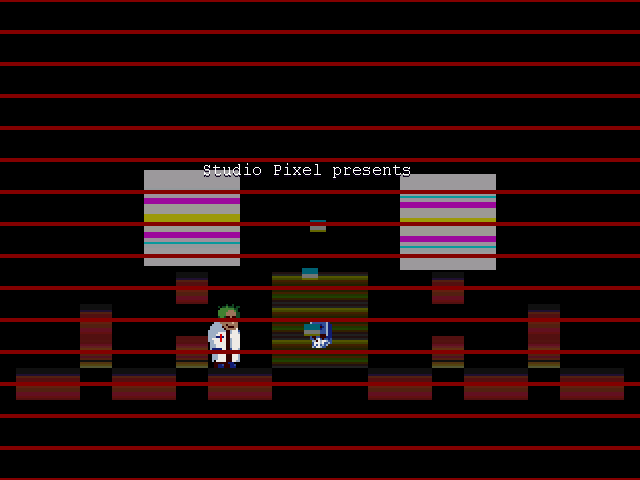
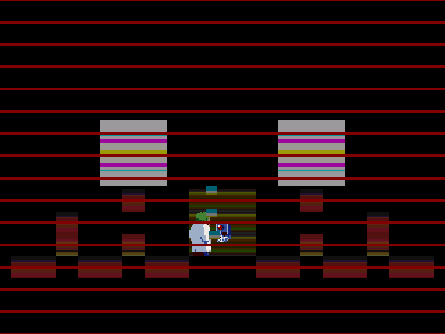
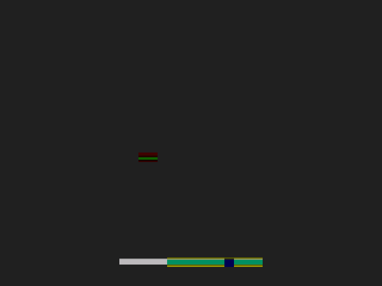

# Game matrix

Every game this product knows about, in one table: the locally supplied corpus this repository measures, and the upstream PCRecomp projects whose status is quoted from their own README. No game binary or asset is stored in this repository.

**Working status** is this pipeline's fail-closed verdict (`docs/VERIFICATION.md`), not an impression: `PASS` requires a recorded scenario; `PARTIAL` means the rebuilt process launched but no independent scenario was run; `FAIL` means it did not get that far. `NOT RUN` is exactly that. Upstream rows are claims, marked `†`, and are never counted as this product's results.

**Frame proof** comes only from a checked-in `reports/frames/**/frame-proof.json` produced by `tools.frame_proof`: it counts frames with real pixel content and refuses single-colour buffers. It is render evidence, not an oracle — it never promotes a row to `PASS` on its own.

**Port details** are read from each project's own `reports/report.json`: functions recovered, generated C, the rebuilt binary, imports the runtime bound, and the low-level/high-level split. `LOW_LEVEL_FALLBACK` functions are register-transfer C, not reconstructed high-level source. A row whose `evidence` points into the git-ignored `projects/` tree is shown as NOT RUN, because it has no committed proof.

Updated 2026-11-24T08:01:57Z by `python -m tools.gamesdb --matrix`.

**Evidence-backed results:** **9 / 128** recorded rows point at a committed proof file; **9** of those carry a PASS/PARTIAL verdict (**1** explicitly report `0` unresolved imports). Other rows are NOT RUN / FAIL here even when a local build log exists outside version control.

## This repository (measured)

| Name | OS | Arch | Port details | Frame proof | Working status |
| --- | --- | --- | --- | --- | --- |
| BusyBox (busybox-w32.exe) | Windows | i386 (PE32) | 6989 fns recovered; 24 units / 181.3 MiB C; binary busybox_w32 42887 KiB; 311 imports bound [macOS arm64 (native)]; low-level 6989/ high-level verified 0 | - | NOT RUN - measurement not committed (local build log only): process launched and exited 0; no oracle supplied |
| Cannonball | Windows | x86-64 | inspect failed: PE32+ is not supported by the PE32 backend yet (machine x86-64); fail-closed instead of guessing | - | NOT RUN - verification did not run |
| Cave Story (DoConfig.exe) | Windows | i386 (PE32) | 458 fns recovered; 2 units / 4.2 MiB C; binary DoConfig 1933 KiB [macOS arm64 (native)]; 90 imports bound; low-level 458/ high-level verified 0 | - | NOT RUN - measurement not committed (local build log only): process launched and exited 1; no oracle supplied |
| Cave Story (Doukutsu.exe) | Windows | i386 (PE32) | 3317 fns recovered; 8 units / 51.0 MiB C; binary Doukutsu 10404 KiB [macOS arm64 (native)]; 143 imports bound; low-level 3310/ high-level verified 7 | 2/3 non-blank frames | PARTIAL - launches, no scenario oracle - process launched and stayed alive until the 10s timeout; 2/3 non-blank frames; no Windows oracle |
| Cave Story (OrgView.exe) | Windows | i386 (PE32) | 603 fns recovered; 2 units / 5.6 MiB C; binary OrgView 2729 KiB [macOS arm64 (native)]; 122 imports bound; low-level 603/ high-level verified 0 | - | FAIL - rebuilt process cannot boot - rebuilt process crashed (exit -11) |
| Chocolate Doom 1.3.0 (downloaded) (chocolate-doom.exe) | Windows | i386 (PE32) | - | - | PARTIAL - launches, no scenario oracle - process launched and booted, 0 unresolved imports; no WAD, no frames |
| Data (file0001.exe) | Windows | None | inspect failed: PEFormatError | - | NOT RUN - verification did not run |
| Data (file0002.exe) | Windows | None | inspect failed: PEFormatError | - | NOT RUN - verification did not run |
| Data (helpme.exe) | Windows | None | inspect failed: PEFormatError | - | NOT RUN - verification did not run |
| Data (netarena.exe) | Windows | None | inspect failed: PEFormatError | - | NOT RUN - verification did not run |
| Data (netipx.exe) | Windows | None | inspect failed: PEFormatError | - | NOT RUN - verification did not run |
| Data (netmodem.exe) | Windows | None | inspect failed: PEFormatError | - | NOT RUN - verification did not run |
| Data (netterm.exe) | Windows | None | inspect failed: PEFormatError | - | NOT RUN - verification did not run |
| Data (order.exe) | Windows | None | inspect failed: PEFormatError | - | NOT RUN - verification did not run |
| Data (rtm.exe) | Windows | None | inspect failed: PEFormatError | - | NOT RUN - verification did not run |
| Data (setup.exe) | Windows | None | inspect failed: PEFormatError | - | NOT RUN - verification did not run |
| Data (shipedit.exe) | Windows | None | inspect failed: PEFormatError | - | NOT RUN - verification did not run |
| Data (tyrian.exe) | Windows | None | inspect failed: PEFormatError | - | NOT RUN - verification did not run |
| Downloads (idman643build18.exe) | Windows | i386 (PE32) | 605 fns recovered; 2 units / 6.6 MiB C; binary idman643build18 14229 KiB [macOS arm64 (native)]; 104 imports bound; low-level 605/ high-level verified 0 | - | NOT RUN - measurement not committed (local build log only): process launched and exited 0; no oracle supplied |
| GeneRally | Windows | i386 (PE32) | 2582 fns recovered; 46 units / 374.0 MiB C; binary GeneRally 91801 KiB [macOS arm64 (native)]; 148 imports bound, 58 unresolved; low-level 2582/ high-level verified 0 | - | FAIL - rebuilt process cannot boot - rebuilt process boot-failed (exit 2) |
| GeneRally (TrackEditor.exe) | Windows | i386 (PE32) | 312 fns recovered; 2 units / 7.0 MiB C; binary TrackEditor 2894 KiB [macOS arm64 (native)]; 147 imports bound; low-level 312/ high-level verified 0 | - | NOT RUN - measurement not committed (local build log only): process launched and exited 0; no oracle supplied |
| Gunroar (gr.exe) | Windows | i386 (PE32) | 3318 fns recovered; 5 units / 19.8 MiB C; binary gr 9048 KiB [macOS arm64 (native)]; 136 imports bound; low-level 3318/ high-level verified 0 | - | FAIL - rebuilt process cannot boot - rebuilt process aborted on an unhandled guest C++ exception (exit 3); guest SEH unwinding is not implemented |
| Hero Core (herocore gm5.exe) | Windows | i386 (PE32) | 17053 fns recovered; 19 units / 66.4 MiB C; binary herocore_gm5 24744 KiB [macOS arm64 (native)]; 495 imports bound, 18 unresolved; low-level 17053/ high-level verified 0 | - | FAIL - rebuilt process cannot boot - rebuilt process boot-failed (exit 2) |
| Hero Core (herocore gm7.exe) | Windows | i386 (PE32) | 21674 fns recovered; 24 units / 87.0 MiB C; binary herocore_gm7 30408 KiB [macOS arm64 (native)]; 506 imports bound, 26 unresolved; low-level 21674/ high-level verified 0 | - | FAIL - rebuilt process cannot boot - rebuilt process boot-failed (exit 2) |
| IGI (IGI-Injector.exe) | Windows | i386 (PE32) | 2687 fns recovered; 7 units / 41.9 MiB C; binary IGI_Injector 10759 KiB [macOS arm64 (native)]; 108 imports bound, 17 unresolved; low-level 2687/ high-level verified 0 | - | FAIL - rebuilt process cannot boot - rebuilt process boot-failed (exit 2) |
| IGI | Windows | i386 (PE32) | 7325 fns recovered; 16 units / 114.9 MiB C; binary igi 38292 KiB [macOS arm64 (native)]; 128 imports bound; low-level 7325/ high-level verified 0 | - | NOT RUN - measurement not committed (local build log only): process launched and exited 1; no oracle supplied |
| Ikachan (dxIka.exe) | Windows | i386 (PE32) | 545 fns recovered; 3 units / 9.8 MiB C; binary dxIka 2921 KiB [macOS arm64 (native)]; 97 imports bound; low-level 543/ high-level verified 2 | - | NOT RUN - measurement not committed (local build log only): process launched and exited 1; no oracle supplied |
| NES_GameGenie (NES_GameGenieEncoder.exe) | Windows | i386 (PE32) | 84 fns recovered; 2 units / 0.3 MiB C; low-level 84/ high-level verified 0; compile failed: build failed (see /Users/haseeb-mir/Documents/Code/GameReComp/projects/NES_GameGenieEncoder/logs/com | - | NOT RUN - verification did not run |
| Noiz2sa | Windows | i386 (PE32) | 6615 fns recovered; 14 units / 94.3 MiB C; binary noiz2sa 22293 KiB [macOS arm64 (native)]; 69 imports bound; low-level 6615/ high-level verified 0 | - | NOT RUN - measurement not committed (local build log only): process launched and stayed alive until the 10s timeout; no crash observed, no oracle |
| OpenTyrian | Windows | x86-64 | no report.json | - | NOT RUN - verification did not run |
| PSFTP (psftp-w32.exe) | Windows | i386 (PE32) | 6093 fns recovered; 24 units / 180.2 MiB C; binary psftp_w32 48990 KiB; 149 imports bound [macOS arm64 (native)]; low-level 6093/ high-level verified 0 | - | NOT RUN - measurement not committed (local build log only): process launched and exited 0; no oracle supplied |
| Pageant (pageant-w32.exe) | Windows | i386 (PE32) | 2996 fns recovered; 6 units / 34.2 MiB C; binary pageant_w32 8258 KiB; 194 imports bound [macOS arm64 (native)]; low-level 2996/ high-level verified 0 | - | NOT RUN - measurement not committed (local build log only): process launched and exited 1; no oracle supplied |
| Parsec47 (p47.exe) | Windows | i386 (PE32) | 3932 fns recovered; 7 units / 38.8 MiB C; binary p47 10769 KiB [macOS arm64 (native)]; 58 imports bound; low-level 3932/ high-level verified 0 | - | FAIL - rebuilt process cannot boot - rebuilt process aborted on an unhandled guest C++ exception (exit 3); guest SEH unwinding is not implemented |
| Pixeltetris | Windows | x86-64 | inspect failed: PE32+ is not supported by the PE32 backend yet (machine x86-64); fail-closed instead of guessing | - | NOT RUN - verification did not run |
| Progress Quest (pq.exe) | Windows | i386 (PE32) | 9689 fns recovered; 11 units / 35.5 MiB C; binary pq 12387 KiB; 448 imports bound [macOS arm64 (native)]; low-level 9689/ high-level verified 0 | - | NOT RUN - measurement not committed (local build log only): process launched and stayed alive until the 10s timeout; no crash observed, no oracle |
| PuTTY (putty-w32.exe) | Windows | i386 (PE32) | 8077 fns recovered; 51 units / 407.4 MiB C; binary putty_w32 110390 KiB; 340 imports bound [macOS arm64 (native)]; low-level 8077/ high-level verified 0 | - | NOT RUN - measurement not committed (local build log only): process launched and exited 0; no oracle supplied |
| Resource_Convertor (gconv.exe) | Windows | i386 (PE32) | 3441 fns recovered; 6 units / 38.7 MiB C; binary gconv 10392 KiB; 78 imports bound [macOS arm64 (native)]; low-level 3441/ high-level verified 0 | - | NOT RUN - measurement not committed (local build log only): process launched and exited 0; no oracle supplied |
| Snake (snake-windows-x86_64.exe) | Windows | x86-64 | inspect failed: PE32+ is not supported by the PE32 backend yet (machine x86-64); fail-closed instead of guessing | - | NOT RUN - verification did not run |
| Snake | Windows | i386 (PE32) | 223 fns recovered; 2 units / 1.4 MiB C; binary snake 1309 KiB; 46 imports bound [macOS arm64 (native)]; low-level 223/ high-level verified 0 | - | NOT RUN - measurement not committed (local build log only): process launched and exited 0; no oracle supplied |
| Tetris (OUCC 1.3, downloaded) (tetris-win-32-en.exe) | Windows | i386 (PE32) | - | 2/2 non-blank frames | PARTIAL - launches, no scenario oracle - native rebuild rendered 2/2 non-blank frames; no Windows oracle and no gameplay verification; no pipeline score recorded |
| Torus Trooper (tt.exe) | Windows | i386 (PE32) | 4367 fns recovered; 7 units / 40.8 MiB C; binary tt 11644 KiB [macOS arm64 (native)]; 58 imports bound; low-level 4367/ high-level verified 0 | - | FAIL - rebuilt process cannot boot - rebuilt process aborted on an unhandled guest C++ exception (exit 3); guest SEH unwinding is not implemented |
| Tumiki Fighters (tf.exe) | Windows | i386 (PE32) | 3768 fns recovered; 7 units / 37.6 MiB C; binary tf 9987 KiB [macOS arm64 (native)]; 58 imports bound; low-level 3768/ high-level verified 0 | - | FAIL - rebuilt process cannot boot - rebuilt process aborted on an unhandled guest C++ exception (exit 3); guest SEH unwinding is not implemented |
| Warning Forever (wf.exe) | Windows | i386 (PE32) | 2815 fns recovered; 6 units / 34.8 MiB C; binary wf 8540 KiB [macOS arm64 (native)]; 147 imports bound; low-level 2815/ high-level verified 0 | - | NOT RUN - measurement not committed (local build log only): process launched and exited 0; no oracle supplied |
| arith-calc | Windows | i386 (PE32) | 33 fns recovered; 2 units / 0.8 MiB C; binary arith_calc 946 KiB [macOS arm64 (native)]; 3 imports bound; low-level 33/ high-level verified 0 | - | NOT RUN - measurement not committed (local build log only): process launched and exited 0; no oracle supplied |
| arith-calc-cli-oracle (arith-calc.exe) | Windows | i386 (PE32) | no report.json | - | PASS - scenario verified |
| base64 | Windows | i386 (PE32) | 255 fns recovered; 2 units / 3.4 MiB C; binary base64 1682 KiB [macOS arm64 (native)]; 44 imports bound; low-level 255/ high-level verified 0 | - | NOT RUN - measurement not committed (local build log only): process launched and exited 0; no oracle supplied |
| base64-cli-oracle (base64.exe) | Windows | i386 (PE32) | no report.json | - | PASS - scenario verified |
| blackbox | Windows | i386 (PE32) | 834 fns recovered; 3 units / 11.0 MiB C; binary blackbox 3545 KiB; 189 imports bound [macOS arm64 (native)]; low-level 834/ high-level verified 0 | - | NOT RUN - measurement not committed (local build log only): process launched and exited 0; no oracle supplied |
| bridges | Windows | i386 (PE32) | 1143 fns recovered; 4 units / 18.4 MiB C; binary bridges 4414 KiB; 190 imports bound [macOS arm64 (native)]; low-level 1143/ high-level verified 0 | - | NOT RUN - measurement not committed (local build log only): process launched and exited 0; no oracle supplied |
| busybox-cli-oracle (busybox.exe) | Windows | i386 (PE32) | - | - | PASS - scenario verified |
| cube | Windows | i386 (PE32) | 852 fns recovered; 3 units / 11.2 MiB C; binary cube 4192 KiB; 192 imports bound [macOS arm64 (native)]; low-level 852/ high-level verified 0 | - | NOT RUN - measurement not committed (local build log only): process launched and exited 0; no oracle supplied |
| dominosa | Windows | i386 (PE32) | 1152 fns recovered; 4 units / 19.5 MiB C; binary dominosa 4754 KiB [macOS arm64 (native)]; 190 imports bound; low-level 1152/ high-level verified 0 | - | NOT RUN - measurement not committed (local build log only): process launched and exited 0; no oracle supplied |
| dominosasolver | Windows | i386 (PE32) | 781 fns recovered; 3 units / 15.0 MiB C; binary dominosasolver 2929 KiB; 61 imports bound [macOS arm64 (native)]; low-level 781/ high-level verified 0 | - | NOT RUN - measurement not committed (local build log only): process launched and exited 1; no oracle supplied |
| fifteen | Windows | i386 (PE32) | 818 fns recovered; 3 units / 10.2 MiB C; binary fifteen 3512 KiB; 189 imports bound [macOS arm64 (native)]; low-level 818/ high-level verified 0 | - | NOT RUN - measurement not committed (local build log only): process launched and exited 0; no oracle supplied |
| fifteensolver | Windows | i386 (PE32) | 411 fns recovered; 2 units / 3.8 MiB C; binary fifteensolver 1687 KiB; 58 imports bound [macOS arm64 (native)]; low-level 411/ high-level verified 0 | - | NOT RUN - measurement not committed (local build log only): process launched and exited 1; no oracle supplied |
| filling | Windows | i386 (PE32) | 957 fns recovered; 3 units / 13.6 MiB C; binary filling 3873 KiB; 190 imports bound [macOS arm64 (native)]; low-level 957/ high-level verified 0 | - | NOT RUN - measurement not committed (local build log only): process launched and exited 0; no oracle supplied |
| fillingsolver | Windows | i386 (PE32) | 553 fns recovered; 2 units / 7.4 MiB C; binary fillingsolver 2129 KiB; 59 imports bound [macOS arm64 (native)]; low-level 553/ high-level verified 0 | - | NOT RUN - measurement not committed (local build log only): process launched and exited 0; no oracle supplied |
| flip | Windows | i386 (PE32) | 953 fns recovered; 3 units / 13.3 MiB C; binary flip 4083 KiB; 189 imports bound [macOS arm64 (native)]; low-level 953/ high-level verified 0 | - | NOT RUN - measurement not committed (local build log only): process launched and exited 0; no oracle supplied |
| flood | Windows | i386 (PE32) | 822 fns recovered; 3 units / 9.8 MiB C; binary flood 3464 KiB; 189 imports bound [macOS arm64 (native)]; low-level 822/ high-level verified 0 | - | NOT RUN - measurement not committed (local build log only): process launched and exited 0; no oracle supplied |
| fuzzpuzz | Windows | i386 (PE32) | 11889 fns recovered; 50 units / 390.3 MiB C; binary fuzzpuzz 50130 KiB; 85 imports bound [macOS arm64 (native)]; low-level 11889/ high-level verified 0 | - | NOT RUN - measurement not committed (local build log only): process launched and exited 1; no oracle supplied |
| galaxies | Windows | i386 (PE32) | 1139 fns recovered; 4 units / 17.4 MiB C; binary galaxies 4462 KiB; 190 imports bound [macOS arm64 (native)]; low-level 1139/ high-level verified 0 | - | NOT RUN - measurement not committed (local build log only): process launched and exited 0; no oracle supplied |
| galaxieseditor | Windows | i386 (PE32) | 1073 fns recovered; 4 units / 16.2 MiB C; binary galaxieseditor 4249 KiB; 190 imports bound [macOS arm64 (native)]; low-level 1073/ high-level verified 0 | - | NOT RUN - measurement not committed (local build log only): process launched and exited 0; no oracle supplied |
| galaxiespicture | Windows | i386 (PE32) | 773 fns recovered; 3 units / 13.6 MiB C; binary galaxiespicture 2977 KiB; 63 imports bound [macOS arm64 (native)]; low-level 773/ high-level verified 0 | - | NOT RUN - measurement not committed (local build log only): process launched and exited 1; no oracle supplied |
| galaxiessolver | Windows | i386 (PE32) | 726 fns recovered; 3 units / 11.0 MiB C; binary galaxiessolver 2637 KiB; 60 imports bound [macOS arm64 (native)]; low-level 726/ high-level verified 0 | - | NOT RUN - measurement not committed (local build log only): process launched and stayed alive until the 10s timeout; no crash observed, no oracle |
| game2048 | Windows | i386 (PE32) | 219 fns recovered; 2 units / 1.3 MiB C; binary game2048 1309 KiB; 46 imports bound [macOS arm64 (native)]; low-level 219/ high-level verified 0 | - | NOT RUN - measurement not committed (local build log only): process launched and exited 0; no oracle supplied |
| game2048-cli-oracle (game2048.exe) | Windows | i386 (PE32) | - | - | PASS - scenario verified |
| grapheditor | Windows | i386 (PE32) | 878 fns recovered; 3 units / 10.6 MiB C; binary grapheditor 3595 KiB; 192 imports bound [macOS arm64 (native)]; low-level 878/ high-level verified 0 | - | NOT RUN - measurement not committed (local build log only): process launched and exited 0; no oracle supplied |
| guess | Windows | i386 (PE32) | 847 fns recovered; 3 units / 10.2 MiB C; binary guess 3805 KiB; 190 imports bound [macOS arm64 (native)]; low-level 847/ high-level verified 0 | - | NOT RUN - measurement not committed (local build log only): process launched and exited 0; no oracle supplied |
| guess_game_x86 | Windows | i386 (PE32) | 221 fns recovered; 2 units / 1.4 MiB C; binary guess_game_x86 1390 KiB; 46 imports bound [macOS arm64 (native)]; low-level 221/ high-level verified 0 | - | NOT RUN - measurement not committed (local build log only): process launched and stayed alive until the 3s timeout; no crash observed, no oracle |
| hangman_x86 | Windows | i386 (PE32) | 221 fns recovered; 2 units / 1.4 MiB C; binary hangman_x86 1390 KiB; 48 imports bound [macOS arm64 (native)]; low-level 221/ high-level verified 0 | - | NOT RUN - measurement not committed (local build log only): process launched and exited 0; no oracle supplied |
| hangman_x86-cli-oracle (hangman_x86.exe) | Windows | i386 (PE32) | - | - | PASS - scenario verified |
| inertia | Windows | i386 (PE32) | 976 fns recovered; 5 units / 24.4 MiB C; binary inertia 4955 KiB; 193 imports bound [macOS arm64 (native)]; low-level 976/ high-level verified 0 | - | NOT RUN - measurement not committed (local build log only): process launched and exited 0; no oracle supplied |
| keen | Windows | i386 (PE32) | 1235 fns recovered; 5 units / 24.9 MiB C; binary keen 5241 KiB; 190 imports bound [macOS arm64 (native)]; low-level 1235/ high-level verified 0 | - | NOT RUN - measurement not committed (local build log only): process launched and exited 0; no oracle supplied |
| keensolver | Windows | i386 (PE32) | 882 fns recovered; 4 units / 20.7 MiB C; binary keensolver 3773 KiB; 61 imports bound [macOS arm64 (native)]; low-level 882/ high-level verified 0 | - | NOT RUN - measurement not committed (local build log only): process launched and exited 1; no oracle supplied |
| lightup | Windows | i386 (PE32) | 984 fns recovered; 3 units / 13.0 MiB C; binary lightup 3842 KiB; 189 imports bound [macOS arm64 (native)]; low-level 984/ high-level verified 0 | - | NOT RUN - measurement not committed (local build log only): process launched and exited 0; no oracle supplied |
| lightupsolver | Windows | i386 (PE32) | 581 fns recovered; 2 units / 6.7 MiB C; binary lightupsolver 2066 KiB; 59 imports bound [macOS arm64 (native)]; low-level 581/ high-level verified 0 | - | NOT RUN - measurement not committed (local build log only): process launched and exited 1; no oracle supplied |
| loopy | Windows | i386 (PE32) | 1679 fns recovered; 5 units / 29.9 MiB C; binary loopy 7938 KiB; 194 imports bound [macOS arm64 (native)]; low-level 1679/ high-level verified 0 | - | NOT RUN - measurement not committed (local build log only): process launched and exited 0; no oracle supplied |
| loopysolver | Windows | i386 (PE32) | 1432 fns recovered; 5 units / 26.4 MiB C; binary loopysolver 6927 KiB; 72 imports bound [macOS arm64 (native)]; low-level 1432/ high-level verified 0 | - | NOT RUN - measurement not committed (local build log only): process launched and exited 1; no oracle supplied |
| magnets | Windows | i386 (PE32) | 1037 fns recovered; 3 units / 14.3 MiB C; binary magnets 3877 KiB; 189 imports bound [macOS arm64 (native)]; low-level 1037/ high-level verified 0 | - | NOT RUN - measurement not committed (local build log only): process launched and exited 0; no oracle supplied |
| magnetssolver | Windows | i386 (PE32) | 658 fns recovered; 3 units / 8.4 MiB C; binary magnetssolver 2247 KiB; 61 imports bound [macOS arm64 (native)]; low-level 658/ high-level verified 0 | - | NOT RUN - measurement not committed (local build log only): process launched and exited 0; no oracle supplied |
| map | Windows | i386 (PE32) | 1042 fns recovered; 4 units / 20.5 MiB C; binary map 4796 KiB; 189 imports bound [macOS arm64 (native)]; low-level 1042/ high-level verified 0 | - | NOT RUN - measurement not committed (local build log only): process launched and exited 0; no oracle supplied |
| mapsolver | Windows | i386 (PE32) | 653 fns recovered; 3 units / 15.4 MiB C; binary mapsolver 3198 KiB; 58 imports bound [macOS arm64 (native)]; low-level 653/ high-level verified 0 | - | NOT RUN - measurement not committed (local build log only): process launched and exited 1; no oracle supplied |
| mineobfusc | Windows | i386 (PE32) | 1617 fns recovered; 6 units / 37.4 MiB C; binary mineobfusc 8210 KiB; 72 imports bound [macOS arm64 (native)]; low-level 1617/ high-level verified 0 | - | NOT RUN - measurement not committed (local build log only): process launched and exited 1; no oracle supplied |
| mines | Windows | i386 (PE32) | 1870 fns recovered; 7 units / 40.9 MiB C; binary mines 9545 KiB [macOS arm64 (native)]; 196 imports bound; low-level 1870/ high-level verified 0 | - | NOT RUN - measurement not committed (local build log only): process launched and exited 0; no oracle supplied |
| mosaic | Windows | i386 (PE32) | 897 fns recovered; 3 units / 10.6 MiB C; binary mosaic 3548 KiB; 190 imports bound [macOS arm64 (native)]; low-level 897/ high-level verified 0 | - | NOT RUN - measurement not committed (local build log only): process launched and exited 0; no oracle supplied |
| netgame | Windows | i386 (PE32) | 1237 fns recovered; 6 units / 36.4 MiB C; binary netgame 6063 KiB; 192 imports bound [macOS arm64 (native)]; low-level 1237/ high-level verified 0 | - | NOT RUN - measurement not committed (local build log only): process launched and exited 3; no oracle supplied |
| netslide | Windows | i386 (PE32) | 1003 fns recovered; 4 units / 17.1 MiB C; binary netslide 4537 KiB; 189 imports bound [macOS arm64 (native)]; low-level 1003/ high-level verified 0 | - | NOT RUN - measurement not committed (local build log only): process launched and exited 0; no oracle supplied |
| nullgame | Windows | i386 (PE32) | 732 fns recovered; 3 units / 8.4 MiB C; binary nullgame 3250 KiB; 189 imports bound [macOS arm64 (native)]; low-level 732/ high-level verified 0 | - | NOT RUN - measurement not committed (local build log only): process launched and exited 0; no oracle supplied |
| palisade | Windows | i386 (PE32) | 997 fns recovered; 3 units / 15.3 MiB C; binary palisade 4230 KiB; 192 imports bound [macOS arm64 (native)]; low-level 997/ high-level verified 0 | - | NOT RUN - measurement not committed (local build log only): process launched and exited 0; no oracle supplied |
| pattern | Windows | i386 (PE32) | 973 fns recovered; 3 units / 14.6 MiB C; binary pattern 3954 KiB; 191 imports bound [macOS arm64 (native)]; low-level 973/ high-level verified 0 | - | NOT RUN - measurement not committed (local build log only): process launched and exited 0; no oracle supplied |
| patternpicture | Windows | i386 (PE32) | 583 fns recovered; 3 units / 8.9 MiB C; binary patternpicture 2308 KiB; 64 imports bound [macOS arm64 (native)]; low-level 583/ high-level verified 0 | - | NOT RUN - measurement not committed (local build log only): process launched and exited 1; no oracle supplied |
| patternsolver | Windows | i386 (PE32) | 585 fns recovered; 3 units / 8.4 MiB C; binary patternsolver 2195 KiB; 61 imports bound [macOS arm64 (native)]; low-level 585/ high-level verified 0 | - | NOT RUN - measurement not committed (local build log only): process launched and exited 1; no oracle supplied |
| pearl | Windows | i386 (PE32) | 1746 fns recovered; 7 units / 42.8 MiB C; binary pearl 8425 KiB; 193 imports bound [macOS arm64 (native)]; low-level 1746/ high-level verified 0 | - | NOT RUN - measurement not committed (local build log only): process launched and exited 0; no oracle supplied |
| pearlbench | Windows | i386 (PE32) | 1347 fns recovered; 6 units / 36.5 MiB C; binary pearlbench 6697 KiB; 65 imports bound [macOS arm64 (native)]; low-level 1347/ high-level verified 0 | - | NOT RUN - measurement not committed (local build log only): process launched and stayed alive until the 10s timeout; no crash observed, no oracle |
| pearlsolver | Windows | i386 (PE32) | 1361 fns recovered; 7 units / 42.6 MiB C; binary pearlsolver 7295 KiB; 65 imports bound [macOS arm64 (native)]; low-level 1361/ high-level verified 0 | - | NOT RUN - measurement not committed (local build log only): process launched and exited 1; no oracle supplied |
| pegs | Windows | i386 (PE32) | 911 fns recovered; 3 units / 12.3 MiB C; binary pegs 3742 KiB; 189 imports bound [macOS arm64 (native)]; low-level 911/ high-level verified 0 | - | NOT RUN - measurement not committed (local build log only): process launched and exited 0; no oracle supplied |
| prime-gen | Windows | i386 (PE32) | 236 fns recovered; 2 units / 2.1 MiB C; binary prime_gen 1600 KiB [macOS arm64 (native)]; 45 imports bound; low-level 236/ high-level verified 0 | - | NOT RUN - measurement not committed (local build log only): process launched and stayed alive until the 3s timeout; no crash observed, no oracle |
| puzzles | Windows | i386 (PE32) | 12063 fns recovered; 50 units / 392.6 MiB C; binary puzzles 51058 KiB; 208 imports bound [macOS arm64 (native)]; low-level 12063/ high-level verified 0 | - | NOT RUN - measurement not committed (local build log only): process launched and exited 0; no oracle supplied |
| rRootage (rr.exe) | Windows | i386 (PE32) | 6788 fns recovered; 14 units / 99.5 MiB C; binary rr 23801 KiB [macOS arm64 (native)]; 69 imports bound; low-level 6788/ high-level verified 0 | - | NOT RUN - measurement not committed (local build log only): process launched and exited 2; no oracle supplied |
| range | Windows | i386 (PE32) | 931 fns recovered; 3 units / 11.3 MiB C; binary range 3646 KiB; 189 imports bound [macOS arm64 (native)]; low-level 931/ high-level verified 0 | - | NOT RUN - measurement not committed (local build log only): process launched and exited 0; no oracle supplied |
| rect | Windows | i386 (PE32) | 1105 fns recovered; 6 units / 38.3 MiB C; binary rect 6557 KiB; 189 imports bound [macOS arm64 (native)]; low-level 1105/ high-level verified 0 | - | NOT RUN - measurement not committed (local build log only): process launched and exited 0; no oracle supplied |
| samegame | Windows | i386 (PE32) | 856 fns recovered; 4 units / 17.7 MiB C; binary samegame 4159 KiB; 189 imports bound [macOS arm64 (native)]; low-level 856/ high-level verified 0 | - | NOT RUN - measurement not committed (local build log only): process launched and exited 0; no oracle supplied |
| signpost | Windows | i386 (PE32) | 943 fns recovered; 3 units / 11.8 MiB C; binary signpost 3744 KiB; 193 imports bound [macOS arm64 (native)]; low-level 943/ high-level verified 0 | - | NOT RUN - measurement not committed (local build log only): process launched and exited 0; no oracle supplied |
| signpostsolver | Windows | i386 (PE32) | 560 fns recovered; 2 units / 5.5 MiB C; binary signpostsolver 2017 KiB; 64 imports bound [macOS arm64 (native)]; low-level 560/ high-level verified 0 | - | NOT RUN - measurement not committed (local build log only): process launched and exited 0; no oracle supplied |
| singles | Windows | i386 (PE32) | 1191 fns recovered; 4 units / 16.9 MiB C; binary singles 4336 KiB; 189 imports bound [macOS arm64 (native)]; low-level 1191/ high-level verified 0 | - | NOT RUN - measurement not committed (local build log only): process launched and exited 0; no oracle supplied |
| singlessolver | Windows | i386 (PE32) | 798 fns recovered; 3 units / 10.8 MiB C; binary singlessolver 2624 KiB; 60 imports bound [macOS arm64 (native)]; low-level 798/ high-level verified 0 | - | NOT RUN - measurement not committed (local build log only): process launched and exited 1; no oracle supplied |
| sixteen | Windows | i386 (PE32) | 817 fns recovered; 3 units / 10.3 MiB C; binary sixteen 3544 KiB; 189 imports bound [macOS arm64 (native)]; low-level 817/ high-level verified 0 | - | NOT RUN - measurement not committed (local build log only): process launched and exited 0; no oracle supplied |
| slant | Windows | i386 (PE32) | 966 fns recovered; 4 units / 18.6 MiB C; binary slant 4503 KiB; 189 imports bound [macOS arm64 (native)]; low-level 966/ high-level verified 0 | - | NOT RUN - measurement not committed (local build log only): process launched and exited 0; no oracle supplied |
| slantsolver | Windows | i386 (PE32) | 571 fns recovered; 3 units / 13.3 MiB C; binary slantsolver 2904 KiB; 59 imports bound [macOS arm64 (native)]; low-level 571/ high-level verified 0 | - | NOT RUN - measurement not committed (local build log only): process launched and exited 1; no oracle supplied |
| solo | Windows | i386 (PE32) | 1410 fns recovered; 9 units / 61.5 MiB C; binary solo 9684 KiB; 190 imports bound [macOS arm64 (native)]; low-level 1410/ high-level verified 0 | - | NOT RUN - measurement not committed (local build log only): process launched and exited 0; no oracle supplied |
| solosolver | Windows | i386 (PE32) | 911 fns recovered; 8 units / 55.7 MiB C; binary solosolver 8130 KiB; 60 imports bound [macOS arm64 (native)]; low-level 911/ high-level verified 0 | - | NOT RUN - measurement not committed (local build log only): process launched and exited 1; no oracle supplied |
| tents | Windows | i386 (PE32) | 1108 fns recovered; 5 units / 30.9 MiB C; binary tents 5380 KiB; 189 imports bound [macOS arm64 (native)]; low-level 1108/ high-level verified 0 | - | NOT RUN - measurement not committed (local build log only): process launched and exited 0; no oracle supplied |
| tentssolver | Windows | i386 (PE32) | 701 fns recovered; 5 units / 25.9 MiB C; binary tentssolver 3829 KiB; 59 imports bound [macOS arm64 (native)]; low-level 701/ high-level verified 0 | - | NOT RUN - measurement not committed (local build log only): process launched and exited 1; no oracle supplied |
| tetris | Windows | i386 (PE32) | 767 fns recovered; 2 units / 4.8 MiB C; binary Tetris 2156 KiB [macOS arm64 (native)]; 57 imports bound, 42 unresolved; low-level 767/ high-level verified 0 | 2/2 non-blank frames | FAIL - rebuilt process cannot boot - rebuilt process boot-failed (exit 2) |
| tetris | Windows | i386 (PE32) | 215 fns recovered; 2 units / 1.3 MiB C; binary tetris 1293 KiB; 45 imports bound [macOS arm64 (native)]; low-level 215/ high-level verified 0 | 2/2 non-blank frames | NOT RUN - measurement not committed (local build log only): process launched and exited 0; no oracle supplied |
| tictactoe | Windows | i386 (PE32) | 216 fns recovered; 2 units / 1.3 MiB C; binary tictactoe 1293 KiB; 43 imports bound [macOS arm64 (native)]; low-level 216/ high-level verified 0 | - | NOT RUN - measurement not committed (local build log only): process launched and exited 0; no oracle supplied |
| tictactoe-cli-oracle (tictactoe.exe) | Windows | i386 (PE32) | - | - | PASS - scenario verified |
| towers | Windows | i386 (PE32) | 1219 fns recovered; 4 units / 21.5 MiB C; binary towers 4724 KiB; 189 imports bound [macOS arm64 (native)]; low-level 1219/ high-level verified 0 | - | NOT RUN - measurement not committed (local build log only): process launched and exited 0; no oracle supplied |
| towerssolver | Windows | i386 (PE32) | 833 fns recovered; 4 units / 16.9 MiB C; binary towerssolver 3222 KiB; 60 imports bound [macOS arm64 (native)]; low-level 833/ high-level verified 0 | - | NOT RUN - measurement not committed (local build log only): process launched and exited 1; no oracle supplied |
| tracks | Windows | i386 (PE32) | 1125 fns recovered; 3 units / 15.1 MiB C; binary tracks 4317 KiB; 191 imports bound [macOS arm64 (native)]; low-level 1125/ high-level verified 0 | - | NOT RUN - measurement not committed (local build log only): process launched and exited 0; no oracle supplied |
| trackssolver | Windows | i386 (PE32) | 725 fns recovered; 3 units / 8.9 MiB C; binary trackssolver 2588 KiB; 61 imports bound [macOS arm64 (native)]; low-level 725/ high-level verified 0 | - | NOT RUN - measurement not committed (local build log only): process launched and exited 1; no oracle supplied |
| twiddle | Windows | i386 (PE32) | 803 fns recovered; 3 units / 9.7 MiB C; binary twiddle 3415 KiB; 193 imports bound [macOS arm64 (native)]; low-level 803/ high-level verified 0 | - | NOT RUN - measurement not committed (local build log only): process launched and exited 0; no oracle supplied |
| undead | Windows | i386 (PE32) | 1054 fns recovered; 4 units / 24.0 MiB C; binary undead 4894 KiB; 190 imports bound [macOS arm64 (native)]; low-level 1054/ high-level verified 0 | - | NOT RUN - measurement not committed (local build log only): process launched and exited 0; no oracle supplied |
| unequal | Windows | i386 (PE32) | 1174 fns recovered; 4 units / 17.2 MiB C; binary unequal 4238 KiB; 189 imports bound [macOS arm64 (native)]; low-level 1174/ high-level verified 0 | - | NOT RUN - measurement not committed (local build log only): process launched and exited 0; no oracle supplied |
| unequalsolver | Windows | i386 (PE32) | 822 fns recovered; 3 units / 12.4 MiB C; binary unequalsolver 2802 KiB; 60 imports bound [macOS arm64 (native)]; low-level 822/ high-level verified 0 | - | NOT RUN - measurement not committed (local build log only): process launched and stayed alive until the 10s timeout; no crash observed, no oracle |
| unruly | Windows | i386 (PE32) | 868 fns recovered; 3 units / 10.5 MiB C; binary unruly 3514 KiB; 189 imports bound [macOS arm64 (native)]; low-level 868/ high-level verified 0 | - | NOT RUN - measurement not committed (local build log only): process launched and exited 0; no oracle supplied |
| unrulysolver | Windows | i386 (PE32) | 501 fns recovered; 2 units / 5.0 MiB C; binary unrulysolver 1853 KiB; 61 imports bound [macOS arm64 (native)]; low-level 501/ high-level verified 0 | - | NOT RUN - measurement not committed (local build log only): process launched and exited 0; no oracle supplied |
| untangle | Windows | i386 (PE32) | 946 fns recovered; 3 units / 14.0 MiB C; binary untangle 4083 KiB; 192 imports bound [macOS arm64 (native)]; low-level 946/ high-level verified 0 | - | NOT RUN - measurement not committed (local build log only): process launched and exited 0; no oracle supplied |

## This repository (not measured)

| Name | OS | Arch | Port details | Frame proof | Working status |
| --- | --- | --- | --- | --- | --- |
| OpenTyrian | DOS | not a PE | data file shipped with the game, not an executable | - | NOT APPLICABLE |
| OpenTyrian | DOS | not a PE | data file shipped with the game, not an executable | - | NOT APPLICABLE |
| OpenTyrian | DOS | not a PE | data file shipped with the game, not an executable | - | NOT APPLICABLE |
| OpenTyrian | DOS | not a PE | data file shipped with the game, not an executable | - | NOT APPLICABLE |
| OpenTyrian | DOS | not a PE | data file shipped with the game, not an executable | - | NOT APPLICABLE |
| OpenTyrian | DOS | not a PE | data file shipped with the game, not an executable | - | NOT APPLICABLE |
| OpenTyrian | DOS | not a PE | data file shipped with the game, not an executable | - | NOT APPLICABLE |
| OpenTyrian | DOS | not a PE | data file shipped with the game, not an executable | - | NOT APPLICABLE |
| OpenTyrian | DOS | not a PE | data file shipped with the game, not an executable | - | NOT APPLICABLE |
| OpenTyrian | DOS | not a PE | data file shipped with the game, not an executable | - | NOT APPLICABLE |
| OpenTyrian | DOS | not a PE | data file shipped with the game, not an executable | - | NOT APPLICABLE |
| OpenTyrian | DOS | not a PE | data file shipped with the game, not an executable | - | NOT APPLICABLE |

## Upstream PCRecomp projects (claims, not measurements)

Status text is quoted from each project's own README; the architecture and OS columns are what that README states. These rows are context for the corpus above, never evidence that this pipeline reproduces them.

| Name | OS | Arch | Port details | Frame proof | Working status |
| --- | --- | --- | --- | --- | --- |
| [Star Wars: Force Commander](https://github.com/sp00nznet/forcecommander) | Windows | x86 (PE32) | 2000; upstream README claim | - | In game! briefing room renders in 3D - 39,038 functions, 10.7M lines† |
| [C&C: Red Alert 2 + Yuri's Revenge](https://github.com/sp00nznet/redalert2-recomp) | Windows | x86 (PE32) | 2000; upstream README claim | - | Runs natively on Linux (win32hle), Bink movies, D3D11 presenter† |
| [C&C: Tiberian Sun + Firestorm](https://github.com/sp00nznet/tiberiansun-recomp) | Windows | x86 (PE32) | 1999; upstream README claim | - | Runs natively on Linux (win32hle): movies, music, menus, skirmish† |
| [Fury³](https://github.com/sp00nznet/fury3) | Windows | x86 (PE32) | 1995; upstream README claim | - | Playable! Flies the canyon - 1,945 functions, SDL2+imgui† |
| [Dance eJay 1 + 2](https://github.com/sp00nznet/ejay) | Windows | x86 (Win16/32) | 1997; upstream README claim | - | Plays and draws! intro decode, 22,050 Hz audio, cursor animation† |
| [Operation Neptune](https://github.com/sp00nznet/operationneptune) | Windows | x86 (PE32) | 1991/1998; upstream README claim | - | Plays! CRT -> WinMain -> opening -> in the submarine† |
| [SimCity 2000 (CD / Win95)](https://github.com/sp00nznet/simcity2000) | Windows | x86 (PE32) | 1996; upstream README claim | - | Plays (Windows); win32hle bring-up runs MFC startup into main window† |
| [SkiFree](https://github.com/sp00nznet/skifree) | Windows | x86 (Win16/Win32) | 1991; upstream README claim | - | Playable rebuild from decompiled C, cross-platform + extras† |
| [Encarta 97 Encyclopedia](https://github.com/sp00nznet/encarta) | Windows | x86 (PE32) | 1996; upstream README claim | - | Runs! Whole app lifted (7,326 fns); hybrid MFC boundary† |
| [Bolo Adventures III](https://github.com/sp00nznet/bolo) | DOS | x86-16 | 1993; upstream README claim | - | Boots & runs! 932 functions, 70K lines, EGA/DOS on SDL2† |
| [Catz](https://github.com/sp00nznet/catz) | Windows 3.x/9x | x86-16 (NE) | 1996; upstream README claim | - | Runs! Win32 window, original frame loop, toys and saving work† |
| [Civilization](https://github.com/sp00nznet/civ) | DOS | x86-16 | 1991; upstream README claim | - | Runs! 672 functions, interactive boot/menu, 164K lines† |
| [World Empire](https://github.com/sp00nznet/worldempire) | Windows 3.x | x86-16 (VB p-code) | 1994; upstream README claim | - | Runs! 99/99 segments, 14,826 functions, 226K lines† |
| [Fallout](https://github.com/sp00nznet/fallout1-re) | Windows | x86 (PE32) | 1997; upstream README claim | - | Fork - native + HTML5 web port, multiplayer† |
| [Fallout 2](https://github.com/sp00nznet/fallout2-re) | Windows | x86 (PE32) | 1998; upstream README claim | - | Fork - decompilation ~complete (alexbatalov upstream)† |
| [Soldier of Fortune](https://github.com/sp00nznet/sof) | Windows | x86 (PE32) | 2000; upstream README claim | - | Active - SDL2 port, 8 subsystems, full maps render† |
| [X-Wing Alliance](https://github.com/sp00nznet/xwa) | Windows | x86 (PE32) | 1999; upstream README claim | - | Active - D3D11 port, concourse UI runs, 2,702 functions† |
| [Black & White](https://github.com/sp00nznet/bw) | Windows | x86 (PE32) | 2001; upstream README claim | - | Active - all 569 types done, 10 Hz game loop runs† |
| [DinoPark Tycoon](https://github.com/sp00nznet/dinopark) | DOS | x86-16 | 1993; upstream README claim | - | Boots! ~90K lines; renders .PIC screens + .ACT dinosaurs† |
| [Grand Theft Auto](https://github.com/sp00nznet/gta) | DOS | x86 | 1997; upstream README claim | - | Builds & runs - 4,094 functions, 444K lines, runtime bringup† |
| [Roller Coaster Construction Set](https://github.com/sp00nznet/coaster) | DOS | x86-16 | 1993; upstream README claim | - | Boots - 886 functions lifted, runs MSC startup into main()† |
| [X-Wing vs TIE Fighter + Balance of Power](https://github.com/sp00nznet/xvt) | Windows | x86 (PE32) | 1997; upstream README claim | - | Boots to a window - 1,790 functions; DirectDraw next† |
| [Nocturne](https://github.com/sp00nznet/nocturne) | Windows | x86 (PE32) | 1999; upstream README claim | - | Phase 7 - 6,027 functions, 0 errors; real window, 42 MB image mapped† |
| [Crimson Skies](https://github.com/sp00nznet/crimsonskies) | Windows | x86 (PE32) | 2000; upstream README claim | - | Compiles & links - 6,232 functions, 826K lines† |
| [El-Fish](https://github.com/sp00nznet/elfish) | Windows 3.x | x86-16 (NE) | 1993; upstream README claim | - | Lifted & links - 2,236 functions, 121 segments† |
| [MechWarrior 3](https://github.com/sp00nznet/mechwarrior3-recomp) | Windows | x86 (PE32) | 1999; upstream README claim | - | Compiles - 2,805 functions, 0 lift errors, 158K lines† |
| [POD Gold](https://github.com/sp00nznet/pod) | Windows | x86 (PE32) | 1997; upstream README claim | - | Compiles & links - 3,405 functions, 0 lift errors, 422K lines† |
| [Recoil](https://github.com/sp00nznet/recoil-recomp) | Windows | x86 (PE32) | 1999; upstream README claim | - | Compiles - 3,490 functions, 0 lift errors, 321K lines† |
| [Gunman Chronicles](https://github.com/sp00nznet/gunman) | Windows | x86 (PE32) | 2000; upstream README claim | - | Phase 2 - 3,990 functions, weapons/entities rebuilt† |
| [Hellbender](https://github.com/sp00nznet/hellbender) | Windows | x86 (PE32) | 1996; upstream README claim | - | Bring-up - 5,262 functions, 0 errors, 507 import bridges† |
| [Microsoft Bob](https://github.com/sp00nznet/bob) | Windows 95 | x86-16 (NE) | 1995; upstream README claim | - | Bring-up - modules lift link-clean, InitInstance runs† |
| [Rise of Nations: Rise of Legends](https://github.com/sp00nznet/rol) | Windows | x86 (PE32) | 2006; upstream README claim | - | Phase 3 - 13.25 MB, 25,513 vtable-only functions, no RTTI† |
| [Heavy Metal: FAKK2](https://github.com/sp00nznet/heavymetal) | Windows | x86 (PE32) | 2000; upstream README claim | - | Foundation - 57 source files, core systems scaffolded† |
| [Jurassic Park: Trespasser](https://github.com/sp00nznet/trespasser) | Windows | x86 (PE32) | 1998; upstream README claim | - | P0 - reconnaissance; ships a linker map† |
| [Missile Attack!](https://github.com/sp00nznet/missileattack) | Windows 3.x | x86-16 (NE) | 1992; upstream README claim | - | P0 fixture: 87 KB NE, one code segment, 21 KB of code† |
| [Monster Truck Madness 1 + 2](https://github.com/sp00nznet/mtm) | Windows | x86 (PE32) | 1996/1998; upstream README claim | - | P0 - renderer split into named DLLs† |
| [One Must Fall: Battlegrounds](https://github.com/sp00nznet/omfbg) | Windows | x86 (PE32 DLLs) | 2003; upstream README claim | - | P0 - 10,374 mangled C++ exports; SafeDisc covers 1%† |
| [Terminal Velocity](https://github.com/sp00nznet/tv) | DOS | x86-32 (DOS/4GW LE) | 1995; upstream README claim | - | P0 - needs the LE/LX front end the toolbox lacks† |
| [The Even More Incredible Machine](https://github.com/sp00nznet/tim) | Windows 3.x | x86-16 (NE) | 1993; upstream README claim | - | P0 - 27 code segments, imports only KERNEL/USER/GDI† |
| [The Magic School Bus Explores the Human Body](https://github.com/sp00nznet/msbus) | Windows 3.x | x86-16 (NE) | 1994; upstream README claim | - | P0 - ~60 KB code driving 190 MB of content† |
| [Black & White 2](https://github.com/sp00nznet/bw2) | Windows | x86 (PE32) | 2005; upstream README claim | - | P0 partial - white.exe (21.7 MB) not extracted† |
| [The Electronic Whole Earth Catalog](https://github.com/sp00nznet/wholeearth) | Classic Mac OS | 68k | 1988; upstream README claim | - | Format project - no PC binary; classic-HFS lister + macrecomp† |

---

## Captured frames

<table>
<tr><td align="center"> Cube (new native rebuild)</td><td align="center">240×263 4 colours <code>4612755ca7d1</code></td></tr>
<tr><td align="center"> Cube (new native rebuild)</td><td align="center">240×263 4 colours <code>90b3fa0e8fa4</code></td></tr>
<tr><td align="center"> Cube (new native rebuild)</td><td align="center">240×263 4 colours <code>90b3fa0e8fa4</code></td></tr>
<tr><td align="center"> Cave Story (one-by-one sweep)</td><td align="center">640×480 5 colours <code>c921689ead26</code></td></tr>
<tr><td align="center"> Cave Story blank control</td><td align="center">640×480 1 colours <code>9347fe86f6b4</code></td></tr>
<tr><td align="center"> Ikachan (blank FAIL example)</td><td align="center">351×238 1 colours <code>bbe32c0f170a</code></td></tr>
<tr><td align="center"> Cave Story (earlier native build)</td><td align="center">640×480 47 colours <code>2bb1b42e7cd6</code></td></tr>
<tr><td align="center"> Cave Story (earlier native build)</td><td align="center">640×480 46 colours <code>503559ab2e1b</code></td></tr>
<tr><td align="center"> Cave Story (earlier native build)</td><td align="center">640×480 16 colours <code>8c9a36bf692b</code></td></tr>
</table>

## Frame inventory (all captured screenshots)

| File | Game / source | Size | Distinct RGB colours | SHA-256 | Verdict |
|---|---|---|---|---|---|
| `cube-native-frame-0000.png` | Cube (new native rebuild) | 240×263 | 4 | `4612755ca7d157200990c452459471be497591c51f56938ef54885f4db0963fa` | PARTIAL — real non-blank native render |
| `cube-native-frame-0001.png` | Cube (new native rebuild) | 240×263 | 4 | `90b3fa0e8fa4159a38a5f251d9ca6e9a3c619cd61a322d0e8beb3e9335e245ef` | PARTIAL — real non-blank native render |
| `cube-native-frame-0002.png` | Cube (new native rebuild) | 240×263 | 4 | `90b3fa0e8fa4159a38a5f251d9ca6e9a3c619cd61a322d0e8beb3e9335e245ef` | PARTIAL — real non-blank native render |
| `doukutsu-sweep-frame-0001.png` | Cave Story (one-by-one sweep) | 640×480 | 5 | `c921689ead26aa8966b9a88cc5fce73e7946bb3d73efa74bc40b764c5cd951cc` | PARTIAL — real non-blank native render |
| `doukutsu-sweep-frame-0000-blank.png` | Cave Story blank control | 640×480 | 1 | `9347fe86f6b448518e30d671057b4ece3e7f2cf3906488168f63736a4c990bc0` | FAIL — blank, never counted as evidence |
| `ikachan-blank-frame.png` | Ikachan (blank FAIL example) | 351×238 | 1 | `bbe32c0f170a633dda300f55f1c914041c6b1fcb0a58b9725eeab734ca582f39` | FAIL — blank, never counted as evidence |
| `cavestory-doukutsu-01-intro.png` | Cave Story (earlier native build) | 640×480 | 47 | `2bb1b42e7cd652851b5fd909eee365fb4a6d0c2db39c5e4d9f60c5e66f277204` | PARTIAL — real non-blank native render |
| `cavestory-doukutsu-02-intro.png` | Cave Story (earlier native build) | 640×480 | 46 | `503559ab2e1b95963dacbe03b6533012e3ed852a18a339925a058ccfb1d59ba0` | PARTIAL — real non-blank native render |
| `cavestory-doukutsu-03-screen.png` | Cave Story (earlier native build) | 640×480 | 16 | `8c9a36bf692ba0cd4fc20fc7802b2c4eeccb9464625d82dce01e236cc48d86d0` | PARTIAL — real non-blank native render |
| `igi-window-level5-splash.png` | Project I.G.I. (native splash) | 640×480 | 6814 | `02500b672883205a89c27388c8505cfb6efb6cd5824eccf5e5da3bcac04fde01` | PARTIAL — real non-blank native render |

## Tested games without captured frames

The following were executed but produced no frame (headless timeout, launcher
failure, no native binary, or no build); no screenshot can be shown for them.

- **100-game engine stress run**: 100 games executed as identical-binary
  Highball controls; 90 BLOCKED, 9 console PASS, 1 nondeterminism FAIL.
  Per-game evidence: `ENGINE100/FINAL_REPORT.md` (outside this repository).
- **AssaultCube / Teeworlds**: recompile retries produced no native binary
  (2-hour recover timeout / exit 2).
- **TrackMania ESWC / Forever / IGI**: engine controls returned BLOCKED.
- **New downloads** (Chocolate Strife, Crispy Strife, VCMI): controls BLOCKED.

See [verification methodology](VERIFICATION.md) and [game matrix](GAME_MATRIX.md).

## Full screenshot inventory (all captured frames)

Every captured frame from the local corpus, grouped by source. A 1-colour frame is recorded as FAIL and is never evidence of rendering.

| File | Size | Distinct colours | SHA-256 | Source |
|---|---|---|---|---|
| `screenshots-frame-0000.bmp` | 580×456 | 1 | `21576d0738639c104726ec2bae957f08fa08238b78297a618327e894fbefce8b` | `END_TO_END_PROOF/batch1/DoConfig/screenshots/frame-0000.bmp` |
| `screenshots-frame-0001.bmp` | 580×456 | 2 | `d9721780e216364aace0fcf69123d243c4c41d98d4dacc2882409d09737a40a4` | `END_TO_END_PROOF/batch1/DoConfig/screenshots/frame-0001.bmp` |
| `screenshots-frame-0002.bmp` | 580×456 | 2 | `d9721780e216364aace0fcf69123d243c4c41d98d4dacc2882409d09737a40a4` | `END_TO_END_PROOF/batch1/DoConfig/screenshots/frame-0002.bmp` |
| `screenshots-frame-0000.bmp` | 320×343 | 4 | `2577f5f3ba97c11dfb70b8996e3fe75aa830edd6874f272eeb4fc5c82a2f19b0` | `END_TO_END_PROOF/batch10/grapheditor/screenshots/frame-0000.bmp` |
| `screenshots-frame-0001.bmp` | 320×343 | 5 | `1f069260415075308c03144c26be744ef77c615a81774c9e33e2b100feedc0d8` | `END_TO_END_PROOF/batch10/grapheditor/screenshots/frame-0001.bmp` |
| `screenshots-frame-0002.bmp` | 320×343 | 5 | `1f069260415075308c03144c26be744ef77c615a81774c9e33e2b100feedc0d8` | `END_TO_END_PROOF/batch10/grapheditor/screenshots/frame-0002.bmp` |
| `screenshots-frame-0000.bmp` | 460×483 | 4 | `2b0b458920f03e475c7259e0ff7e01ce7f2b8735ef838391acd5a4b8916ac831` | `END_TO_END_PROOF/batch10/pattern/screenshots/frame-0000.bmp` |
| `screenshots-frame-0001.bmp` | 460×483 | 144 | `519aa0dd48624c1b5b8ebfbd4e83643c6d473ed512ef706f75faceb2df8ae5a2` | `END_TO_END_PROOF/batch10/pattern/screenshots/frame-0001.bmp` |
| `screenshots-frame-0002.bmp` | 460×483 | 144 | `519aa0dd48624c1b5b8ebfbd4e83643c6d473ed512ef706f75faceb2df8ae5a2` | `END_TO_END_PROOF/batch10/pattern/screenshots/frame-0002.bmp` |
| `screenshots-frame-0000.bmp` | 263×286 | 4 | `5b6e506ef1a9255cff0d8165589798f04a461e6632fd228afb3d8ac3c1e00112` | `END_TO_END_PROOF/batch10/pegs/screenshots/frame-0000.bmp` |
| `screenshots-frame-0001.bmp` | 263×286 | 6 | `fe87268f84553bae8b3af0ca32360787e8f7eee9de2a89b3ff41681c579e5ce0` | `END_TO_END_PROOF/batch10/pegs/screenshots/frame-0001.bmp` |
| `screenshots-frame-0002.bmp` | 263×286 | 6 | `fe87268f84553bae8b3af0ca32360787e8f7eee9de2a89b3ff41681c579e5ce0` | `END_TO_END_PROOF/batch10/pegs/screenshots/frame-0002.bmp` |
| `screenshots-frame-0000.bmp` | 320×247 | 4 | `471a1674c40efbbe93a155a683fcde66b905c6e0670057a516a81b96075ae78f` | `END_TO_END_PROOF/batch10/range/screenshots/frame-0000.bmp` |
| `screenshots-frame-0001.bmp` | 320×247 | 158 | `799827b2347edb7fbac61a59f22d5a59b74b49b9d11997105936ed240300dc2f` | `END_TO_END_PROOF/batch10/range/screenshots/frame-0001.bmp` |
| `screenshots-frame-0002.bmp` | 320×247 | 158 | `799827b2347edb7fbac61a59f22d5a59b74b49b9d11997105936ed240300dc2f` | `END_TO_END_PROOF/batch10/range/screenshots/frame-0002.bmp` |
| `screenshots-frame-0000.bmp` | 288×311 | 4 | `6c16d3c3d307edf1d1e23fd1d521e77b9f831398a6e68a166de90a24233b8fd1` | `END_TO_END_PROOF/batch10/unruly/screenshots/frame-0000.bmp` |
| `screenshots-frame-0001.bmp` | 288×311 | 11 | `4d0ce9f966e7f672199e49854ce9a3cd8989f0ad5615a59ccc1727dd5ed8acfb` | `END_TO_END_PROOF/batch10/unruly/screenshots/frame-0001.bmp` |
| `screenshots-frame-0002.bmp` | 288×311 | 11 | `4d0ce9f966e7f672199e49854ce9a3cd8989f0ad5615a59ccc1727dd5ed8acfb` | `END_TO_END_PROOF/batch10/unruly/screenshots/frame-0002.bmp` |
| `screenshots-frame-0000.bmp` | 758×514 | 1 | `4a054497c844bd10c9729033e8f344af46fd38c3ea7a2c936a07d313c00aec49` | `END_TO_END_PROOF/batch2/trackeditor/screenshots/frame-0000.bmp` |
| `screenshots-frame-0001.bmp` | 758×514 | 2 | `f75f3e90df06aa13b78cf4b52a092f300405d29a7a49e5de805069a45748781c` | `END_TO_END_PROOF/batch2/trackeditor/screenshots/frame-0001.bmp` |
| `screenshots-frame-0002.bmp` | 758×514 | 2 | `f75f3e90df06aa13b78cf4b52a092f300405d29a7a49e5de805069a45748781c` | `END_TO_END_PROOF/batch2/trackeditor/screenshots/frame-0002.bmp` |
| `screenshots-frame-0000.bmp` | 351×238 | 1 | `95078c6514ce49bbfd597a09919465ccd54e87891db5ae7bb86ed7f6cee02349` | `END_TO_END_PROOF/batch5/dxIka/screenshots/frame-0000.bmp` |
| `screenshots-frame-0001.bmp` | 351×238 | 1 | `95078c6514ce49bbfd597a09919465ccd54e87891db5ae7bb86ed7f6cee02349` | `END_TO_END_PROOF/batch5/dxIka/screenshots/frame-0001.bmp` |
| `screenshots-frame-0002.bmp` | 351×238 | 1 | `95078c6514ce49bbfd597a09919465ccd54e87891db5ae7bb86ed7f6cee02349` | `END_TO_END_PROOF/batch5/dxIka/screenshots/frame-0002.bmp` |
| `screenshots-frame-0000.bmp` | 240×263 | 4 | `1bb345a93da8a6945f16feec9f30a1203e4f4ba874a26c0628db1e1ff77e6b1b` | `END_TO_END_PROOF/batch8/fifteen/screenshots/frame-0000.bmp` |
| `screenshots-frame-0001.bmp` | 240×263 | 165 | `7bc74859535b2f557b66950701b75062fb9dc008bee9879671749f9c423e0baa` | `END_TO_END_PROOF/batch8/fifteen/screenshots/frame-0001.bmp` |
| `screenshots-frame-0002.bmp` | 240×263 | 165 | `7bc74859535b2f557b66950701b75062fb9dc008bee9879671749f9c423e0baa` | `END_TO_END_PROOF/batch8/fifteen/screenshots/frame-0002.bmp` |
| `screenshots-frame-0000.bmp` | 416×439 | 4 | `43f52e0a94bc5bf86c4187d7f3eed37834043380c61a25ed761f7aa86e51335f` | `END_TO_END_PROOF/batch8/flood/screenshots/frame-0000.bmp` |
| `screenshots-frame-0001.bmp` | 416×439 | 11 | `23abb25a5877abd89990fd4574493333d447d903fd2857d2d6c38b05e594b649` | `END_TO_END_PROOF/batch8/flood/screenshots/frame-0001.bmp` |
| `screenshots-frame-0002.bmp` | 416×439 | 11 | `23abb25a5877abd89990fd4574493333d447d903fd2857d2d6c38b05e594b649` | `END_TO_END_PROOF/batch8/flood/screenshots/frame-0002.bmp` |
| `screenshots-frame-0000.bmp` | 200×223 | 4 | `84896a2966269176396db4c41326e64d71aa6dfa32f43346f89e9ecb243a590e` | `END_TO_END_PROOF/batch8/nullgame/screenshots/frame-0000.bmp` |
| `screenshots-frame-0001.bmp` | 200×223 | 3 | `1373ba87a9683cf22a7a935dbf33f990bb8b59b60bc20bedb1823ba7df07406a` | `END_TO_END_PROOF/batch8/nullgame/screenshots/frame-0001.bmp` |
| `screenshots-frame-0002.bmp` | 200×223 | 3 | `1373ba87a9683cf22a7a935dbf33f990bb8b59b60bc20bedb1823ba7df07406a` | `END_TO_END_PROOF/batch8/nullgame/screenshots/frame-0002.bmp` |
| `screenshots-frame-0000.bmp` | 288×311 | 4 | `6c16d3c3d307edf1d1e23fd1d521e77b9f831398a6e68a166de90a24233b8fd1` | `END_TO_END_PROOF/batch8/sixteen/screenshots/frame-0000.bmp` |
| `screenshots-frame-0001.bmp` | 288×311 | 165 | `70d3bf61ddf15cbf1678d8033b90074ad5519e273d36e1cea94af0b1fb5c54c1` | `END_TO_END_PROOF/batch8/sixteen/screenshots/frame-0001.bmp` |
| `screenshots-frame-0002.bmp` | 288×311 | 165 | `70d3bf61ddf15cbf1678d8033b90074ad5519e273d36e1cea94af0b1fb5c54c1` | `END_TO_END_PROOF/batch8/sixteen/screenshots/frame-0002.bmp` |
| `screenshots-frame-0000.bmp` | 352×375 | 4 | `3f510dae647d14820b5d3d605e0fef87a6183232e3e937cd137c86d747a33b47` | `END_TO_END_PROOF/batch9/blackbox/screenshots/frame-0000.bmp` |
| `screenshots-frame-0001.bmp` | 352×375 | 7 | `add0d0d783e1ecf1b018758eec949c4169f9fc58116ccc92d45a441ada669b20` | `END_TO_END_PROOF/batch9/blackbox/screenshots/frame-0001.bmp` |
| `screenshots-frame-0002.bmp` | 352×375 | 7 | `add0d0d783e1ecf1b018758eec949c4169f9fc58116ccc92d45a441ada669b20` | `END_TO_END_PROOF/batch9/blackbox/screenshots/frame-0002.bmp` |
| `screenshots-frame-0000.bmp` | 263×443 | 4 | `703b699d9e8616809858774ffd9e56f11ceff77a3ad5a502de93752db7a61335` | `END_TO_END_PROOF/batch9/guess/screenshots/frame-0000.bmp` |
| `screenshots-frame-0001.bmp` | 263×443 | 11 | `6a2e825a7d2bc9e59af4c6de3de32a66437cbf743b7276f5f54649e245b5a0e4` | `END_TO_END_PROOF/batch9/guess/screenshots/frame-0001.bmp` |
| `screenshots-frame-0002.bmp` | 263×443 | 11 | `6a2e825a7d2bc9e59af4c6de3de32a66437cbf743b7276f5f54649e245b5a0e4` | `END_TO_END_PROOF/batch9/guess/screenshots/frame-0002.bmp` |
| `screenshots-frame-0000.bmp` | 352×375 | 4 | `3f510dae647d14820b5d3d605e0fef87a6183232e3e937cd137c86d747a33b47` | `END_TO_END_PROOF/batch9/mosaic/screenshots/frame-0000.bmp` |
| `screenshots-frame-0001.bmp` | 352×375 | 197 | `46583ca535d9ba185d6088e890b23e6e4f625cbe8692161db763fa2cd3b9e82b` | `END_TO_END_PROOF/batch9/mosaic/screenshots/frame-0001.bmp` |
| `screenshots-frame-0002.bmp` | 352×375 | 197 | `46583ca535d9ba185d6088e890b23e6e4f625cbe8692161db763fa2cd3b9e82b` | `END_TO_END_PROOF/batch9/mosaic/screenshots/frame-0002.bmp` |
| `screenshots-frame-0000.bmp` | 190×213 | 4 | `df3af9edbbf6261b239c446650c8f436804815370ecfa6e5a1e60c42a499e8ca` | `END_TO_END_PROOF/batch9/samegame/screenshots/frame-0000.bmp` |
| `screenshots-frame-0001.bmp` | 190×213 | 8 | `ec87b61912caf40414d4b199300198773af7924e677b264f4f69f01216a7389b` | `END_TO_END_PROOF/batch9/samegame/screenshots/frame-0001.bmp` |
| `screenshots-frame-0002.bmp` | 190×213 | 8 | `ec87b61912caf40414d4b199300198773af7924e677b264f4f69f01216a7389b` | `END_TO_END_PROOF/batch9/samegame/screenshots/frame-0002.bmp` |
| `screenshots-frame-0000.bmp` | 192×215 | 4 | `0d4fd700bae05056c558f44a80610b9b04e24bf18d208069dffa04935bffa79a` | `END_TO_END_PROOF/batch9/twiddle/screenshots/frame-0000.bmp` |
| `screenshots-frame-0001.bmp` | 192×215 | 162 | `d697b41de3377b5ad7b0e9c2df06c7c3861cd3dd1ba18e7873fde69dbb59a8a8` | `END_TO_END_PROOF/batch9/twiddle/screenshots/frame-0001.bmp` |
| `screenshots-frame-0002.bmp` | 192×215 | 162 | `d697b41de3377b5ad7b0e9c2df06c7c3861cd3dd1ba18e7873fde69dbb59a8a8` | `END_TO_END_PROOF/batch9/twiddle/screenshots/frame-0002.bmp` |
| `screenshots-000-Doukutsu-frame-0000.bmp` | 640×480 | 1 | `a6ff748a2c1b386844bf8afd790540cf5f4642a1251d2958196f2b25ae413a12` | `MACOS_PORTS/screenshots/000-Doukutsu-frame-0000.bmp` |
| `screenshots-000-Doukutsu-frame-0001.bmp` | 640×480 | 5 | `39adc1bc7a975e791eb4415930ad7da582b4f710aa7676e8e9f401990bd9df44` | `MACOS_PORTS/screenshots/000-Doukutsu-frame-0001.bmp` |
| `screenshots-005-dxIka-frame-0000.bmp` | 351×238 | 1 | `95078c6514ce49bbfd597a09919465ccd54e87891db5ae7bb86ed7f6cee02349` | `MACOS_PORTS/screenshots/005-dxIka-frame-0000.bmp` |
| `screenshots-005-dxIka-frame-0001.bmp` | 351×238 | 1 | `95078c6514ce49bbfd597a09919465ccd54e87891db5ae7bb86ed7f6cee02349` | `MACOS_PORTS/screenshots/005-dxIka-frame-0001.bmp` |
| `screenshots-cavestory-doukutsu-01-intro.png` | 640×480 | 47 | `2bb1b42e7cd652851b5fd909eee365fb4a6d0c2db39c5e4d9f60c5e66f277204` | `PROOF/screenshots/cavestory-doukutsu-01-intro.png` |
| `screenshots-cavestory-doukutsu-02-intro.png` | 640×480 | 46 | `503559ab2e1b95963dacbe03b6533012e3ed852a18a339925a058ccfb1d59ba0` | `PROOF/screenshots/cavestory-doukutsu-02-intro.png` |
| `screenshots-cavestory-doukutsu-03-screen.png` | 640×480 | 16 | `8c9a36bf692ba0cd4fc20fc7802b2c4eeccb9464625d82dce01e236cc48d86d0` | `PROOF/screenshots/cavestory-doukutsu-03-screen.png` |
| `screenshots-cube-native-frame-0000.bmp` | 240×263 | 4 | `1bb345a93da8a6945f16feec9f30a1203e4f4ba874a26c0628db1e1ff77e6b1b` | `PROOF/screenshots/cube-native-frame-0000.bmp` |
| `screenshots-cube-native-frame-0000.png` | 240×263 | 4 | `9d9354563483299a037f5d2b05d0f27e4f7b08c6b54c2c2abda6c88ba9b574d6` | `PROOF/screenshots/cube-native-frame-0000.png` |
| `screenshots-cube-native-frame-0001.bmp` | 240×263 | 4 | `22909349b96f928ff7c7fa2de60cc1f21ca3e21f55d5e53b4e92fe6245ad5937` | `PROOF/screenshots/cube-native-frame-0001.bmp` |
| `screenshots-cube-native-frame-0001.png` | 240×263 | 4 | `6ee0fb77087fee263d49efae690a2b26eb0e69af5201e91462640fc10457c8e5` | `PROOF/screenshots/cube-native-frame-0001.png` |
| `screenshots-cube-native-frame-0002.bmp` | 240×263 | 4 | `22909349b96f928ff7c7fa2de60cc1f21ca3e21f55d5e53b4e92fe6245ad5937` | `PROOF/screenshots/cube-native-frame-0002.bmp` |
| `screenshots-cube-native-frame-0002.png` | 240×263 | 4 | `6ee0fb77087fee263d49efae690a2b26eb0e69af5201e91462640fc10457c8e5` | `PROOF/screenshots/cube-native-frame-0002.png` |
| `screenshots-igi-window-level5-splash.png` | 640×480 | 6814 | `02500b672883205a89c27388c8505cfb6efb6cd5824eccf5e5da3bcac04fde01` | `PROOF/screenshots/igi-window-level5-splash.png` |
| `screenshots-ikachan-native-frame-0000.bmp` | 351×238 | 1 | `95078c6514ce49bbfd597a09919465ccd54e87891db5ae7bb86ed7f6cee02349` | `PROOF/screenshots/ikachan-native-frame-0000.bmp` |
| `screenshots-ikachan-native-frame-0000.png` | 351×238 | 1 | `967db05021e1d219c3ad2e5ff91deab9e3a5499983820115f856a224b8392581` | `PROOF/screenshots/ikachan-native-frame-0000.png` |
| `screenshots-tm-forever-original-desktop-no-window.png` | 3360×2100 | 3257 | `8fb8df33a567d0509cf33276aefec98ee189f6ca005328720a9350c972e00847` | `PROOF/screenshots/tm-forever-original-desktop-no-window.png` |
| `macos-cube-native.bmp` | 240×263 | 4 | `1bb345a93da8a6945f16feec9f30a1203e4f4ba874a26c0628db1e1ff77e6b1b` | `SIDE_BY_SIDE_EVIDENCE/screenshots/macos/cube-native.bmp` |
| `macos-ikachan-blank.bmp` | 351×238 | 1 | `95078c6514ce49bbfd597a09919465ccd54e87891db5ae7bb86ed7f6cee02349` | `SIDE_BY_SIDE_EVIDENCE/screenshots/macos/ikachan-blank.bmp` |
| `frame-0000-frame-0000.bmp` | 240×263 | 4 | `1bb345a93da8a6945f16feec9f30a1203e4f4ba874a26c0628db1e1ff77e6b1b` | `evidence/cube/frame-0000.bmp` |
| `frame-0000-frame-0000.bmp` | 351×238 | 1 | `95078c6514ce49bbfd597a09919465ccd54e87891db5ae7bb86ed7f6cee02349` | `evidence/ikachan/frame-0000.bmp` |

### Gallery

<table>
<tr><td align="center"> screenshots-frame-0000.bmp</td><td>580×456 1 colours</td></tr>
<tr><td align="center"> screenshots-frame-0001.bmp</td><td>580×456 2 colours</td></tr>
<tr><td align="center"> screenshots-frame-0002.bmp</td><td>580×456 2 colours</td></tr>
<tr><td align="center"> screenshots-frame-0000.bmp</td><td>320×343 4 colours</td></tr>
<tr><td align="center"> screenshots-frame-0001.bmp</td><td>320×343 5 colours</td></tr>
<tr><td align="center"> screenshots-frame-0002.bmp</td><td>320×343 5 colours</td></tr>
<tr><td align="center"> screenshots-frame-0000.bmp</td><td>460×483 4 colours</td></tr>
<tr><td align="center"> screenshots-frame-0001.bmp</td><td>460×483 144 colours</td></tr>
<tr><td align="center"> screenshots-frame-0002.bmp</td><td>460×483 144 colours</td></tr>
<tr><td align="center"> screenshots-frame-0000.bmp</td><td>263×286 4 colours</td></tr>
<tr><td align="center"> screenshots-frame-0001.bmp</td><td>263×286 6 colours</td></tr>
<tr><td align="center"> screenshots-frame-0002.bmp</td><td>263×286 6 colours</td></tr>
<tr><td align="center"> screenshots-frame-0000.bmp</td><td>320×247 4 colours</td></tr>
<tr><td align="center"> screenshots-frame-0001.bmp</td><td>320×247 158 colours</td></tr>
<tr><td align="center"> screenshots-frame-0002.bmp</td><td>320×247 158 colours</td></tr>
<tr><td align="center"> screenshots-frame-0000.bmp</td><td>288×311 4 colours</td></tr>
<tr><td align="center"> screenshots-frame-0001.bmp</td><td>288×311 11 colours</td></tr>
<tr><td align="center"> screenshots-frame-0002.bmp</td><td>288×311 11 colours</td></tr>
<tr><td align="center"> screenshots-frame-0000.bmp</td><td>758×514 1 colours</td></tr>
<tr><td align="center"> screenshots-frame-0001.bmp</td><td>758×514 2 colours</td></tr>
<tr><td align="center"> screenshots-frame-0002.bmp</td><td>758×514 2 colours</td></tr>
<tr><td align="center"> screenshots-frame-0000.bmp</td><td>351×238 1 colours</td></tr>
<tr><td align="center"> screenshots-frame-0001.bmp</td><td>351×238 1 colours</td></tr>
<tr><td align="center"> screenshots-frame-0002.bmp</td><td>351×238 1 colours</td></tr>
<tr><td align="center"> screenshots-frame-0000.bmp</td><td>240×263 4 colours</td></tr>
<tr><td align="center"> screenshots-frame-0001.bmp</td><td>240×263 165 colours</td></tr>
<tr><td align="center"> screenshots-frame-0002.bmp</td><td>240×263 165 colours</td></tr>
<tr><td align="center"> screenshots-frame-0000.bmp</td><td>416×439 4 colours</td></tr>
<tr><td align="center"> screenshots-frame-0001.bmp</td><td>416×439 11 colours</td></tr>
<tr><td align="center"> screenshots-frame-0002.bmp</td><td>416×439 11 colours</td></tr>
<tr><td align="center"> screenshots-frame-0000.bmp</td><td>200×223 4 colours</td></tr>
<tr><td align="center"> screenshots-frame-0001.bmp</td><td>200×223 3 colours</td></tr>
<tr><td align="center"> screenshots-frame-0002.bmp</td><td>200×223 3 colours</td></tr>
<tr><td align="center"> screenshots-frame-0000.bmp</td><td>288×311 4 colours</td></tr>
<tr><td align="center"> screenshots-frame-0001.bmp</td><td>288×311 165 colours</td></tr>
<tr><td align="center"> screenshots-frame-0002.bmp</td><td>288×311 165 colours</td></tr>
<tr><td align="center"> screenshots-frame-0000.bmp</td><td>352×375 4 colours</td></tr>
<tr><td align="center"> screenshots-frame-0001.bmp</td><td>352×375 7 colours</td></tr>
<tr><td align="center"> screenshots-frame-0002.bmp</td><td>352×375 7 colours</td></tr>
<tr><td align="center"> screenshots-frame-0000.bmp</td><td>263×443 4 colours</td></tr>
<tr><td align="center"> screenshots-frame-0001.bmp</td><td>263×443 11 colours</td></tr>
<tr><td align="center"> screenshots-frame-0002.bmp</td><td>263×443 11 colours</td></tr>
<tr><td align="center"> screenshots-frame-0000.bmp</td><td>352×375 4 colours</td></tr>
<tr><td align="center"> screenshots-frame-0001.bmp</td><td>352×375 197 colours</td></tr>
<tr><td align="center"> screenshots-frame-0002.bmp</td><td>352×375 197 colours</td></tr>
<tr><td align="center"> screenshots-frame-0000.bmp</td><td>190×213 4 colours</td></tr>
<tr><td align="center"> screenshots-frame-0001.bmp</td><td>190×213 8 colours</td></tr>
<tr><td align="center"> screenshots-frame-0002.bmp</td><td>190×213 8 colours</td></tr>
<tr><td align="center"> screenshots-frame-0000.bmp</td><td>192×215 4 colours</td></tr>
<tr><td align="center"> screenshots-frame-0001.bmp</td><td>192×215 162 colours</td></tr>
<tr><td align="center"> screenshots-frame-0002.bmp</td><td>192×215 162 colours</td></tr>
<tr><td align="center"> screenshots-000-Doukutsu-frame-0000.bmp</td><td>640×480 1 colours</td></tr>
<tr><td align="center"> screenshots-000-Doukutsu-frame-0001.bmp</td><td>640×480 5 colours</td></tr>
<tr><td align="center"> screenshots-005-dxIka-frame-0000.bmp</td><td>351×238 1 colours</td></tr>
<tr><td align="center"> screenshots-005-dxIka-frame-0001.bmp</td><td>351×238 1 colours</td></tr>
<tr><td align="center"> screenshots-cavestory-doukutsu-01-intro.png</td><td>640×480 47 colours</td></tr>
<tr><td align="center"> screenshots-cavestory-doukutsu-02-intro.png</td><td>640×480 46 colours</td></tr>
<tr><td align="center"> screenshots-cavestory-doukutsu-03-screen.png</td><td>640×480 16 colours</td></tr>
<tr><td align="center"> screenshots-cube-native-frame-0000.bmp</td><td>240×263 4 colours</td></tr>
<tr><td align="center"> screenshots-cube-native-frame-0000.png</td><td>240×263 4 colours</td></tr>
<tr><td align="center"> screenshots-cube-native-frame-0001.bmp</td><td>240×263 4 colours</td></tr>
<tr><td align="center"> screenshots-cube-native-frame-0001.png</td><td>240×263 4 colours</td></tr>
<tr><td align="center"> screenshots-cube-native-frame-0002.bmp</td><td>240×263 4 colours</td></tr>
<tr><td align="center"> screenshots-cube-native-frame-0002.png</td><td>240×263 4 colours</td></tr>
<tr><td align="center"> screenshots-igi-window-level5-splash.png</td><td>640×480 6814 colours</td></tr>
<tr><td align="center"> screenshots-ikachan-native-frame-0000.bmp</td><td>351×238 1 colours</td></tr>
<tr><td align="center"> screenshots-ikachan-native-frame-0000.png</td><td>351×238 1 colours</td></tr>
<tr><td align="center"> screenshots-tm-forever-original-desktop-no-window.png</td><td>3360×2100 3257 colours</td></tr>
<tr><td align="center"> macos-cube-native.bmp</td><td>240×263 4 colours</td></tr>
<tr><td align="center"> macos-ikachan-blank.bmp</td><td>351×238 1 colours</td></tr>
<tr><td align="center"> frame-0000-frame-0000.bmp</td><td>240×263 4 colours</td></tr>
<tr><td align="center"> frame-0000-frame-0000.bmp</td><td>351×238 1 colours</td></tr>
</table>
