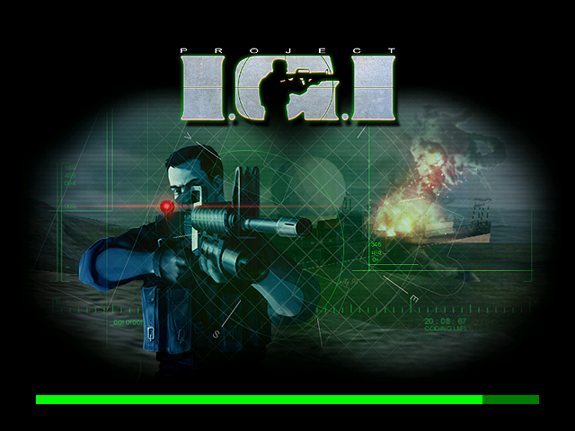
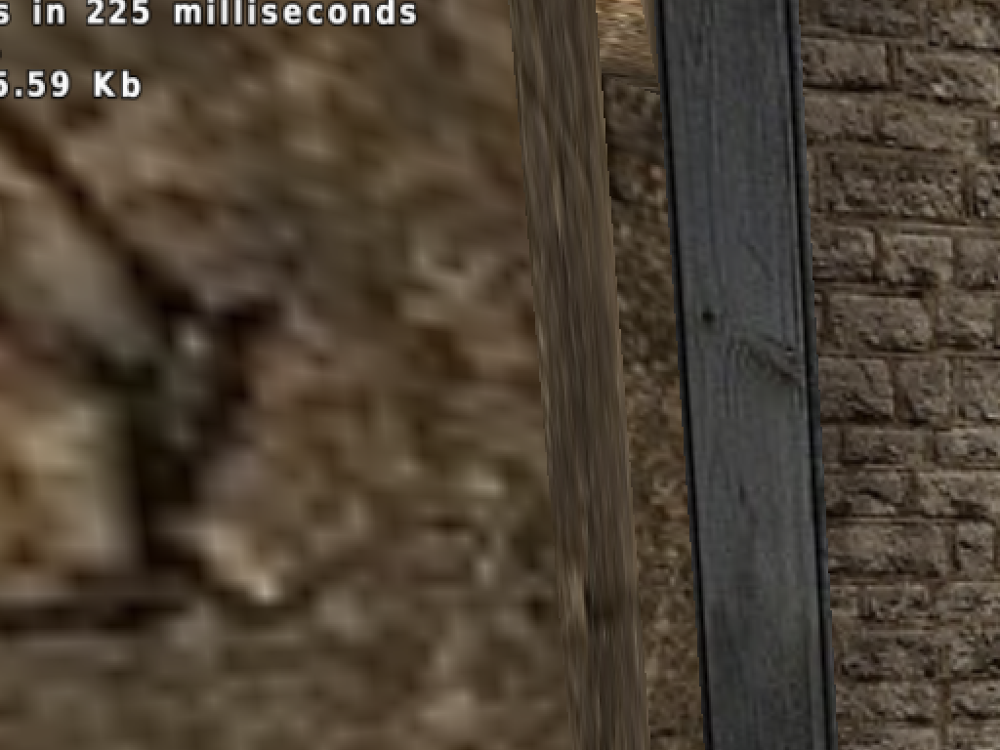
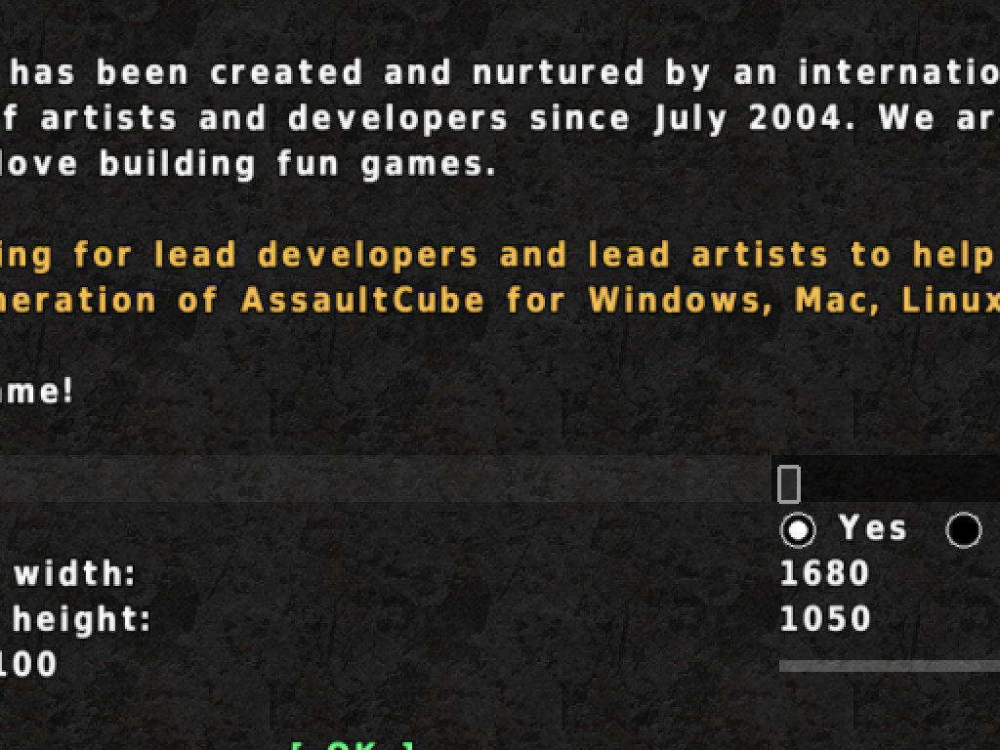
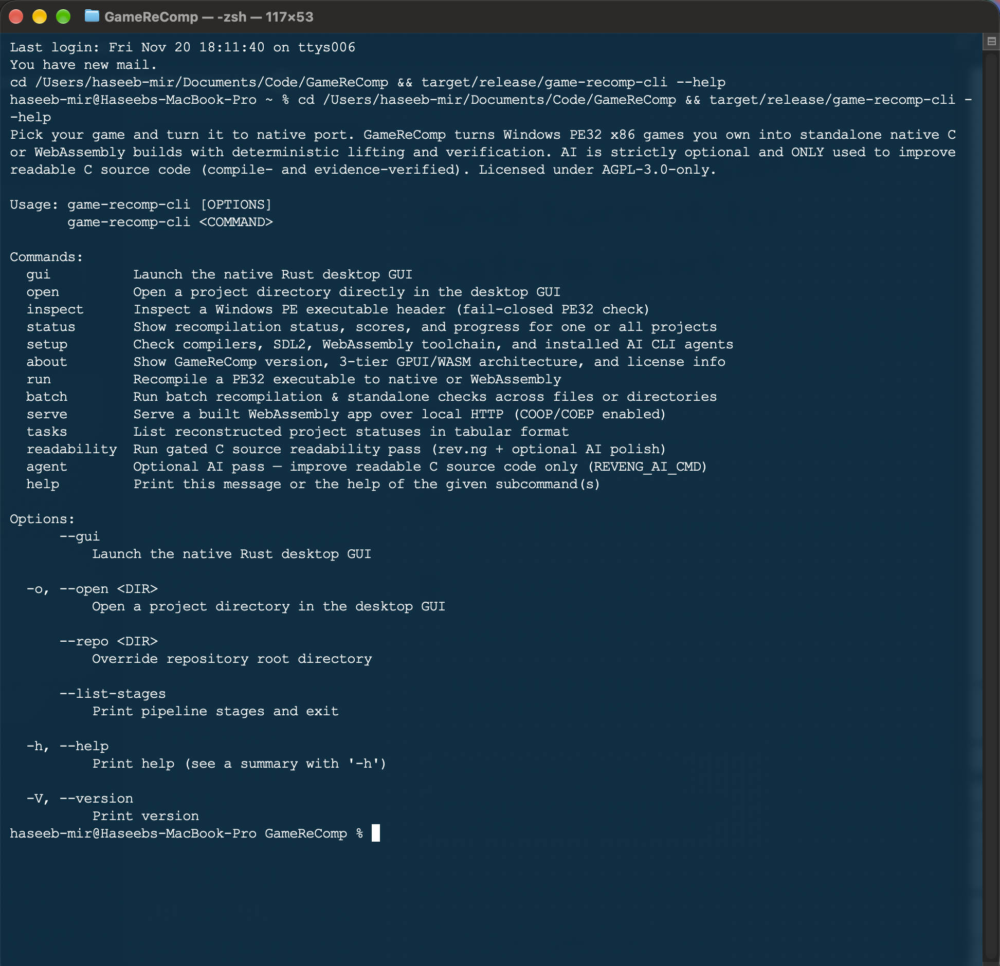
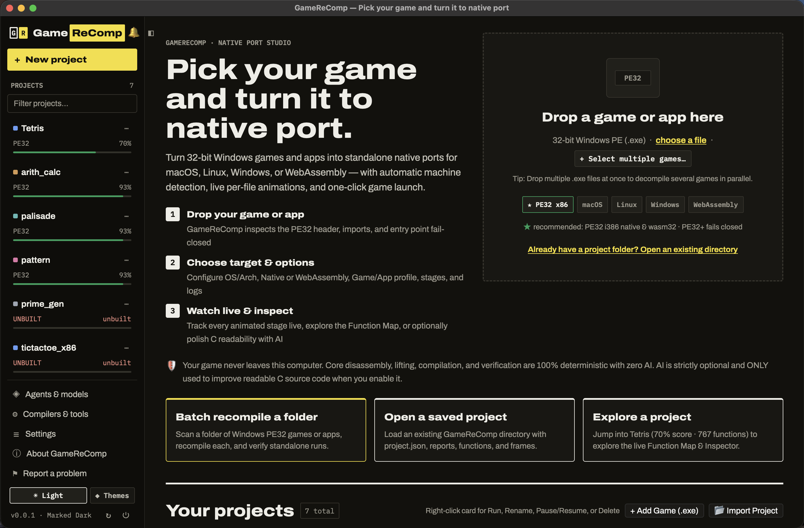
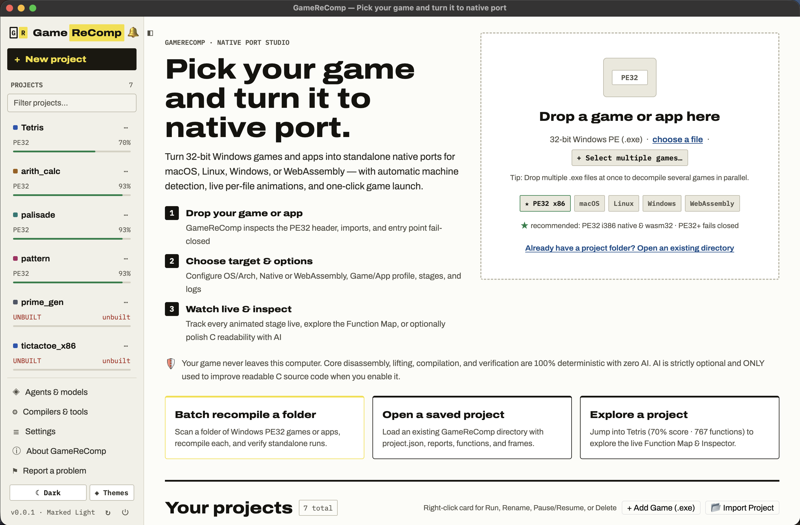
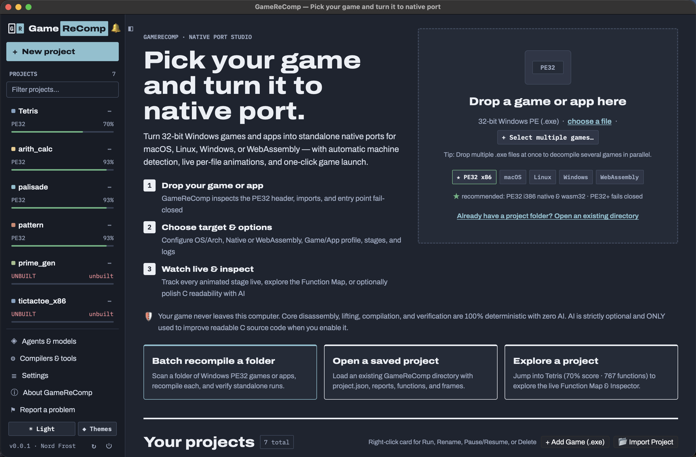
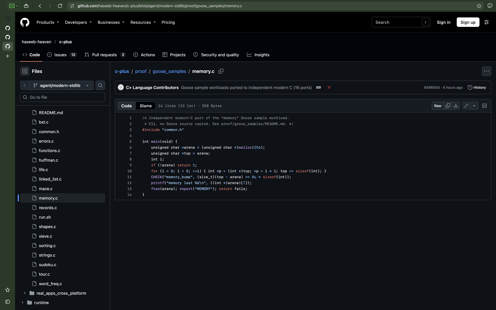

# Game matrix

Every game this product knows about, in one table: the locally supplied corpus this repository measures, and the upstream PCRecomp projects whose status is quoted from their own README. No game binary or asset is stored in this repository.

**Working status** is this pipeline's fail-closed verdict (`docs/VERIFICATION.md`), not an impression: `PASS` requires a recorded scenario; `PARTIAL` means the rebuilt process launched but no independent scenario was run; `FAIL` means it did not get that far. `NOT RUN` is exactly that. Upstream rows are claims, marked `†`, and are never counted as this product's results.

**Frame proof** comes only from a checked-in `reports/frames/**/frame-proof.json` produced by `tools.frame_proof`: it counts frames with real pixel content and refuses single-colour buffers. It is render evidence, not an oracle — it never promotes a row to `PASS` on its own.

**Port details** are read from each project's own `reports/report.json`: functions recovered, generated C, the rebuilt binary, imports the runtime bound, and the low-level/high-level split. `LOW_LEVEL_FALLBACK` functions are register-transfer C, not reconstructed high-level source. A row whose `evidence` points into the git-ignored `projects/` tree is shown as NOT RUN, because it has no committed proof.

Updated 2026-11-25T23:30:00Z by `python -m tools.gamesdb --matrix`; IGI fresh-frame rows added by hand with shipped-byte hashes.

**Evidence-backed results:** **9 / 128** recorded rows point at a committed proof file; **9** of those carry a PASS/PARTIAL verdict (**1** explicitly report `0` unresolved imports). Other rows are NOT RUN / FAIL here even when a local build log exists outside version control.

## Installed on this machine (Highball bottle)

All 361 installed Windows executables found under `~/Library/Application Support/Highball/bottles/Games/` are listed below. Counts: 5 BAD, 192 PE32 i386, 164 PE32+ x86-64. A listed app is an installed input, not a working port. `PE32+ x86-64` and invalid headers fail closed with a named reason. Screenshots are embedded at full frame size only where a real committed frame exists; every other row says so explicitly. No frame is fabricated, and no row is PASS without an independent Windows scenario oracle.

| Installed executable | Format | Honest ten-word description | Full-frame screenshot proof |
| --- | --- | --- | --- |
| `Games/drive_c/Program Files/Cheat Engine/Cheat Engine.exe` | PE32 i386 | Cheat Engine.exe: PE32 i386 accepted; no frame; NOT RUN without | none - no committed frame |
| `Games/drive_c/Program Files/Cheat Engine/DotNetDataCollector32.exe` | PE32 i386 | DotNetDataCollector32.exe: PE32 i386 accepted; no frame; NOT RUN without oracle | none - no committed frame |
| `Games/drive_c/Program Files/Cheat Engine/DotNetDataCollector64.exe` | PE32+ x86-64 | DotNetDataCollector64.exe: PE32+ x86-64 refused; fail-closed; no port or frame claimed | none - no committed frame |
| `Games/drive_c/Program Files/Cheat Engine/Kernelmoduleunloader.exe` | PE32 i386 | Kernelmoduleunloader.exe: PE32 i386 accepted; no frame; NOT RUN without oracle | none - no committed frame |
| `Games/drive_c/Program Files/Cheat Engine/Tutorial-x86_64.exe` | PE32+ x86-64 | Tutorial-x86_64.exe: PE32+ x86-64 refused; fail-closed; no port or frame claimed | none - no committed frame |
| `Games/drive_c/Program Files/Cheat Engine/ceregreset.exe` | PE32 i386 | ceregreset.exe: PE32 i386 accepted; no frame; NOT RUN without oracle | none - no committed frame |
| `Games/drive_c/Program Files/Cheat Engine/cheatengine-i386.exe` | PE32 i386 | cheatengine-i386.exe: PE32 i386 accepted; no frame; NOT RUN without oracle | none - no committed frame |
| `Games/drive_c/Program Files/Cheat Engine/cheatengine-x86_64-SSE4-AVX2.exe` | PE32+ x86-64 | cheatengine-x86_64-SSE4-AVX2.exe: PE32+ x86-64 refused; fail-closed; no port or frame claimed | none - no committed frame |
| `Games/drive_c/Program Files/Cheat Engine/cheatengine-x86_64.exe` | PE32+ x86-64 | cheatengine-x86_64.exe: PE32+ x86-64 refused; fail-closed; no port or frame claimed | none - no committed frame |
| `Games/drive_c/Program Files/Cheat Engine/gtutorial-i386.exe` | PE32 i386 | gtutorial-i386.exe: PE32 i386 accepted; no frame; NOT RUN without oracle | none - no committed frame |
| `Games/drive_c/Program Files/Cheat Engine/gtutorial-x86_64.exe` | PE32+ x86-64 | gtutorial-x86_64.exe: PE32+ x86-64 refused; fail-closed; no port or frame claimed | none - no committed frame |
| `Games/drive_c/Program Files/Cheat Engine/unins000.exe` | PE32 i386 | unins000.exe: PE32 i386 accepted; no frame; NOT RUN without oracle | none - no committed frame |
| `Games/drive_c/Program Files/Cheat Engine/windowsrepair.exe` | PE32 i386 | windowsrepair.exe: PE32 i386 accepted; no frame; NOT RUN without oracle | none - no committed frame |
| `Games/drive_c/Program Files/Internet Explorer/iexplore.exe` | PE32+ x86-64 | iexplore.exe: PE32+ x86-64 refused; fail-closed; no port or frame claimed | none - no committed frame |
| `Games/drive_c/Program Files/Windows Media Player/wmplayer.exe` | PE32+ x86-64 | wmplayer.exe: PE32+ x86-64 refused; fail-closed; no port or frame claimed | none - no committed frame |
| `Games/drive_c/Program Files/Windows NT/Accessories/wordpad.exe` | PE32+ x86-64 | wordpad.exe: PE32+ x86-64 refused; fail-closed; no port or frame claimed | none - no committed frame |
| `Games/drive_c/Program Files (x86)/Common Files/Solveig Multimedia/ffmpeg.exe` | PE32 i386 | ffmpeg.exe: PE32 i386 accepted; no frame; NOT RUN without oracle | none - no committed frame |
| `Games/drive_c/Program Files (x86)/Common Files/Solveig Multimedia/x264.exe` | PE32 i386 | x264.exe: PE32 i386 accepted; no frame; NOT RUN without oracle | none - no committed frame |
| `Games/drive_c/Program Files (x86)/HyperCam 7/SMM_HCEditor.exe` | PE32 i386 | SMM_HCEditor.exe: PE32 i386 accepted; no frame; NOT RUN without oracle | none - no committed frame |
| `Games/drive_c/Program Files (x86)/HyperCam 7/SMM_HyperCam.exe` | PE32 i386 | SMM_HyperCam.exe: PE32 i386 accepted; no frame; NOT RUN without oracle | none - no committed frame |
| `Games/drive_c/Program Files (x86)/HyperCam 7/SMM_HyperCam_Recovery.exe` | PE32 i386 | SMM_HyperCam_Recovery.exe: PE32 i386 accepted; no frame; NOT RUN without oracle | none - no committed frame |
| `Games/drive_c/Program Files (x86)/HyperCam 7/Uninstall.exe` | PE32 i386 | Uninstall.exe: PE32 i386 accepted; no frame; NOT RUN without oracle | none - no committed frame |
| `Games/drive_c/Program Files (x86)/Internet Download Manager/IDMGrHlp.exe` | PE32 i386 | IDMGrHlp.exe: PE32 i386 accepted; no frame; NOT RUN without oracle | none - no committed frame |
| `Games/drive_c/Program Files (x86)/Internet Download Manager/IDMIntegrator64.exe` | PE32+ x86-64 | IDMIntegrator64.exe: PE32+ x86-64 refused; fail-closed; no port or frame claimed | none - no committed frame |
| `Games/drive_c/Program Files (x86)/Internet Download Manager/IDMMsgHost.exe` | PE32 i386 | IDMMsgHost.exe: PE32 i386 accepted; no frame; NOT RUN without oracle | none - no committed frame |
| `Games/drive_c/Program Files (x86)/Internet Download Manager/IDMan.exe` | PE32 i386 | IDMan.exe: PE32 i386 accepted; no frame; NOT RUN without oracle | none - no committed frame |
| `Games/drive_c/Program Files (x86)/Internet Download Manager/IEMonitor.exe` | PE32 i386 | IEMonitor.exe: PE32 i386 accepted; no frame; NOT RUN without oracle | none - no committed frame |
| `Games/drive_c/Program Files (x86)/Internet Download Manager/MediumILStart.exe` | PE32 i386 | MediumILStart.exe: PE32 i386 accepted; no frame; NOT RUN without oracle | none - no committed frame |
| `Games/drive_c/Program Files (x86)/Internet Download Manager/Uninstall.exe` | PE32 i386 | Uninstall.exe: PE32 i386 accepted; no frame; NOT RUN without oracle | none - no committed frame |
| `Games/drive_c/Program Files (x86)/Internet Download Manager/idmBroker.exe` | PE32 i386 | idmBroker.exe: PE32 i386 accepted; no frame; NOT RUN without oracle | none - no committed frame |
| `Games/drive_c/Program Files (x86)/Internet Explorer/iexplore.exe` | PE32 i386 | iexplore.exe: PE32 i386 accepted; no frame; NOT RUN without oracle | none - no committed frame |
| `Games/drive_c/Program Files (x86)/Winamp/Elevator.exe` | PE32 i386 | Elevator.exe: PE32 i386 accepted; no frame; NOT RUN without oracle | none - no committed frame |
| `Games/drive_c/Program Files (x86)/Winamp/UninstWA.exe` | PE32 i386 | UninstWA.exe: PE32 i386 accepted; no frame; NOT RUN without oracle | none - no committed frame |
| `Games/drive_c/Program Files (x86)/Winamp/reporter.exe` | PE32 i386 | reporter.exe: PE32 i386 accepted; no frame; NOT RUN without oracle | none - no committed frame |
| `Games/drive_c/Program Files (x86)/Winamp/winamp.exe` | PE32 i386 | winamp.exe: PE32 i386 accepted; no frame; NOT RUN without oracle | none - no committed frame |
| `Games/drive_c/Program Files (x86)/Winamp/winampa.exe` | PE32 i386 | winampa.exe: PE32 i386 accepted; no frame; NOT RUN without oracle | none - no committed frame |
| `Games/drive_c/Program Files (x86)/Windows Media Player/wmplayer.exe` | PE32 i386 | wmplayer.exe: PE32 i386 accepted; no frame; NOT RUN without oracle | none - no committed frame |
| `Games/drive_c/Program Files (x86)/Windows NT/Accessories/wordpad.exe` | PE32 i386 | wordpad.exe: PE32 i386 accepted; no frame; NOT RUN without oracle | none - no committed frame |
| `Games/drive_c/recomp-oracle/DoConfig.exe` | PE32 i386 | DoConfig.exe: PE32 i386 accepted; no frame; NOT RUN without oracle | none - no committed frame |
| `Games/drive_c/recomp-oracle/Tetris.exe` | PE32+ x86-64 | Tetris.exe: PE32+ x86-64 refused; fail-closed; no port or frame claimed | full-frame: `docs/screenshots/native/tetris-oucc-new-01.png` |
| `Games/drive_c/recomp-oracle/TrackEditor.exe` | PE32 i386 | TrackEditor.exe: PE32 i386 accepted; no frame; NOT RUN without oracle | none - no committed frame |
| `Games/drive_c/recomp-oracle/arith-calc.exe` | PE32 i386 | arith-calc.exe: PE32 i386 accepted; no frame; NOT RUN without oracle | none - no committed frame |
| `Games/drive_c/recomp-oracle/base64.exe` | PE32 i386 | base64.exe: PE32 i386 accepted; no frame; NOT RUN without oracle | none - no committed frame |
| `Games/drive_c/recomp-oracle/blackbox.exe` | PE32+ x86-64 | blackbox.exe: PE32+ x86-64 refused; fail-closed; no port or frame claimed | none - no committed frame |
| `Games/drive_c/recomp-oracle/bridges.exe` | PE32+ x86-64 | bridges.exe: PE32+ x86-64 refused; fail-closed; no port or frame claimed | none - no committed frame |
| `Games/drive_c/recomp-oracle/busybox.exe` | PE32 i386 | busybox.exe: PE32 i386 accepted; no frame; NOT RUN without oracle | none - no committed frame |
| `Games/drive_c/recomp-oracle/cube.exe` | PE32+ x86-64 | cube.exe: PE32+ x86-64 refused; fail-closed; no port or frame claimed | full-frame: `docs/screenshots/cube-native-frame-0000.png`, `docs/screenshots/cube-native-frame-0001.png` |
| `Games/drive_c/recomp-oracle/fifteen.exe` | PE32+ x86-64 | fifteen.exe: PE32+ x86-64 refused; fail-closed; no port or frame claimed | none - no committed frame |
| `Games/drive_c/recomp-oracle/fifteensolver.exe` | PE32 i386 | fifteensolver.exe: PE32 i386 accepted; no frame; NOT RUN without oracle | none - no committed frame |
| `Games/drive_c/recomp-oracle/filling.exe` | PE32+ x86-64 | filling.exe: PE32+ x86-64 refused; fail-closed; no port or frame claimed | none - no committed frame |
| `Games/drive_c/recomp-oracle/fillingsolver.exe` | PE32 i386 | fillingsolver.exe: PE32 i386 accepted; no frame; NOT RUN without oracle | none - no committed frame |
| `Games/drive_c/recomp-oracle/flip.exe` | PE32+ x86-64 | flip.exe: PE32+ x86-64 refused; fail-closed; no port or frame claimed | none - no committed frame |
| `Games/drive_c/recomp-oracle/flood.exe` | PE32+ x86-64 | flood.exe: PE32+ x86-64 refused; fail-closed; no port or frame claimed | none - no committed frame |
| `Games/drive_c/recomp-oracle/galaxies.exe` | PE32+ x86-64 | galaxies.exe: PE32+ x86-64 refused; fail-closed; no port or frame claimed | none - no committed frame |
| `Games/drive_c/recomp-oracle/galaxiespicture.exe` | PE32 i386 | galaxiespicture.exe: PE32 i386 accepted; no frame; NOT RUN without oracle | none - no committed frame |
| `Games/drive_c/recomp-oracle/galaxiessolver.exe` | PE32 i386 | galaxiessolver.exe: PE32 i386 accepted; no frame; NOT RUN without oracle | none - no committed frame |
| `Games/drive_c/recomp-oracle/game2048.exe` | PE32+ x86-64 | game2048.exe: PE32+ x86-64 refused; fail-closed; no port or frame claimed | none - no committed frame |
| `Games/drive_c/recomp-oracle/guess.exe` | PE32+ x86-64 | guess.exe: PE32+ x86-64 refused; fail-closed; no port or frame claimed | none - no committed frame |
| `Games/drive_c/recomp-oracle/guess_game_x64.exe` | PE32+ x86-64 | guess_game_x64.exe: PE32+ x86-64 refused; fail-closed; no port or frame claimed | none - no committed frame |
| `Games/drive_c/recomp-oracle/guess_game_x86.exe` | PE32 i386 | guess_game_x86.exe: PE32 i386 accepted; no frame; NOT RUN without oracle | none - no committed frame |
| `Games/drive_c/recomp-oracle/hangman_x64.exe` | PE32+ x86-64 | hangman_x64.exe: PE32+ x86-64 refused; fail-closed; no port or frame claimed | none - no committed frame |
| `Games/drive_c/recomp-oracle/hangman_x86.exe` | PE32 i386 | hangman_x86.exe: PE32 i386 accepted; no frame; NOT RUN without oracle | none - no committed frame |
| `Games/drive_c/recomp-oracle/igi2-hm.exe` | PE32 i386 | igi2-hm.exe: PE32 i386; native frame committed; no Windows oracle claim | full-frame: `proof/screenshots/igi-level1-fresh-0002.png` |
| `Games/drive_c/recomp-oracle/igi2.exe` | PE32 i386 | igi2.exe: PE32 i386; native frame committed; no Windows oracle claim | full-frame: `proof/screenshots/igi-level1-fresh-0002.png`, `proof/screenshots/igi-level5-fresh-0001.png`, `proof/screenshots/igi-level9-fresh-0002.png` |
| `Games/drive_c/recomp-oracle/inertia.exe` | PE32+ x86-64 | inertia.exe: PE32+ x86-64 refused; fail-closed; no port or frame claimed | none - no committed frame |
| `Games/drive_c/recomp-oracle/keen.exe` | PE32+ x86-64 | keen.exe: PE32+ x86-64 refused; fail-closed; no port or frame claimed | none - no committed frame |
| `Games/drive_c/recomp-oracle/keensolver.exe` | PE32 i386 | keensolver.exe: PE32 i386 accepted; no frame; NOT RUN without oracle | none - no committed frame |
| `Games/drive_c/recomp-oracle/lightup.exe` | PE32+ x86-64 | lightup.exe: PE32+ x86-64 refused; fail-closed; no port or frame claimed | none - no committed frame |
| `Games/drive_c/recomp-oracle/lightupsolver.exe` | PE32 i386 | lightupsolver.exe: PE32 i386 accepted; no frame; NOT RUN without oracle | none - no committed frame |
| `Games/drive_c/recomp-oracle/luhn.exe` | PE32 i386 | luhn.exe: PE32 i386 accepted; no frame; NOT RUN without oracle | none - no committed frame |
| `Games/drive_c/recomp-oracle/magnets.exe` | PE32+ x86-64 | magnets.exe: PE32+ x86-64 refused; fail-closed; no port or frame claimed | none - no committed frame |
| `Games/drive_c/recomp-oracle/magnetssolver.exe` | PE32 i386 | magnetssolver.exe: PE32 i386 accepted; no frame; NOT RUN without oracle | none - no committed frame |
| `Games/drive_c/recomp-oracle/map.exe` | PE32+ x86-64 | map.exe: PE32+ x86-64 refused; fail-closed; no port or frame claimed | none - no committed frame |
| `Games/drive_c/recomp-oracle/mapsolver.exe` | PE32 i386 | mapsolver.exe: PE32 i386 accepted; no frame; NOT RUN without oracle | none - no committed frame |
| `Games/drive_c/recomp-oracle/mines.exe` | PE32 i386 | mines.exe: PE32 i386 accepted; no frame; NOT RUN without oracle | none - no committed frame |
| `Games/drive_c/recomp-oracle/mosaic.exe` | PE32+ x86-64 | mosaic.exe: PE32+ x86-64 refused; fail-closed; no port or frame claimed | none - no committed frame |
| `Games/drive_c/recomp-oracle/netgame.exe` | PE32+ x86-64 | netgame.exe: PE32+ x86-64 refused; fail-closed; no port or frame claimed | none - no committed frame |
| `Games/drive_c/recomp-oracle/oversample.exe` | PE32 i386 | oversample.exe: PE32 i386 accepted; no frame; NOT RUN without oracle | none - no committed frame |
| `Games/drive_c/recomp-oracle/p12_float32.exe` | PE32 i386 | p12_float32.exe: PE32 i386 accepted; no frame; NOT RUN without oracle | none - no committed frame |
| `Games/drive_c/recomp-oracle/p12_float64.exe` | PE32+ x86-64 | p12_float64.exe: PE32+ x86-64 refused; fail-closed; no port or frame claimed | none - no committed frame |
| `Games/drive_c/recomp-oracle/p12_l2w64.exe` | PE32+ x86-64 | p12_l2w64.exe: PE32+ x86-64 refused; fail-closed; no port or frame claimed | none - no committed frame |
| `Games/drive_c/recomp-oracle/pattern.exe` | PE32+ x86-64 | pattern.exe: PE32+ x86-64 refused; fail-closed; no port or frame claimed | none - no committed frame |
| `Games/drive_c/recomp-oracle/patternpicture.exe` | PE32 i386 | patternpicture.exe: PE32 i386 accepted; no frame; NOT RUN without oracle | none - no committed frame |
| `Games/drive_c/recomp-oracle/patternsolver.exe` | PE32 i386 | patternsolver.exe: PE32 i386 accepted; no frame; NOT RUN without oracle | none - no committed frame |
| `Games/drive_c/recomp-oracle/pegs.exe` | PE32+ x86-64 | pegs.exe: PE32+ x86-64 refused; fail-closed; no port or frame claimed | none - no committed frame |
| `Games/drive_c/recomp-oracle/prime-gen.exe` | PE32 i386 | prime-gen.exe: PE32 i386 accepted; no frame; NOT RUN without oracle | none - no committed frame |
| `Games/drive_c/recomp-oracle/range.exe` | PE32+ x86-64 | range.exe: PE32+ x86-64 refused; fail-closed; no port or frame claimed | none - no committed frame |
| `Games/drive_c/recomp-oracle/rect.exe` | PE32+ x86-64 | rect.exe: PE32+ x86-64 refused; fail-closed; no port or frame claimed | none - no committed frame |
| `Games/drive_c/recomp-oracle/run64.exe` | PE32+ x86-64 | run64.exe: PE32+ x86-64 refused; fail-closed; no port or frame claimed | none - no committed frame |
| `Games/drive_c/recomp-oracle/samegame.exe` | PE32+ x86-64 | samegame.exe: PE32+ x86-64 refused; fail-closed; no port or frame claimed | none - no committed frame |
| `Games/drive_c/recomp-oracle/signpost.exe` | PE32+ x86-64 | signpost.exe: PE32+ x86-64 refused; fail-closed; no port or frame claimed | none - no committed frame |
| `Games/drive_c/recomp-oracle/signpostsolver.exe` | PE32 i386 | signpostsolver.exe: PE32 i386 accepted; no frame; NOT RUN without oracle | none - no committed frame |
| `Games/drive_c/recomp-oracle/singles.exe` | PE32+ x86-64 | singles.exe: PE32+ x86-64 refused; fail-closed; no port or frame claimed | none - no committed frame |
| `Games/drive_c/recomp-oracle/singlessolver.exe` | PE32 i386 | singlessolver.exe: PE32 i386 accepted; no frame; NOT RUN without oracle | none - no committed frame |
| `Games/drive_c/recomp-oracle/sixteen.exe` | PE32+ x86-64 | sixteen.exe: PE32+ x86-64 refused; fail-closed; no port or frame claimed | none - no committed frame |
| `Games/drive_c/recomp-oracle/slantsolver.exe` | PE32 i386 | slantsolver.exe: PE32 i386 accepted; no frame; NOT RUN without oracle | none - no committed frame |
| `Games/drive_c/recomp-oracle/snake-windows-x86_64.exe` | PE32+ x86-64 | snake-windows-x86_64.exe: PE32+ x86-64 refused; fail-closed; no port or frame claimed | none - no committed frame |
| `Games/drive_c/recomp-oracle/snake.exe` | PE32+ x86-64 | snake.exe: PE32+ x86-64 refused; fail-closed; no port or frame claimed | none - no committed frame |
| `Games/drive_c/recomp-oracle/solosolver.exe` | PE32 i386 | solosolver.exe: PE32 i386 accepted; no frame; NOT RUN without oracle | none - no committed frame |
| `Games/drive_c/recomp-oracle/tents.exe` | PE32+ x86-64 | tents.exe: PE32+ x86-64 refused; fail-closed; no port or frame claimed | none - no committed frame |
| `Games/drive_c/recomp-oracle/tentssolver.exe` | PE32 i386 | tentssolver.exe: PE32 i386 accepted; no frame; NOT RUN without oracle | none - no committed frame |
| `Games/drive_c/recomp-oracle/tetris-win-32-ch.exe` | PE32 i386 | tetris-win-32-ch.exe: PE32 i386 accepted; no frame; NOT RUN without oracle | none - no committed frame |
| `Games/drive_c/recomp-oracle/tetris-win-32-en.exe` | PE32 i386 | tetris-win-32-en.exe: PE32 i386 accepted; no frame; NOT RUN without oracle | none - no committed frame |
| `Games/drive_c/recomp-oracle/tetris-win-32-jp.exe` | PE32 i386 | tetris-win-32-jp.exe: PE32 i386 accepted; no frame; NOT RUN without oracle | none - no committed frame |
| `Games/drive_c/recomp-oracle/tf.exe` | PE32 i386 | tf.exe: PE32 i386 accepted; no frame; NOT RUN without oracle | none - no committed frame |
| `Games/drive_c/recomp-oracle/tictactoe.exe` | PE32+ x86-64 | tictactoe.exe: PE32+ x86-64 refused; fail-closed; no port or frame claimed | none - no committed frame |
| `Games/drive_c/recomp-oracle/towers.exe` | PE32+ x86-64 | towers.exe: PE32+ x86-64 refused; fail-closed; no port or frame claimed | none - no committed frame |
| `Games/drive_c/recomp-oracle/towerssolver.exe` | PE32 i386 | towerssolver.exe: PE32 i386 accepted; no frame; NOT RUN without oracle | none - no committed frame |
| `Games/drive_c/recomp-oracle/tracks.exe` | PE32+ x86-64 | tracks.exe: PE32+ x86-64 refused; fail-closed; no port or frame claimed | none - no committed frame |
| `Games/drive_c/recomp-oracle/trackssolver.exe` | PE32 i386 | trackssolver.exe: PE32 i386 accepted; no frame; NOT RUN without oracle | none - no committed frame |
| `Games/drive_c/recomp-oracle/twiddle.exe` | PE32+ x86-64 | twiddle.exe: PE32+ x86-64 refused; fail-closed; no port or frame claimed | none - no committed frame |
| `Games/drive_c/recomp-oracle/undead.exe` | PE32+ x86-64 | undead.exe: PE32+ x86-64 refused; fail-closed; no port or frame claimed | none - no committed frame |
| `Games/drive_c/recomp-oracle/unequal.exe` | PE32+ x86-64 | unequal.exe: PE32+ x86-64 refused; fail-closed; no port or frame claimed | none - no committed frame |
| `Games/drive_c/recomp-oracle/unequalsolver.exe` | PE32 i386 | unequalsolver.exe: PE32 i386 accepted; no frame; NOT RUN without oracle | none - no committed frame |
| `Games/drive_c/recomp-oracle/unruly.exe` | PE32+ x86-64 | unruly.exe: PE32+ x86-64 refused; fail-closed; no port or frame claimed | none - no committed frame |
| `Games/drive_c/recomp-oracle/unrulysolver.exe` | PE32 i386 | unrulysolver.exe: PE32 i386 accepted; no frame; NOT RUN without oracle | none - no committed frame |
| `Games/drive_c/recomp-oracle/untangle.exe` | PE32+ x86-64 | untangle.exe: PE32+ x86-64 refused; fail-closed; no port or frame claimed | none - no committed frame |
| `Games/drive_c/users/haseeb-mir/AppData/Local/OpenIGI/Library/openigi/versions/0.6.2/OpenIGI.Desktop.exe` | PE32+ x86-64 | OpenIGI.Desktop.exe: PE32+ x86-64 refused; fail-closed; no port or frame claimed | none - no committed frame |
| `Games/drive_c/users/haseeb-mir/AppData/Local/Temp/2EL09O1F/Resume.exe` | PE32 i386 | Resume.exe: PE32 i386 accepted; no frame; NOT RUN without oracle | none - no committed frame |
| `Games/drive_c/users/haseeb-mir/AppData/Local/Temp/2EL09O1F/SolveigMM_HyperCam_7_0_2601_19/presetup/Common/SMM_HCEditor.exe` | PE32 i386 | SMM_HCEditor.exe: PE32 i386 accepted; no frame; NOT RUN without oracle | none - no committed frame |
| `Games/drive_c/users/haseeb-mir/AppData/Local/Temp/2EL09O1F/SolveigMM_HyperCam_7_0_2601_19/presetup/Common/SMM_HyperCam.exe` | PE32 i386 | SMM_HyperCam.exe: PE32 i386 accepted; no frame; NOT RUN without oracle | none - no committed frame |
| `Games/drive_c/users/haseeb-mir/AppData/Local/Temp/2EL09O1F/SolveigMM_HyperCam_7_0_2601_19/presetup/Common/SMM_HyperCam_Recovery.exe` | PE32 i386 | SMM_HyperCam_Recovery.exe: PE32 i386 accepted; no frame; NOT RUN without oracle | none - no committed frame |
| `Games/drive_c/users/haseeb-mir/AppData/Local/Temp/2EL09O1F/SolveigMM_HyperCam_7_0_2601_19/presetup/Sys/Uninstall.exe` | PE32 i386 | Uninstall.exe: PE32 i386 accepted; no frame; NOT RUN without oracle | none - no committed frame |
| `Games/drive_c/users/haseeb-mir/AppData/Local/Temp/2EL09O1F/SolveigMM_HyperCam_7_0_2601_19/presetup/Sys/ffmpeg.exe` | PE32 i386 | ffmpeg.exe: PE32 i386 accepted; no frame; NOT RUN without oracle | none - no committed frame |
| `Games/drive_c/users/haseeb-mir/AppData/Local/Temp/2EL09O1F/SolveigMM_HyperCam_7_0_2601_19/presetup/Sys/x264.exe` | PE32 i386 | x264.exe: PE32 i386 accepted; no frame; NOT RUN without oracle | none - no committed frame |
| `Games/drive_c/users/haseeb-mir/AppData/Local/Temp/2EL09O1F/comregc.exe` | PE32+ x86-64 | comregc.exe: PE32+ x86-64 refused; fail-closed; no port or frame claimed | none - no committed frame |
| `Games/drive_c/windows/Microsoft.NET/Framework/v1.1.4322/aspnet_regiis.exe` | PE32 i386 | aspnet_regiis.exe: PE32 i386 accepted; no frame; NOT RUN without oracle | none - no committed frame |
| `Games/drive_c/windows/Microsoft.NET/Framework/v1.1.4322/ngen.exe` | PE32 i386 | ngen.exe: PE32 i386 accepted; no frame; NOT RUN without oracle | none - no committed frame |
| `Games/drive_c/windows/Microsoft.NET/Framework/v1.1.4322/regsvcs.exe` | PE32 i386 | regsvcs.exe: PE32 i386 accepted; no frame; NOT RUN without oracle | none - no committed frame |
| `Games/drive_c/windows/Microsoft.NET/Framework/v2.0.50727/csc.exe` | PE32 i386 | csc.exe: PE32 i386 accepted; no frame; NOT RUN without oracle | none - no committed frame |
| `Games/drive_c/windows/Microsoft.NET/Framework/v2.0.50727/installutil.exe` | PE32 i386 | installutil.exe: PE32 i386 accepted; no frame; NOT RUN without oracle | none - no committed frame |
| `Games/drive_c/windows/Microsoft.NET/Framework/v2.0.50727/msbuild.exe` | PE32 i386 | msbuild.exe: PE32 i386 accepted; no frame; NOT RUN without oracle | none - no committed frame |
| `Games/drive_c/windows/Microsoft.NET/Framework/v2.0.50727/ngen.exe` | PE32 i386 | ngen.exe: PE32 i386 accepted; no frame; NOT RUN without oracle | none - no committed frame |
| `Games/drive_c/windows/Microsoft.NET/Framework/v2.0.50727/regasm.exe` | PE32 i386 | regasm.exe: PE32 i386 accepted; no frame; NOT RUN without oracle | none - no committed frame |
| `Games/drive_c/windows/Microsoft.NET/Framework/v3.0/windows communication foundation/servicemodelreg.exe` | PE32 i386 | servicemodelreg.exe: PE32 i386 accepted; no frame; NOT RUN without oracle | none - no committed frame |
| `Games/drive_c/windows/Microsoft.NET/Framework/v3.0/wpf/presentationfontcache.exe` | PE32 i386 | presentationfontcache.exe: PE32 i386 accepted; no frame; NOT RUN without oracle | none - no committed frame |
| `Games/drive_c/windows/Microsoft.NET/Framework/v3.5/msbuild.exe` | PE32 i386 | msbuild.exe: PE32 i386 accepted; no frame; NOT RUN without oracle | none - no committed frame |
| `Games/drive_c/windows/Microsoft.NET/Framework/v4.0.30319/csc.exe` | PE32 i386 | csc.exe: PE32 i386 accepted; no frame; NOT RUN without oracle | none - no committed frame |
| `Games/drive_c/windows/Microsoft.NET/Framework/v4.0.30319/installutil.exe` | PE32 i386 | installutil.exe: PE32 i386 accepted; no frame; NOT RUN without oracle | none - no committed frame |
| `Games/drive_c/windows/Microsoft.NET/Framework/v4.0.30319/msbuild.exe` | PE32 i386 | msbuild.exe: PE32 i386 accepted; no frame; NOT RUN without oracle | none - no committed frame |
| `Games/drive_c/windows/Microsoft.NET/Framework/v4.0.30319/ngen.exe` | PE32 i386 | ngen.exe: PE32 i386 accepted; no frame; NOT RUN without oracle | none - no committed frame |
| `Games/drive_c/windows/Microsoft.NET/Framework64/v1.1.4322/aspnet_regiis.exe` | PE32+ x86-64 | aspnet_regiis.exe: PE32+ x86-64 refused; fail-closed; no port or frame claimed | none - no committed frame |
| `Games/drive_c/windows/Microsoft.NET/Framework64/v1.1.4322/ngen.exe` | PE32+ x86-64 | ngen.exe: PE32+ x86-64 refused; fail-closed; no port or frame claimed | none - no committed frame |
| `Games/drive_c/windows/Microsoft.NET/Framework64/v1.1.4322/regsvcs.exe` | PE32+ x86-64 | regsvcs.exe: PE32+ x86-64 refused; fail-closed; no port or frame claimed | none - no committed frame |
| `Games/drive_c/windows/Microsoft.NET/Framework64/v2.0.50727/csc.exe` | PE32 i386 | csc.exe: PE32 i386 accepted; no frame; NOT RUN without oracle | none - no committed frame |
| `Games/drive_c/windows/Microsoft.NET/Framework64/v2.0.50727/installutil.exe` | PE32 i386 | installutil.exe: PE32 i386 accepted; no frame; NOT RUN without oracle | none - no committed frame |
| `Games/drive_c/windows/Microsoft.NET/Framework64/v2.0.50727/msbuild.exe` | PE32 i386 | msbuild.exe: PE32 i386 accepted; no frame; NOT RUN without oracle | none - no committed frame |
| `Games/drive_c/windows/Microsoft.NET/Framework64/v2.0.50727/ngen.exe` | PE32+ x86-64 | ngen.exe: PE32+ x86-64 refused; fail-closed; no port or frame claimed | none - no committed frame |
| `Games/drive_c/windows/Microsoft.NET/Framework64/v2.0.50727/regasm.exe` | PE32+ x86-64 | regasm.exe: PE32+ x86-64 refused; fail-closed; no port or frame claimed | none - no committed frame |
| `Games/drive_c/windows/Microsoft.NET/Framework64/v3.0/windows communication foundation/servicemodelreg.exe` | PE32+ x86-64 | servicemodelreg.exe: PE32+ x86-64 refused; fail-closed; no port or frame claimed | none - no committed frame |
| `Games/drive_c/windows/Microsoft.NET/Framework64/v3.0/wpf/presentationfontcache.exe` | PE32+ x86-64 | presentationfontcache.exe: PE32+ x86-64 refused; fail-closed; no port or frame claimed | none - no committed frame |
| `Games/drive_c/windows/Microsoft.NET/Framework64/v3.5/msbuild.exe` | PE32 i386 | msbuild.exe: PE32 i386 accepted; no frame; NOT RUN without oracle | none - no committed frame |
| `Games/drive_c/windows/Microsoft.NET/Framework64/v4.0.30319/csc.exe` | PE32 i386 | csc.exe: PE32 i386 accepted; no frame; NOT RUN without oracle | none - no committed frame |
| `Games/drive_c/windows/Microsoft.NET/Framework64/v4.0.30319/installutil.exe` | PE32 i386 | installutil.exe: PE32 i386 accepted; no frame; NOT RUN without oracle | none - no committed frame |
| `Games/drive_c/windows/Microsoft.NET/Framework64/v4.0.30319/msbuild.exe` | PE32 i386 | msbuild.exe: PE32 i386 accepted; no frame; NOT RUN without oracle | none - no committed frame |
| `Games/drive_c/windows/Microsoft.NET/Framework64/v4.0.30319/ngen.exe` | PE32+ x86-64 | ngen.exe: PE32+ x86-64 refused; fail-closed; no port or frame claimed | none - no committed frame |
| `Games/drive_c/windows/command/start.exe` | PE32 i386 | start.exe: PE32 i386 accepted; no frame; NOT RUN without oracle | none - no committed frame |
| `Games/drive_c/windows/explorer.exe` | PE32+ x86-64 | explorer.exe: PE32+ x86-64 refused; fail-closed; no port or frame claimed | none - no committed frame |
| `Games/drive_c/windows/hh.exe` | PE32+ x86-64 | hh.exe: PE32+ x86-64 refused; fail-closed; no port or frame claimed | none - no committed frame |
| `Games/drive_c/windows/notepad.exe` | PE32+ x86-64 | notepad.exe: PE32+ x86-64 refused; fail-closed; no port or frame claimed | none - no committed frame |
| `Games/drive_c/windows/regedit.exe` | PE32+ x86-64 | regedit.exe: PE32+ x86-64 refused; fail-closed; no port or frame claimed | none - no committed frame |
| `Games/drive_c/windows/rundll.exe` | BAD | rundll.exe: invalid PE header; fail-closed; no port or frame claimed | none - no committed frame |
| `Games/drive_c/windows/system32/WindowsPowerShell/v1.0/powershell.exe` | PE32+ x86-64 | powershell.exe: PE32+ x86-64 refused; fail-closed; no port or frame claimed | none - no committed frame |
| `Games/drive_c/windows/system32/arp.exe` | PE32+ x86-64 | arp.exe: PE32+ x86-64 refused; fail-closed; no port or frame claimed | none - no committed frame |
| `Games/drive_c/windows/system32/attrib.exe` | PE32+ x86-64 | attrib.exe: PE32+ x86-64 refused; fail-closed; no port or frame claimed | none - no committed frame |
| `Games/drive_c/windows/system32/cabarc.exe` | PE32+ x86-64 | cabarc.exe: PE32+ x86-64 refused; fail-closed; no port or frame claimed | none - no committed frame |
| `Games/drive_c/windows/system32/cacls.exe` | PE32+ x86-64 | cacls.exe: PE32+ x86-64 refused; fail-closed; no port or frame claimed | none - no committed frame |
| `Games/drive_c/windows/system32/certutil.exe` | PE32+ x86-64 | certutil.exe: PE32+ x86-64 refused; fail-closed; no port or frame claimed | none - no committed frame |
| `Games/drive_c/windows/system32/clock.exe` | PE32+ x86-64 | clock.exe: PE32+ x86-64 refused; fail-closed; no port or frame claimed | none - no committed frame |
| `Games/drive_c/windows/system32/cmd.exe` | PE32+ x86-64 | cmd.exe: PE32+ x86-64 refused; fail-closed; no port or frame claimed | none - no committed frame |
| `Games/drive_c/windows/system32/conhost.exe` | PE32+ x86-64 | conhost.exe: PE32+ x86-64 refused; fail-closed; no port or frame claimed | none - no committed frame |
| `Games/drive_c/windows/system32/control.exe` | PE32+ x86-64 | control.exe: PE32+ x86-64 refused; fail-closed; no port or frame claimed | none - no committed frame |
| `Games/drive_c/windows/system32/cscript.exe` | PE32+ x86-64 | cscript.exe: PE32+ x86-64 refused; fail-closed; no port or frame claimed | none - no committed frame |
| `Games/drive_c/windows/system32/dism.exe` | PE32+ x86-64 | dism.exe: PE32+ x86-64 refused; fail-closed; no port or frame claimed | none - no committed frame |
| `Games/drive_c/windows/system32/dllhost.exe` | PE32+ x86-64 | dllhost.exe: PE32+ x86-64 refused; fail-closed; no port or frame claimed | none - no committed frame |
| `Games/drive_c/windows/system32/dplaysvr.exe` | PE32+ x86-64 | dplaysvr.exe: PE32+ x86-64 refused; fail-closed; no port or frame claimed | none - no committed frame |
| `Games/drive_c/windows/system32/dpnsvr.exe` | PE32+ x86-64 | dpnsvr.exe: PE32+ x86-64 refused; fail-closed; no port or frame claimed | none - no committed frame |
| `Games/drive_c/windows/system32/dpvsetup.exe` | PE32+ x86-64 | dpvsetup.exe: PE32+ x86-64 refused; fail-closed; no port or frame claimed | none - no committed frame |
| `Games/drive_c/windows/system32/dxdiag.exe` | PE32+ x86-64 | dxdiag.exe: PE32+ x86-64 refused; fail-closed; no port or frame claimed | none - no committed frame |
| `Games/drive_c/windows/system32/eject.exe` | PE32+ x86-64 | eject.exe: PE32+ x86-64 refused; fail-closed; no port or frame claimed | none - no committed frame |
| `Games/drive_c/windows/system32/expand.exe` | PE32+ x86-64 | expand.exe: PE32+ x86-64 refused; fail-closed; no port or frame claimed | none - no committed frame |
| `Games/drive_c/windows/system32/explorer.exe` | PE32+ x86-64 | explorer.exe: PE32+ x86-64 refused; fail-closed; no port or frame claimed | none - no committed frame |
| `Games/drive_c/windows/system32/extrac32.exe` | PE32+ x86-64 | extrac32.exe: PE32+ x86-64 refused; fail-closed; no port or frame claimed | none - no committed frame |
| `Games/drive_c/windows/system32/fc.exe` | PE32+ x86-64 | fc.exe: PE32+ x86-64 refused; fail-closed; no port or frame claimed | none - no committed frame |
| `Games/drive_c/windows/system32/find.exe` | PE32+ x86-64 | find.exe: PE32+ x86-64 refused; fail-closed; no port or frame claimed | none - no committed frame |
| `Games/drive_c/windows/system32/findstr.exe` | PE32+ x86-64 | findstr.exe: PE32+ x86-64 refused; fail-closed; no port or frame claimed | none - no committed frame |
| `Games/drive_c/windows/system32/fsutil.exe` | PE32+ x86-64 | fsutil.exe: PE32+ x86-64 refused; fail-closed; no port or frame claimed | none - no committed frame |
| `Games/drive_c/windows/system32/hostname.exe` | PE32+ x86-64 | hostname.exe: PE32+ x86-64 refused; fail-closed; no port or frame claimed | none - no committed frame |
| `Games/drive_c/windows/system32/icacls.exe` | PE32+ x86-64 | icacls.exe: PE32+ x86-64 refused; fail-closed; no port or frame claimed | none - no committed frame |
| `Games/drive_c/windows/system32/icinfo.exe` | PE32+ x86-64 | icinfo.exe: PE32+ x86-64 refused; fail-closed; no port or frame claimed | none - no committed frame |
| `Games/drive_c/windows/system32/iexplore.exe` | PE32+ x86-64 | iexplore.exe: PE32+ x86-64 refused; fail-closed; no port or frame claimed | none - no committed frame |
| `Games/drive_c/windows/system32/ipconfig.exe` | PE32+ x86-64 | ipconfig.exe: PE32+ x86-64 refused; fail-closed; no port or frame claimed | none - no committed frame |
| `Games/drive_c/windows/system32/klist.exe` | PE32+ x86-64 | klist.exe: PE32+ x86-64 refused; fail-closed; no port or frame claimed | none - no committed frame |
| `Games/drive_c/windows/system32/lodctr.exe` | PE32+ x86-64 | lodctr.exe: PE32+ x86-64 refused; fail-closed; no port or frame claimed | none - no committed frame |
| `Games/drive_c/windows/system32/makecab.exe` | PE32+ x86-64 | makecab.exe: PE32+ x86-64 refused; fail-closed; no port or frame claimed | none - no committed frame |
| `Games/drive_c/windows/system32/mshta.exe` | PE32+ x86-64 | mshta.exe: PE32+ x86-64 refused; fail-closed; no port or frame claimed | none - no committed frame |
| `Games/drive_c/windows/system32/msidb.exe` | PE32+ x86-64 | msidb.exe: PE32+ x86-64 refused; fail-closed; no port or frame claimed | none - no committed frame |
| `Games/drive_c/windows/system32/msiexec.exe` | PE32+ x86-64 | msiexec.exe: PE32+ x86-64 refused; fail-closed; no port or frame claimed | none - no committed frame |
| `Games/drive_c/windows/system32/msinfo32.exe` | PE32+ x86-64 | msinfo32.exe: PE32+ x86-64 refused; fail-closed; no port or frame claimed | none - no committed frame |
| `Games/drive_c/windows/system32/net.exe` | PE32+ x86-64 | net.exe: PE32+ x86-64 refused; fail-closed; no port or frame claimed | none - no committed frame |
| `Games/drive_c/windows/system32/netsh.exe` | PE32+ x86-64 | netsh.exe: PE32+ x86-64 refused; fail-closed; no port or frame claimed | none - no committed frame |
| `Games/drive_c/windows/system32/netstat.exe` | PE32+ x86-64 | netstat.exe: PE32+ x86-64 refused; fail-closed; no port or frame claimed | none - no committed frame |
| `Games/drive_c/windows/system32/notepad.exe` | PE32+ x86-64 | notepad.exe: PE32+ x86-64 refused; fail-closed; no port or frame claimed | none - no committed frame |
| `Games/drive_c/windows/system32/ntoskrnl.exe` | PE32+ x86-64 | ntoskrnl.exe: PE32+ x86-64 refused; fail-closed; no port or frame claimed | none - no committed frame |
| `Games/drive_c/windows/system32/oleview.exe` | PE32+ x86-64 | oleview.exe: PE32+ x86-64 refused; fail-closed; no port or frame claimed | none - no committed frame |
| `Games/drive_c/windows/system32/ping.exe` | PE32+ x86-64 | ping.exe: PE32+ x86-64 refused; fail-closed; no port or frame claimed | none - no committed frame |
| `Games/drive_c/windows/system32/plugplay.exe` | PE32+ x86-64 | plugplay.exe: PE32+ x86-64 refused; fail-closed; no port or frame claimed | none - no committed frame |
| `Games/drive_c/windows/system32/pnputil.exe` | PE32+ x86-64 | pnputil.exe: PE32+ x86-64 refused; fail-closed; no port or frame claimed | none - no committed frame |
| `Games/drive_c/windows/system32/progman.exe` | PE32+ x86-64 | progman.exe: PE32+ x86-64 refused; fail-closed; no port or frame claimed | none - no committed frame |
| `Games/drive_c/windows/system32/reg.exe` | PE32+ x86-64 | reg.exe: PE32+ x86-64 refused; fail-closed; no port or frame claimed | none - no committed frame |
| `Games/drive_c/windows/system32/regini.exe` | PE32+ x86-64 | regini.exe: PE32+ x86-64 refused; fail-closed; no port or frame claimed | none - no committed frame |
| `Games/drive_c/windows/system32/regsvr32.exe` | PE32+ x86-64 | regsvr32.exe: PE32+ x86-64 refused; fail-closed; no port or frame claimed | none - no committed frame |
| `Games/drive_c/windows/system32/robocopy.exe` | PE32+ x86-64 | robocopy.exe: PE32+ x86-64 refused; fail-closed; no port or frame claimed | none - no committed frame |
| `Games/drive_c/windows/system32/rpcss.exe` | PE32+ x86-64 | rpcss.exe: PE32+ x86-64 refused; fail-closed; no port or frame claimed | none - no committed frame |
| `Games/drive_c/windows/system32/runas.exe` | PE32+ x86-64 | runas.exe: PE32+ x86-64 refused; fail-closed; no port or frame claimed | none - no committed frame |
| `Games/drive_c/windows/system32/rundll32.exe` | PE32+ x86-64 | rundll32.exe: PE32+ x86-64 refused; fail-closed; no port or frame claimed | none - no committed frame |
| `Games/drive_c/windows/system32/sc.exe` | PE32+ x86-64 | sc.exe: PE32+ x86-64 refused; fail-closed; no port or frame claimed | none - no committed frame |
| `Games/drive_c/windows/system32/schtasks.exe` | PE32+ x86-64 | schtasks.exe: PE32+ x86-64 refused; fail-closed; no port or frame claimed | none - no committed frame |
| `Games/drive_c/windows/system32/sdbinst.exe` | PE32+ x86-64 | sdbinst.exe: PE32+ x86-64 refused; fail-closed; no port or frame claimed | none - no committed frame |
| `Games/drive_c/windows/system32/secedit.exe` | PE32+ x86-64 | secedit.exe: PE32+ x86-64 refused; fail-closed; no port or frame claimed | none - no committed frame |
| `Games/drive_c/windows/system32/services.exe` | PE32+ x86-64 | services.exe: PE32+ x86-64 refused; fail-closed; no port or frame claimed | none - no committed frame |
| `Games/drive_c/windows/system32/setx.exe` | PE32+ x86-64 | setx.exe: PE32+ x86-64 refused; fail-closed; no port or frame claimed | none - no committed frame |
| `Games/drive_c/windows/system32/shutdown.exe` | PE32+ x86-64 | shutdown.exe: PE32+ x86-64 refused; fail-closed; no port or frame claimed | none - no committed frame |
| `Games/drive_c/windows/system32/sort.exe` | PE32+ x86-64 | sort.exe: PE32+ x86-64 refused; fail-closed; no port or frame claimed | none - no committed frame |
| `Games/drive_c/windows/system32/spoolsv.exe` | PE32+ x86-64 | spoolsv.exe: PE32+ x86-64 refused; fail-closed; no port or frame claimed | none - no committed frame |
| `Games/drive_c/windows/system32/start.exe` | PE32+ x86-64 | start.exe: PE32+ x86-64 refused; fail-closed; no port or frame claimed | none - no committed frame |
| `Games/drive_c/windows/system32/subst.exe` | PE32+ x86-64 | subst.exe: PE32+ x86-64 refused; fail-closed; no port or frame claimed | none - no committed frame |
| `Games/drive_c/windows/system32/svchost.exe` | PE32+ x86-64 | svchost.exe: PE32+ x86-64 refused; fail-closed; no port or frame claimed | none - no committed frame |
| `Games/drive_c/windows/system32/systeminfo.exe` | PE32+ x86-64 | systeminfo.exe: PE32+ x86-64 refused; fail-closed; no port or frame claimed | none - no committed frame |
| `Games/drive_c/windows/system32/taskkill.exe` | PE32+ x86-64 | taskkill.exe: PE32+ x86-64 refused; fail-closed; no port or frame claimed | none - no committed frame |
| `Games/drive_c/windows/system32/tasklist.exe` | PE32+ x86-64 | tasklist.exe: PE32+ x86-64 refused; fail-closed; no port or frame claimed | none - no committed frame |
| `Games/drive_c/windows/system32/taskmgr.exe` | PE32+ x86-64 | taskmgr.exe: PE32+ x86-64 refused; fail-closed; no port or frame claimed | none - no committed frame |
| `Games/drive_c/windows/system32/termsv.exe` | PE32+ x86-64 | termsv.exe: PE32+ x86-64 refused; fail-closed; no port or frame claimed | none - no committed frame |
| `Games/drive_c/windows/system32/timeout.exe` | PE32+ x86-64 | timeout.exe: PE32+ x86-64 refused; fail-closed; no port or frame claimed | none - no committed frame |
| `Games/drive_c/windows/system32/uninstaller.exe` | PE32+ x86-64 | uninstaller.exe: PE32+ x86-64 refused; fail-closed; no port or frame claimed | none - no committed frame |
| `Games/drive_c/windows/system32/unlodctr.exe` | PE32+ x86-64 | unlodctr.exe: PE32+ x86-64 refused; fail-closed; no port or frame claimed | none - no committed frame |
| `Games/drive_c/windows/system32/view.exe` | PE32+ x86-64 | view.exe: PE32+ x86-64 refused; fail-closed; no port or frame claimed | none - no committed frame |
| `Games/drive_c/windows/system32/wbem/mofcomp.exe` | PE32+ x86-64 | mofcomp.exe: PE32+ x86-64 refused; fail-closed; no port or frame claimed | none - no committed frame |
| `Games/drive_c/windows/system32/wbem/wmic.exe` | PE32+ x86-64 | wmic.exe: PE32+ x86-64 refused; fail-closed; no port or frame claimed | none - no committed frame |
| `Games/drive_c/windows/system32/wevtutil.exe` | PE32+ x86-64 | wevtutil.exe: PE32+ x86-64 refused; fail-closed; no port or frame claimed | none - no committed frame |
| `Games/drive_c/windows/system32/where.exe` | PE32+ x86-64 | where.exe: PE32+ x86-64 refused; fail-closed; no port or frame claimed | none - no committed frame |
| `Games/drive_c/windows/system32/whoami.exe` | PE32+ x86-64 | whoami.exe: PE32+ x86-64 refused; fail-closed; no port or frame claimed | none - no committed frame |
| `Games/drive_c/windows/system32/wineboot.exe` | PE32+ x86-64 | wineboot.exe: PE32+ x86-64 refused; fail-closed; no port or frame claimed | none - no committed frame |
| `Games/drive_c/windows/system32/winebrowser.exe` | PE32+ x86-64 | winebrowser.exe: PE32+ x86-64 refused; fail-closed; no port or frame claimed | none - no committed frame |
| `Games/drive_c/windows/system32/winecfg.exe` | PE32+ x86-64 | winecfg.exe: PE32+ x86-64 refused; fail-closed; no port or frame claimed | none - no committed frame |
| `Games/drive_c/windows/system32/wineconsole.exe` | PE32+ x86-64 | wineconsole.exe: PE32+ x86-64 refused; fail-closed; no port or frame claimed | none - no committed frame |
| `Games/drive_c/windows/system32/winedbg.exe` | PE32+ x86-64 | winedbg.exe: PE32+ x86-64 refused; fail-closed; no port or frame claimed | none - no committed frame |
| `Games/drive_c/windows/system32/winedevice.exe` | PE32+ x86-64 | winedevice.exe: PE32+ x86-64 refused; fail-closed; no port or frame claimed | none - no committed frame |
| `Games/drive_c/windows/system32/winefile.exe` | PE32+ x86-64 | winefile.exe: PE32+ x86-64 refused; fail-closed; no port or frame claimed | none - no committed frame |
| `Games/drive_c/windows/system32/winemenubuilder.exe` | PE32+ x86-64 | winemenubuilder.exe: PE32+ x86-64 refused; fail-closed; no port or frame claimed | none - no committed frame |
| `Games/drive_c/windows/system32/winemine.exe` | PE32+ x86-64 | winemine.exe: PE32+ x86-64 refused; fail-closed; no port or frame claimed | none - no committed frame |
| `Games/drive_c/windows/system32/winemsibuilder.exe` | PE32+ x86-64 | winemsibuilder.exe: PE32+ x86-64 refused; fail-closed; no port or frame claimed | none - no committed frame |
| `Games/drive_c/windows/system32/winepath.exe` | PE32+ x86-64 | winepath.exe: PE32+ x86-64 refused; fail-closed; no port or frame claimed | none - no committed frame |
| `Games/drive_c/windows/system32/winhlp32.exe` | PE32+ x86-64 | winhlp32.exe: PE32+ x86-64 refused; fail-closed; no port or frame claimed | none - no committed frame |
| `Games/drive_c/windows/system32/winmgmt.exe` | PE32+ x86-64 | winmgmt.exe: PE32+ x86-64 refused; fail-closed; no port or frame claimed | none - no committed frame |
| `Games/drive_c/windows/system32/winver.exe` | PE32+ x86-64 | winver.exe: PE32+ x86-64 refused; fail-closed; no port or frame claimed | none - no committed frame |
| `Games/drive_c/windows/system32/write.exe` | PE32+ x86-64 | write.exe: PE32+ x86-64 refused; fail-closed; no port or frame claimed | none - no committed frame |
| `Games/drive_c/windows/system32/wscript.exe` | PE32+ x86-64 | wscript.exe: PE32+ x86-64 refused; fail-closed; no port or frame claimed | none - no committed frame |
| `Games/drive_c/windows/system32/wuauserv.exe` | PE32+ x86-64 | wuauserv.exe: PE32+ x86-64 refused; fail-closed; no port or frame claimed | none - no committed frame |
| `Games/drive_c/windows/system32/wusa.exe` | PE32+ x86-64 | wusa.exe: PE32+ x86-64 refused; fail-closed; no port or frame claimed | none - no committed frame |
| `Games/drive_c/windows/system32/xcopy.exe` | PE32+ x86-64 | xcopy.exe: PE32+ x86-64 refused; fail-closed; no port or frame claimed | none - no committed frame |
| `Games/drive_c/windows/syswow64/WindowsPowerShell/v1.0/powershell.exe` | PE32 i386 | powershell.exe: PE32 i386 accepted; no frame; NOT RUN without oracle | none - no committed frame |
| `Games/drive_c/windows/syswow64/arp.exe` | PE32 i386 | arp.exe: PE32 i386 accepted; no frame; NOT RUN without oracle | none - no committed frame |
| `Games/drive_c/windows/syswow64/attrib.exe` | PE32 i386 | attrib.exe: PE32 i386 accepted; no frame; NOT RUN without oracle | none - no committed frame |
| `Games/drive_c/windows/syswow64/cabarc.exe` | PE32 i386 | cabarc.exe: PE32 i386 accepted; no frame; NOT RUN without oracle | none - no committed frame |
| `Games/drive_c/windows/syswow64/cacls.exe` | PE32 i386 | cacls.exe: PE32 i386 accepted; no frame; NOT RUN without oracle | none - no committed frame |
| `Games/drive_c/windows/syswow64/certutil.exe` | PE32 i386 | certutil.exe: PE32 i386 accepted; no frame; NOT RUN without oracle | none - no committed frame |
| `Games/drive_c/windows/syswow64/clock.exe` | PE32 i386 | clock.exe: PE32 i386 accepted; no frame; NOT RUN without oracle | none - no committed frame |
| `Games/drive_c/windows/syswow64/cmd.exe` | PE32 i386 | cmd.exe: PE32 i386 accepted; no frame; NOT RUN without oracle | none - no committed frame |
| `Games/drive_c/windows/syswow64/control.exe` | PE32 i386 | control.exe: PE32 i386 accepted; no frame; NOT RUN without oracle | none - no committed frame |
| `Games/drive_c/windows/syswow64/cscript.exe` | PE32 i386 | cscript.exe: PE32 i386 accepted; no frame; NOT RUN without oracle | none - no committed frame |
| `Games/drive_c/windows/syswow64/ddhelp.exe` | PE32 i386 | ddhelp.exe: PE32 i386 accepted; no frame; NOT RUN without oracle | none - no committed frame |
| `Games/drive_c/windows/syswow64/dism.exe` | PE32 i386 | dism.exe: PE32 i386 accepted; no frame; NOT RUN without oracle | none - no committed frame |
| `Games/drive_c/windows/syswow64/dllhost.exe` | PE32 i386 | dllhost.exe: PE32 i386 accepted; no frame; NOT RUN without oracle | none - no committed frame |
| `Games/drive_c/windows/syswow64/dosx.exe` | PE32 i386 | dosx.exe: PE32 i386 accepted; no frame; NOT RUN without oracle | none - no committed frame |
| `Games/drive_c/windows/syswow64/dplaysvr.exe` | PE32 i386 | dplaysvr.exe: PE32 i386 accepted; no frame; NOT RUN without oracle | none - no committed frame |
| `Games/drive_c/windows/syswow64/dpnsvr.exe` | PE32 i386 | dpnsvr.exe: PE32 i386 accepted; no frame; NOT RUN without oracle | none - no committed frame |
| `Games/drive_c/windows/syswow64/dpvsetup.exe` | PE32 i386 | dpvsetup.exe: PE32 i386 accepted; no frame; NOT RUN without oracle | none - no committed frame |
| `Games/drive_c/windows/syswow64/dxdiag.exe` | PE32 i386 | dxdiag.exe: PE32 i386 accepted; no frame; NOT RUN without oracle | none - no committed frame |
| `Games/drive_c/windows/syswow64/eject.exe` | PE32 i386 | eject.exe: PE32 i386 accepted; no frame; NOT RUN without oracle | none - no committed frame |
| `Games/drive_c/windows/syswow64/expand.exe` | PE32 i386 | expand.exe: PE32 i386 accepted; no frame; NOT RUN without oracle | none - no committed frame |
| `Games/drive_c/windows/syswow64/explorer.exe` | PE32 i386 | explorer.exe: PE32 i386 accepted; no frame; NOT RUN without oracle | none - no committed frame |
| `Games/drive_c/windows/syswow64/extrac32.exe` | PE32 i386 | extrac32.exe: PE32 i386 accepted; no frame; NOT RUN without oracle | none - no committed frame |
| `Games/drive_c/windows/syswow64/fc.exe` | PE32 i386 | fc.exe: PE32 i386 accepted; no frame; NOT RUN without oracle | none - no committed frame |
| `Games/drive_c/windows/syswow64/find.exe` | PE32 i386 | find.exe: PE32 i386 accepted; no frame; NOT RUN without oracle | none - no committed frame |
| `Games/drive_c/windows/syswow64/findstr.exe` | PE32 i386 | findstr.exe: PE32 i386 accepted; no frame; NOT RUN without oracle | none - no committed frame |
| `Games/drive_c/windows/syswow64/fsutil.exe` | PE32 i386 | fsutil.exe: PE32 i386 accepted; no frame; NOT RUN without oracle | none - no committed frame |
| `Games/drive_c/windows/syswow64/gdi.exe` | BAD | gdi.exe: invalid PE header; fail-closed; no port or frame claimed | none - no committed frame |
| `Games/drive_c/windows/syswow64/hh.exe` | PE32 i386 | hh.exe: PE32 i386 accepted; no frame; NOT RUN without oracle | none - no committed frame |
| `Games/drive_c/windows/syswow64/hostname.exe` | PE32 i386 | hostname.exe: PE32 i386 accepted; no frame; NOT RUN without oracle | none - no committed frame |
| `Games/drive_c/windows/syswow64/icacls.exe` | PE32 i386 | icacls.exe: PE32 i386 accepted; no frame; NOT RUN without oracle | none - no committed frame |
| `Games/drive_c/windows/syswow64/icinfo.exe` | PE32 i386 | icinfo.exe: PE32 i386 accepted; no frame; NOT RUN without oracle | none - no committed frame |
| `Games/drive_c/windows/syswow64/iexplore.exe` | PE32 i386 | iexplore.exe: PE32 i386 accepted; no frame; NOT RUN without oracle | none - no committed frame |
| `Games/drive_c/windows/syswow64/ipconfig.exe` | PE32 i386 | ipconfig.exe: PE32 i386 accepted; no frame; NOT RUN without oracle | none - no committed frame |
| `Games/drive_c/windows/syswow64/klist.exe` | PE32 i386 | klist.exe: PE32 i386 accepted; no frame; NOT RUN without oracle | none - no committed frame |
| `Games/drive_c/windows/syswow64/krnl386.exe` | BAD | krnl386.exe: invalid PE header; fail-closed; no port or frame claimed | none - no committed frame |
| `Games/drive_c/windows/syswow64/lodctr.exe` | PE32 i386 | lodctr.exe: PE32 i386 accepted; no frame; NOT RUN without oracle | none - no committed frame |
| `Games/drive_c/windows/syswow64/makecab.exe` | PE32 i386 | makecab.exe: PE32 i386 accepted; no frame; NOT RUN without oracle | none - no committed frame |
| `Games/drive_c/windows/syswow64/mshta.exe` | PE32 i386 | mshta.exe: PE32 i386 accepted; no frame; NOT RUN without oracle | none - no committed frame |
| `Games/drive_c/windows/syswow64/msidb.exe` | PE32 i386 | msidb.exe: PE32 i386 accepted; no frame; NOT RUN without oracle | none - no committed frame |
| `Games/drive_c/windows/syswow64/msiexec.exe` | PE32 i386 | msiexec.exe: PE32 i386 accepted; no frame; NOT RUN without oracle | none - no committed frame |
| `Games/drive_c/windows/syswow64/msinfo32.exe` | PE32 i386 | msinfo32.exe: PE32 i386 accepted; no frame; NOT RUN without oracle | none - no committed frame |
| `Games/drive_c/windows/syswow64/net.exe` | PE32 i386 | net.exe: PE32 i386 accepted; no frame; NOT RUN without oracle | none - no committed frame |
| `Games/drive_c/windows/syswow64/netsh.exe` | PE32 i386 | netsh.exe: PE32 i386 accepted; no frame; NOT RUN without oracle | none - no committed frame |
| `Games/drive_c/windows/syswow64/netstat.exe` | PE32 i386 | netstat.exe: PE32 i386 accepted; no frame; NOT RUN without oracle | none - no committed frame |
| `Games/drive_c/windows/syswow64/notepad.exe` | PE32 i386 | notepad.exe: PE32 i386 accepted; no frame; NOT RUN without oracle | none - no committed frame |
| `Games/drive_c/windows/syswow64/ntoskrnl.exe` | PE32 i386 | ntoskrnl.exe: PE32 i386 accepted; no frame; NOT RUN without oracle | none - no committed frame |
| `Games/drive_c/windows/syswow64/oleview.exe` | PE32 i386 | oleview.exe: PE32 i386 accepted; no frame; NOT RUN without oracle | none - no committed frame |
| `Games/drive_c/windows/syswow64/ping.exe` | PE32 i386 | ping.exe: PE32 i386 accepted; no frame; NOT RUN without oracle | none - no committed frame |
| `Games/drive_c/windows/syswow64/pnputil.exe` | PE32 i386 | pnputil.exe: PE32 i386 accepted; no frame; NOT RUN without oracle | none - no committed frame |
| `Games/drive_c/windows/syswow64/progman.exe` | PE32 i386 | progman.exe: PE32 i386 accepted; no frame; NOT RUN without oracle | none - no committed frame |
| `Games/drive_c/windows/syswow64/reg.exe` | PE32 i386 | reg.exe: PE32 i386 accepted; no frame; NOT RUN without oracle | none - no committed frame |
| `Games/drive_c/windows/syswow64/regedit.exe` | PE32 i386 | regedit.exe: PE32 i386 accepted; no frame; NOT RUN without oracle | none - no committed frame |
| `Games/drive_c/windows/syswow64/regini.exe` | PE32 i386 | regini.exe: PE32 i386 accepted; no frame; NOT RUN without oracle | none - no committed frame |
| `Games/drive_c/windows/syswow64/regsvr32.exe` | PE32 i386 | regsvr32.exe: PE32 i386 accepted; no frame; NOT RUN without oracle | none - no committed frame |
| `Games/drive_c/windows/syswow64/robocopy.exe` | PE32 i386 | robocopy.exe: PE32 i386 accepted; no frame; NOT RUN without oracle | none - no committed frame |
| `Games/drive_c/windows/syswow64/runas.exe` | PE32 i386 | runas.exe: PE32 i386 accepted; no frame; NOT RUN without oracle | none - no committed frame |
| `Games/drive_c/windows/syswow64/rundll32.exe` | PE32 i386 | rundll32.exe: PE32 i386 accepted; no frame; NOT RUN without oracle | none - no committed frame |
| `Games/drive_c/windows/syswow64/sc.exe` | PE32 i386 | sc.exe: PE32 i386 accepted; no frame; NOT RUN without oracle | none - no committed frame |
| `Games/drive_c/windows/syswow64/schtasks.exe` | PE32 i386 | schtasks.exe: PE32 i386 accepted; no frame; NOT RUN without oracle | none - no committed frame |
| `Games/drive_c/windows/syswow64/sdbinst.exe` | PE32 i386 | sdbinst.exe: PE32 i386 accepted; no frame; NOT RUN without oracle | none - no committed frame |
| `Games/drive_c/windows/syswow64/secedit.exe` | PE32 i386 | secedit.exe: PE32 i386 accepted; no frame; NOT RUN without oracle | none - no committed frame |
| `Games/drive_c/windows/syswow64/setx.exe` | PE32 i386 | setx.exe: PE32 i386 accepted; no frame; NOT RUN without oracle | none - no committed frame |
| `Games/drive_c/windows/syswow64/shutdown.exe` | PE32 i386 | shutdown.exe: PE32 i386 accepted; no frame; NOT RUN without oracle | none - no committed frame |
| `Games/drive_c/windows/syswow64/sort.exe` | PE32 i386 | sort.exe: PE32 i386 accepted; no frame; NOT RUN without oracle | none - no committed frame |
| `Games/drive_c/windows/syswow64/start.exe` | PE32 i386 | start.exe: PE32 i386 accepted; no frame; NOT RUN without oracle | none - no committed frame |
| `Games/drive_c/windows/syswow64/subst.exe` | PE32 i386 | subst.exe: PE32 i386 accepted; no frame; NOT RUN without oracle | none - no committed frame |
| `Games/drive_c/windows/syswow64/svchost.exe` | PE32 i386 | svchost.exe: PE32 i386 accepted; no frame; NOT RUN without oracle | none - no committed frame |
| `Games/drive_c/windows/syswow64/systeminfo.exe` | PE32 i386 | systeminfo.exe: PE32 i386 accepted; no frame; NOT RUN without oracle | none - no committed frame |
| `Games/drive_c/windows/syswow64/taskkill.exe` | PE32 i386 | taskkill.exe: PE32 i386 accepted; no frame; NOT RUN without oracle | none - no committed frame |
| `Games/drive_c/windows/syswow64/tasklist.exe` | PE32 i386 | tasklist.exe: PE32 i386 accepted; no frame; NOT RUN without oracle | none - no committed frame |
| `Games/drive_c/windows/syswow64/taskmgr.exe` | PE32 i386 | taskmgr.exe: PE32 i386 accepted; no frame; NOT RUN without oracle | none - no committed frame |
| `Games/drive_c/windows/syswow64/timeout.exe` | PE32 i386 | timeout.exe: PE32 i386 accepted; no frame; NOT RUN without oracle | none - no committed frame |
| `Games/drive_c/windows/syswow64/uninstaller.exe` | PE32 i386 | uninstaller.exe: PE32 i386 accepted; no frame; NOT RUN without oracle | none - no committed frame |
| `Games/drive_c/windows/syswow64/unlodctr.exe` | PE32 i386 | unlodctr.exe: PE32 i386 accepted; no frame; NOT RUN without oracle | none - no committed frame |
| `Games/drive_c/windows/syswow64/user.exe` | BAD | user.exe: invalid PE header; fail-closed; no port or frame claimed | none - no committed frame |
| `Games/drive_c/windows/syswow64/view.exe` | PE32 i386 | view.exe: PE32 i386 accepted; no frame; NOT RUN without oracle | none - no committed frame |
| `Games/drive_c/windows/syswow64/wbem/mofcomp.exe` | PE32 i386 | mofcomp.exe: PE32 i386 accepted; no frame; NOT RUN without oracle | none - no committed frame |
| `Games/drive_c/windows/syswow64/wbem/wmic.exe` | PE32 i386 | wmic.exe: PE32 i386 accepted; no frame; NOT RUN without oracle | none - no committed frame |
| `Games/drive_c/windows/syswow64/wevtutil.exe` | PE32 i386 | wevtutil.exe: PE32 i386 accepted; no frame; NOT RUN without oracle | none - no committed frame |
| `Games/drive_c/windows/syswow64/where.exe` | PE32 i386 | where.exe: PE32 i386 accepted; no frame; NOT RUN without oracle | none - no committed frame |
| `Games/drive_c/windows/syswow64/whoami.exe` | PE32 i386 | whoami.exe: PE32 i386 accepted; no frame; NOT RUN without oracle | none - no committed frame |
| `Games/drive_c/windows/syswow64/winebrowser.exe` | PE32 i386 | winebrowser.exe: PE32 i386 accepted; no frame; NOT RUN without oracle | none - no committed frame |
| `Games/drive_c/windows/syswow64/winecfg.exe` | PE32 i386 | winecfg.exe: PE32 i386 accepted; no frame; NOT RUN without oracle | none - no committed frame |
| `Games/drive_c/windows/syswow64/wineconsole.exe` | PE32 i386 | wineconsole.exe: PE32 i386 accepted; no frame; NOT RUN without oracle | none - no committed frame |
| `Games/drive_c/windows/syswow64/winedbg.exe` | PE32 i386 | winedbg.exe: PE32 i386 accepted; no frame; NOT RUN without oracle | none - no committed frame |
| `Games/drive_c/windows/syswow64/winedevice.exe` | PE32 i386 | winedevice.exe: PE32 i386 accepted; no frame; NOT RUN without oracle | none - no committed frame |
| `Games/drive_c/windows/syswow64/winefile.exe` | PE32 i386 | winefile.exe: PE32 i386 accepted; no frame; NOT RUN without oracle | none - no committed frame |
| `Games/drive_c/windows/syswow64/winemine.exe` | PE32 i386 | winemine.exe: PE32 i386 accepted; no frame; NOT RUN without oracle | none - no committed frame |
| `Games/drive_c/windows/syswow64/winemsibuilder.exe` | PE32 i386 | winemsibuilder.exe: PE32 i386 accepted; no frame; NOT RUN without oracle | none - no committed frame |
| `Games/drive_c/windows/syswow64/winepath.exe` | PE32 i386 | winepath.exe: PE32 i386 accepted; no frame; NOT RUN without oracle | none - no committed frame |
| `Games/drive_c/windows/syswow64/winevdm.exe` | PE32 i386 | winevdm.exe: PE32 i386 accepted; no frame; NOT RUN without oracle | none - no committed frame |
| `Games/drive_c/windows/syswow64/winhlp32.exe` | PE32 i386 | winhlp32.exe: PE32 i386 accepted; no frame; NOT RUN without oracle | none - no committed frame |
| `Games/drive_c/windows/syswow64/winmgmt.exe` | PE32 i386 | winmgmt.exe: PE32 i386 accepted; no frame; NOT RUN without oracle | none - no committed frame |
| `Games/drive_c/windows/syswow64/winver.exe` | PE32 i386 | winver.exe: PE32 i386 accepted; no frame; NOT RUN without oracle | none - no committed frame |
| `Games/drive_c/windows/syswow64/write.exe` | PE32 i386 | write.exe: PE32 i386 accepted; no frame; NOT RUN without oracle | none - no committed frame |
| `Games/drive_c/windows/syswow64/wscript.exe` | PE32 i386 | wscript.exe: PE32 i386 accepted; no frame; NOT RUN without oracle | none - no committed frame |
| `Games/drive_c/windows/syswow64/wusa.exe` | PE32 i386 | wusa.exe: PE32 i386 accepted; no frame; NOT RUN without oracle | none - no committed frame |
| `Games/drive_c/windows/syswow64/xcopy.exe` | PE32 i386 | xcopy.exe: PE32 i386 accepted; no frame; NOT RUN without oracle | none - no committed frame |
| `Games/drive_c/windows/winhelp.exe` | BAD | winhelp.exe: invalid PE header; fail-closed; no port or frame claimed | none - no committed frame |
| `Games/drive_c/windows/winhlp32.exe` | PE32 i386 | winhlp32.exe: PE32 i386 accepted; no frame; NOT RUN without oracle | none - no committed frame |

### Full-frame gallery (real committed frames only)

*Fresh native IGI level one frame; render evidence only, no*

*Fresh native IGI level five frame; render evidence only, no*

*Fresh native IGI level nine frame; render evidence only, no*

*Native Cube render frame zero; render evidence only, no Windows*

*Native Cube render frame one; render evidence only, no Windows*

*Native Tetris OUCC render frame; render evidence only, no Windows*

*Native Cave Story render frame; render evidence only, no Windows*

*Native AssaultCube setup frame; render evidence only, no Windows oracle.*

## This repository (measured)

| Name | OS | Arch | Port details | Frame proof | Working status |
| --- | --- | --- | --- | --- | --- |
| AssaultCube | Windows | i386 (PE32) | source-built native macOS arm64 binary `52a3a254…` in `proof/binaries/`; Apple clang++ + SDL2/enet/OpenAL; hash/log in `proof/ports/ac-native-port.json` | CUA 1024x768 17,689-colour frame + native frame | PARTIAL - source port renders; no Windows oracle |
| BusyBox (busybox-w32.exe) | Windows | i386 (PE32) | 6989 fns recovered; 24 units / 181.3 MiB C; binary busybox_w32 42887 KiB; 311 imports bound [macOS arm64 (native)]; low-level 6989/ high-level verified 0 | - | NOT RUN - measurement not committed (local build log only): process launched and exited 0; no oracle supplied |
| Cannonball | Windows | x86-64 | inspect failed: PE32+ is not supported by the PE32 backend yet (machine x86-64); fail-closed instead of guessing | - | NOT RUN - verification did not run |
| Cave Story (DoConfig.exe) | Windows | i386 (PE32) | 458 fns recovered; 2 units / 4.2 MiB C; binary DoConfig 1933 KiB [macOS arm64 (native)]; 90 imports bound; low-level 458/ high-level verified 0 | - | NOT RUN - measurement not committed (local build log only): process launched and exited 1; no oracle supplied |
| Cave Story (Doukutsu.exe) | Windows | i386 (PE32) | 3317 fns recovered; 8 units / 51.0 MiB C; binary Doukutsu 10404 KiB [macOS arm64 (native)]; 143 imports bound; low-level 3310/ high-level verified 7 | 2/3 non-blank frames | PARTIAL - launches, no scenario oracle - process launched and stayed alive until the 10s timeout; 2/3 non-blank frames; no Windows oracle |
| Cave Story (OrgView.exe) | Windows | i386 (PE32) | 603 fns recovered; 2 units / 5.6 MiB C; binary OrgView 2729 KiB [macOS arm64 (native)]; 122 imports bound; low-level 603/ high-level verified 0 | - | FAIL - rebuilt process cannot boot - rebuilt process crashed (exit -11) |
| Chocolate Doom 1.3.0 (downloaded) (chocolate-doom.exe) | Windows | i386 (PE32) | - | - | PARTIAL - launches, no scenario oracle - process launched and booted, 0 unresolved imports; no WAD, no frames |
| Data (file0001.exe) | Windows | None | inspect failed: PEFormatError | - | NOT RUN - verification did not run |
| Data (file0002.exe) | Windows | None | inspect failed: PEFormatError | - | NOT RUN - verification did not run |
| Data (helpme.exe) | Windows | None | inspect failed: PEFormatError | - | NOT RUN - verification did not run |
| Data (netarena.exe) | Windows | None | inspect failed: PEFormatError | - | NOT RUN - verification did not run |
| Data (netipx.exe) | Windows | None | inspect failed: PEFormatError | - | NOT RUN - verification did not run |
| Data (netmodem.exe) | Windows | None | inspect failed: PEFormatError | - | NOT RUN - verification did not run |
| Data (netterm.exe) | Windows | None | inspect failed: PEFormatError | - | NOT RUN - verification did not run |
| Data (order.exe) | Windows | None | inspect failed: PEFormatError | - | NOT RUN - verification did not run |
| Data (rtm.exe) | Windows | None | inspect failed: PEFormatError | - | NOT RUN - verification did not run |
| Data (setup.exe) | Windows | None | inspect failed: PEFormatError | - | NOT RUN - verification did not run |
| Data (shipedit.exe) | Windows | None | inspect failed: PEFormatError | - | NOT RUN - verification did not run |
| Data (tyrian.exe) | Windows | None | inspect failed: PEFormatError | - | NOT RUN - verification did not run |
| Downloads (idman643build18.exe) | Windows | i386 (PE32) | 605 fns recovered; 2 units / 6.6 MiB C; binary idman643build18 14229 KiB [macOS arm64 (native)]; 104 imports bound; low-level 605/ high-level verified 0; hash and log in `proof/ports/idm-native-port.json` | none - process exits at its own Windows-version check | PARTIAL - build/launch proof committed; no scenario oracle |
| GeneRally | Windows | i386 (PE32) | 2582 fns recovered; 46 units / 374.0 MiB C; binary GeneRally 91801 KiB [macOS arm64 (native)]; 148 imports bound, 58 unresolved; low-level 2582/ high-level verified 0 | - | FAIL - rebuilt process cannot boot - rebuilt process boot-failed (exit 2) |
| GeneRally (TrackEditor.exe) | Windows | i386 (PE32) | 312 fns recovered; 2 units / 7.0 MiB C; binary TrackEditor 2894 KiB [macOS arm64 (native)]; 147 imports bound; low-level 312/ high-level verified 0 | - | NOT RUN - measurement not committed (local build log only): process launched and exited 0; no oracle supplied |
| Ghostty (macOS source app) | macOS / Windows / Linux | arm64 / x86-64 | native Windows PE `0fbfaf30…` under Highball exit 0; native Linux ELF `6165fbec…` on glibc 2.43 exit 0; exact stdout in `evidence/GHOSTTY_WINDOWS/` | none - CUA capture showed desktop, not window | PARTIAL (process PASS) - no GUI frame proof |
| Gunroar (gr.exe) | Windows | i386 (PE32) | 3318 fns recovered; 5 units / 19.8 MiB C; binary gr 9048 KiB [macOS arm64 (native)]; 136 imports bound; low-level 3318/ high-level verified 0 | - | FAIL - rebuilt process cannot boot - rebuilt process aborted on an unhandled guest C++ exception (exit 3); guest SEH unwinding is not implemented |
| Hero Core (herocore gm5.exe) | Windows | i386 (PE32) | 17053 fns recovered; 19 units / 66.4 MiB C; binary herocore_gm5 24744 KiB [macOS arm64 (native)]; 495 imports bound, 18 unresolved; low-level 17053/ high-level verified 0 | - | FAIL - rebuilt process cannot boot - rebuilt process boot-failed (exit 2) |
| Hero Core (herocore gm7.exe) | Windows | i386 (PE32) | 21674 fns recovered; 24 units / 87.0 MiB C; binary herocore_gm7 30408 KiB [macOS arm64 (native)]; 506 imports bound, 26 unresolved; low-level 21674/ high-level verified 0 | - | FAIL - rebuilt process cannot boot - rebuilt process boot-failed (exit 2) |
| IGI (IGI-Injector.exe) | Windows | i386 (PE32) | 2687 fns recovered; 7 units / 41.9 MiB C; binary IGI_Injector 10759 KiB [macOS arm64 (native)]; 108 imports bound, 17 unresolved; low-level 2687/ high-level verified 0 | - | FAIL - rebuilt process cannot boot - rebuilt process boot-failed (exit 2) |
| IGI | Windows | i386 (PE32) | 7325 fns recovered; 16 units / 114.9 MiB C; binary igi 38292 KiB [macOS arm64 (native)]; 128 imports bound; low-level 7325/ high-level verified 0 | fresh level 1/5/9 frames in `proof/screenshots/` | PARTIAL - fresh native frames and process proof in `proof/ports/igi-native-port.json`; no original-Windows oracle |
| Ikachan (dxIka.exe) | Windows | i386 (PE32) | 545 fns recovered; 3 units / 9.8 MiB C; binary dxIka 2921 KiB [macOS arm64 (native)]; 97 imports bound; low-level 543/ high-level verified 2 | - | NOT RUN - measurement not committed (local build log only): process launched and exited 1; no oracle supplied |
| NES_GameGenie (NES_GameGenieEncoder.exe) | Windows | i386 (PE32) | 84 fns recovered; 2 units / 0.3 MiB C; low-level 84/ high-level verified 0; compile failed: build failed (see /Users/haseeb-mir/Documents/Code/GameReComp/projects/NES_GameGenieEncoder/logs/com | - | NOT RUN - verification did not run |
| Noiz2sa | Windows | i386 (PE32) | 6615 fns recovered; 14 units / 94.3 MiB C; binary noiz2sa 22293 KiB [macOS arm64 (native)]; 69 imports bound; low-level 6615/ high-level verified 0 | - | NOT RUN - measurement not committed (local build log only): process launched and stayed alive until the 10s timeout; no crash observed, no oracle |
| OpenTyrian | Windows | x86-64 | no report.json | - | NOT RUN - verification did not run |
| PSFTP (psftp-w32.exe) | Windows | i386 (PE32) | 6093 fns recovered; 24 units / 180.2 MiB C; binary psftp_w32 48990 KiB; 149 imports bound [macOS arm64 (native)]; low-level 6093/ high-level verified 0 | - | NOT RUN - measurement not committed (local build log only): process launched and exited 0; no oracle supplied |
| Pageant (pageant-w32.exe) | Windows | i386 (PE32) | 2996 fns recovered; 6 units / 34.2 MiB C; binary pageant_w32 8258 KiB; 194 imports bound [macOS arm64 (native)]; low-level 2996/ high-level verified 0 | - | NOT RUN - measurement not committed (local build log only): process launched and exited 1; no oracle supplied |
| Parsec47 (p47.exe) | Windows | i386 (PE32) | 3932 fns recovered; 7 units / 38.8 MiB C; binary p47 10769 KiB [macOS arm64 (native)]; 58 imports bound; low-level 3932/ high-level verified 0 | - | FAIL - rebuilt process cannot boot - rebuilt process aborted on an unhandled guest C++ exception (exit 3); guest SEH unwinding is not implemented |
| Pixeltetris | Windows | x86-64 | inspect failed: PE32+ is not supported by the PE32 backend yet (machine x86-64); fail-closed instead of guessing | - | NOT RUN - verification did not run |
| Progress Quest (pq.exe) | Windows | i386 (PE32) | 9689 fns recovered; 11 units / 35.5 MiB C; binary pq 12387 KiB; 448 imports bound [macOS arm64 (native)]; low-level 9689/ high-level verified 0 | - | NOT RUN - measurement not committed (local build log only): process launched and stayed alive until the 10s timeout; no crash observed, no oracle |
| PuTTY (putty-w32.exe) | Windows | i386 (PE32) | 8077 fns recovered; 51 units / 407.4 MiB C; binary putty_w32 110390 KiB; 340 imports bound [macOS arm64 (native)]; low-level 8077/ high-level verified 0 | - | NOT RUN - measurement not committed (local build log only): process launched and exited 0; no oracle supplied |
| Resource_Convertor (gconv.exe) | Windows | i386 (PE32) | 3441 fns recovered; 6 units / 38.7 MiB C; binary gconv 10392 KiB; 78 imports bound [macOS arm64 (native)]; low-level 3441/ high-level verified 0 | - | NOT RUN - measurement not committed (local build log only): process launched and exited 0; no oracle supplied |
| Snake (snake-windows-x86_64.exe) | Windows | x86-64 | inspect failed: PE32+ is not supported by the PE32 backend yet (machine x86-64); fail-closed instead of guessing | - | NOT RUN - verification did not run |
| Snake | Windows | i386 (PE32) | 223 fns recovered; 2 units / 1.4 MiB C; binary snake 1309 KiB; 46 imports bound [macOS arm64 (native)]; low-level 223/ high-level verified 0 | - | NOT RUN - measurement not committed (local build log only): process launched and exited 0; no oracle supplied |
| TrackMania Nations ESWC | Windows | i386 (PE32) | 84,249 fns recovered; 699 source units / 1.108 GB C; 741 objects built; low-memory retry BLOCKED in three oversized units (clang/GCC); no native binary; see `evidence/proofs/tmnations-eswc-lowmem-blocked.json` | none | BLOCKED - no native binary or frame; detailed in `proof/ESWC_LOWMEM_STATUS.md` |
| TrackMania Nations Forever | Windows | i386 (PE32) | `TmForever.map` validated with 118,469 symbols; Highball boot control; no D3D9 backend; no native build | desktop-only control capture | BLOCKED - no native binary or frame |
| Tetris (OUCC 1.3, downloaded) (tetris-win-32-en.exe) | Windows | i386 (PE32) | - | 2/2 non-blank frames | PARTIAL - launches, no scenario oracle - native rebuild rendered 2/2 non-blank frames; no Windows oracle and no gameplay verification; no pipeline score recorded |
| Torus Trooper (tt.exe) | Windows | i386 (PE32) | 4367 fns recovered; 7 units / 40.8 MiB C; binary tt 11644 KiB [macOS arm64 (native)]; 58 imports bound; low-level 4367/ high-level verified 0 | - | FAIL - rebuilt process cannot boot - rebuilt process aborted on an unhandled guest C++ exception (exit 3); guest SEH unwinding is not implemented |
| Tumiki Fighters (tf.exe) | Windows | i386 (PE32) | 3768 fns recovered; 7 units / 37.6 MiB C; binary tf 9987 KiB [macOS arm64 (native)]; 58 imports bound; low-level 3768/ high-level verified 0 | - | FAIL - rebuilt process cannot boot - rebuilt process aborted on an unhandled guest C++ exception (exit 3); guest SEH unwinding is not implemented |
| Warning Forever (wf.exe) | Windows | i386 (PE32) | 2815 fns recovered; 6 units / 34.8 MiB C; binary wf 8540 KiB [macOS arm64 (native)]; 147 imports bound; low-level 2815/ high-level verified 0 | - | NOT RUN - measurement not committed (local build log only): process launched and exited 0; no oracle supplied |
| arith-calc | Windows | i386 (PE32) | 33 fns recovered; 2 units / 0.8 MiB C; binary arith_calc 946 KiB [macOS arm64 (native)]; 3 imports bound; low-level 33/ high-level verified 0 | - | NOT RUN - measurement not committed (local build log only): process launched and exited 0; no oracle supplied |
| arith-calc-cli-oracle (arith-calc.exe) | Windows | i386 (PE32) | no report.json | - | PASS - scenario verified |
| base64 | Windows | i386 (PE32) | 255 fns recovered; 2 units / 3.4 MiB C; binary base64 1682 KiB [macOS arm64 (native)]; 44 imports bound; low-level 255/ high-level verified 0 | - | NOT RUN - measurement not committed (local build log only): process launched and exited 0; no oracle supplied |
| base64-cli-oracle (base64.exe) | Windows | i386 (PE32) | no report.json | - | PASS - scenario verified |
| blackbox | Windows | i386 (PE32) | 834 fns recovered; 3 units / 11.0 MiB C; binary blackbox 3545 KiB; 189 imports bound [macOS arm64 (native)]; low-level 834/ high-level verified 0 | - | NOT RUN - measurement not committed (local build log only): process launched and exited 0; no oracle supplied |
| bridges | Windows | i386 (PE32) | 1143 fns recovered; 4 units / 18.4 MiB C; binary bridges 4414 KiB; 190 imports bound [macOS arm64 (native)]; low-level 1143/ high-level verified 0 | - | NOT RUN - measurement not committed (local build log only): process launched and exited 0; no oracle supplied |
| busybox-cli-oracle (busybox.exe) | Windows | i386 (PE32) | - | - | PASS - scenario verified |
| cube | Windows | i386 (PE32) | 852 fns recovered; 3 units / 11.2 MiB C; binary cube 4192 KiB; 192 imports bound [macOS arm64 (native)]; low-level 852/ high-level verified 0 | - | NOT RUN - measurement not committed (local build log only): process launched and exited 0; no oracle supplied |
| dominosa | Windows | i386 (PE32) | 1152 fns recovered; 4 units / 19.5 MiB C; binary dominosa 4754 KiB [macOS arm64 (native)]; 190 imports bound; low-level 1152/ high-level verified 0 | - | NOT RUN - measurement not committed (local build log only): process launched and exited 0; no oracle supplied |
| dominosasolver | Windows | i386 (PE32) | 781 fns recovered; 3 units / 15.0 MiB C; binary dominosasolver 2929 KiB; 61 imports bound [macOS arm64 (native)]; low-level 781/ high-level verified 0 | - | NOT RUN - measurement not committed (local build log only): process launched and exited 1; no oracle supplied |
| fifteen | Windows | i386 (PE32) | 818 fns recovered; 3 units / 10.2 MiB C; binary fifteen 3512 KiB; 189 imports bound [macOS arm64 (native)]; low-level 818/ high-level verified 0 | - | NOT RUN - measurement not committed (local build log only): process launched and exited 0; no oracle supplied |
| fifteensolver | Windows | i386 (PE32) | 411 fns recovered; 2 units / 3.8 MiB C; binary fifteensolver 1687 KiB; 58 imports bound [macOS arm64 (native)]; low-level 411/ high-level verified 0 | - | NOT RUN - measurement not committed (local build log only): process launched and exited 1; no oracle supplied |
| filling | Windows | i386 (PE32) | 957 fns recovered; 3 units / 13.6 MiB C; binary filling 3873 KiB; 190 imports bound [macOS arm64 (native)]; low-level 957/ high-level verified 0 | - | NOT RUN - measurement not committed (local build log only): process launched and exited 0; no oracle supplied |
| fillingsolver | Windows | i386 (PE32) | 553 fns recovered; 2 units / 7.4 MiB C; binary fillingsolver 2129 KiB; 59 imports bound [macOS arm64 (native)]; low-level 553/ high-level verified 0 | - | NOT RUN - measurement not committed (local build log only): process launched and exited 0; no oracle supplied |
| flip | Windows | i386 (PE32) | 953 fns recovered; 3 units / 13.3 MiB C; binary flip 4083 KiB; 189 imports bound [macOS arm64 (native)]; low-level 953/ high-level verified 0 | - | NOT RUN - measurement not committed (local build log only): process launched and exited 0; no oracle supplied |
| flood | Windows | i386 (PE32) | 822 fns recovered; 3 units / 9.8 MiB C; binary flood 3464 KiB; 189 imports bound [macOS arm64 (native)]; low-level 822/ high-level verified 0 | - | NOT RUN - measurement not committed (local build log only): process launched and exited 0; no oracle supplied |
| fuzzpuzz | Windows | i386 (PE32) | 11889 fns recovered; 50 units / 390.3 MiB C; binary fuzzpuzz 50130 KiB; 85 imports bound [macOS arm64 (native)]; low-level 11889/ high-level verified 0 | - | NOT RUN - measurement not committed (local build log only): process launched and exited 1; no oracle supplied |
| galaxies | Windows | i386 (PE32) | 1139 fns recovered; 4 units / 17.4 MiB C; binary galaxies 4462 KiB; 190 imports bound [macOS arm64 (native)]; low-level 1139/ high-level verified 0 | - | NOT RUN - measurement not committed (local build log only): process launched and exited 0; no oracle supplied |
| galaxieseditor | Windows | i386 (PE32) | 1073 fns recovered; 4 units / 16.2 MiB C; binary galaxieseditor 4249 KiB; 190 imports bound [macOS arm64 (native)]; low-level 1073/ high-level verified 0 | - | NOT RUN - measurement not committed (local build log only): process launched and exited 0; no oracle supplied |
| galaxiespicture | Windows | i386 (PE32) | 773 fns recovered; 3 units / 13.6 MiB C; binary galaxiespicture 2977 KiB; 63 imports bound [macOS arm64 (native)]; low-level 773/ high-level verified 0 | - | NOT RUN - measurement not committed (local build log only): process launched and exited 1; no oracle supplied |
| galaxiessolver | Windows | i386 (PE32) | 726 fns recovered; 3 units / 11.0 MiB C; binary galaxiessolver 2637 KiB; 60 imports bound [macOS arm64 (native)]; low-level 726/ high-level verified 0 | - | NOT RUN - measurement not committed (local build log only): process launched and stayed alive until the 10s timeout; no crash observed, no oracle |
| game2048 | Windows | i386 (PE32) | 219 fns recovered; 2 units / 1.3 MiB C; binary game2048 1309 KiB; 46 imports bound [macOS arm64 (native)]; low-level 219/ high-level verified 0 | - | NOT RUN - measurement not committed (local build log only): process launched and exited 0; no oracle supplied |
| game2048-cli-oracle (game2048.exe) | Windows | i386 (PE32) | - | - | PASS - scenario verified |
| grapheditor | Windows | i386 (PE32) | 878 fns recovered; 3 units / 10.6 MiB C; binary grapheditor 3595 KiB; 192 imports bound [macOS arm64 (native)]; low-level 878/ high-level verified 0 | - | NOT RUN - measurement not committed (local build log only): process launched and exited 0; no oracle supplied |
| guess | Windows | i386 (PE32) | 847 fns recovered; 3 units / 10.2 MiB C; binary guess 3805 KiB; 190 imports bound [macOS arm64 (native)]; low-level 847/ high-level verified 0 | - | NOT RUN - measurement not committed (local build log only): process launched and exited 0; no oracle supplied |
| guess_game_x86 | Windows | i386 (PE32) | 221 fns recovered; 2 units / 1.4 MiB C; binary guess_game_x86 1390 KiB; 46 imports bound [macOS arm64 (native)]; low-level 221/ high-level verified 0 | - | NOT RUN - measurement not committed (local build log only): process launched and stayed alive until the 3s timeout; no crash observed, no oracle |
| hangman_x86 | Windows | i386 (PE32) | 221 fns recovered; 2 units / 1.4 MiB C; binary hangman_x86 1390 KiB; 48 imports bound [macOS arm64 (native)]; low-level 221/ high-level verified 0 | - | NOT RUN - measurement not committed (local build log only): process launched and exited 0; no oracle supplied |
| hangman_x86-cli-oracle (hangman_x86.exe) | Windows | i386 (PE32) | - | - | PASS - scenario verified |
| inertia | Windows | i386 (PE32) | 976 fns recovered; 5 units / 24.4 MiB C; binary inertia 4955 KiB; 193 imports bound [macOS arm64 (native)]; low-level 976/ high-level verified 0 | - | NOT RUN - measurement not committed (local build log only): process launched and exited 0; no oracle supplied |
| keen | Windows | i386 (PE32) | 1235 fns recovered; 5 units / 24.9 MiB C; binary keen 5241 KiB; 190 imports bound [macOS arm64 (native)]; low-level 1235/ high-level verified 0 | - | NOT RUN - measurement not committed (local build log only): process launched and exited 0; no oracle supplied |
| keensolver | Windows | i386 (PE32) | 882 fns recovered; 4 units / 20.7 MiB C; binary keensolver 3773 KiB; 61 imports bound [macOS arm64 (native)]; low-level 882/ high-level verified 0 | - | NOT RUN - measurement not committed (local build log only): process launched and exited 1; no oracle supplied |
| lightup | Windows | i386 (PE32) | 984 fns recovered; 3 units / 13.0 MiB C; binary lightup 3842 KiB; 189 imports bound [macOS arm64 (native)]; low-level 984/ high-level verified 0 | - | NOT RUN - measurement not committed (local build log only): process launched and exited 0; no oracle supplied |
| lightupsolver | Windows | i386 (PE32) | 581 fns recovered; 2 units / 6.7 MiB C; binary lightupsolver 2066 KiB; 59 imports bound [macOS arm64 (native)]; low-level 581/ high-level verified 0 | - | NOT RUN - measurement not committed (local build log only): process launched and exited 1; no oracle supplied |
| loopy | Windows | i386 (PE32) | 1679 fns recovered; 5 units / 29.9 MiB C; binary loopy 7938 KiB; 194 imports bound [macOS arm64 (native)]; low-level 1679/ high-level verified 0 | - | NOT RUN - measurement not committed (local build log only): process launched and exited 0; no oracle supplied |
| loopysolver | Windows | i386 (PE32) | 1432 fns recovered; 5 units / 26.4 MiB C; binary loopysolver 6927 KiB; 72 imports bound [macOS arm64 (native)]; low-level 1432/ high-level verified 0 | - | NOT RUN - measurement not committed (local build log only): process launched and exited 1; no oracle supplied |
| magnets | Windows | i386 (PE32) | 1037 fns recovered; 3 units / 14.3 MiB C; binary magnets 3877 KiB; 189 imports bound [macOS arm64 (native)]; low-level 1037/ high-level verified 0 | - | NOT RUN - measurement not committed (local build log only): process launched and exited 0; no oracle supplied |
| magnetssolver | Windows | i386 (PE32) | 658 fns recovered; 3 units / 8.4 MiB C; binary magnetssolver 2247 KiB; 61 imports bound [macOS arm64 (native)]; low-level 658/ high-level verified 0 | - | NOT RUN - measurement not committed (local build log only): process launched and exited 0; no oracle supplied |
| map | Windows | i386 (PE32) | 1042 fns recovered; 4 units / 20.5 MiB C; binary map 4796 KiB; 189 imports bound [macOS arm64 (native)]; low-level 1042/ high-level verified 0 | - | NOT RUN - measurement not committed (local build log only): process launched and exited 0; no oracle supplied |
| mapsolver | Windows | i386 (PE32) | 653 fns recovered; 3 units / 15.4 MiB C; binary mapsolver 3198 KiB; 58 imports bound [macOS arm64 (native)]; low-level 653/ high-level verified 0 | - | NOT RUN - measurement not committed (local build log only): process launched and exited 1; no oracle supplied |
| mineobfusc | Windows | i386 (PE32) | 1617 fns recovered; 6 units / 37.4 MiB C; binary mineobfusc 8210 KiB; 72 imports bound [macOS arm64 (native)]; low-level 1617/ high-level verified 0 | - | NOT RUN - measurement not committed (local build log only): process launched and exited 1; no oracle supplied |
| mines | Windows | i386 (PE32) | 1870 fns recovered; 7 units / 40.9 MiB C; binary mines 9545 KiB [macOS arm64 (native)]; 196 imports bound; low-level 1870/ high-level verified 0 | - | NOT RUN - measurement not committed (local build log only): process launched and exited 0; no oracle supplied |
| mosaic | Windows | i386 (PE32) | 897 fns recovered; 3 units / 10.6 MiB C; binary mosaic 3548 KiB; 190 imports bound [macOS arm64 (native)]; low-level 897/ high-level verified 0 | - | NOT RUN - measurement not committed (local build log only): process launched and exited 0; no oracle supplied |
| netgame | Windows | i386 (PE32) | 1237 fns recovered; 6 units / 36.4 MiB C; binary netgame 6063 KiB; 192 imports bound [macOS arm64 (native)]; low-level 1237/ high-level verified 0 | - | NOT RUN - measurement not committed (local build log only): process launched and exited 3; no oracle supplied |
| netslide | Windows | i386 (PE32) | 1003 fns recovered; 4 units / 17.1 MiB C; binary netslide 4537 KiB; 189 imports bound [macOS arm64 (native)]; low-level 1003/ high-level verified 0 | - | NOT RUN - measurement not committed (local build log only): process launched and exited 0; no oracle supplied |
| nullgame | Windows | i386 (PE32) | 732 fns recovered; 3 units / 8.4 MiB C; binary nullgame 3250 KiB; 189 imports bound [macOS arm64 (native)]; low-level 732/ high-level verified 0 | - | NOT RUN - measurement not committed (local build log only): process launched and exited 0; no oracle supplied |
| palisade | Windows | i386 (PE32) | 997 fns recovered; 3 units / 15.3 MiB C; binary palisade 4230 KiB; 192 imports bound [macOS arm64 (native)]; low-level 997/ high-level verified 0 | - | NOT RUN - measurement not committed (local build log only): process launched and exited 0; no oracle supplied |
| pattern | Windows | i386 (PE32) | 973 fns recovered; 3 units / 14.6 MiB C; binary pattern 3954 KiB; 191 imports bound [macOS arm64 (native)]; low-level 973/ high-level verified 0 | - | NOT RUN - measurement not committed (local build log only): process launched and exited 0; no oracle supplied |
| patternpicture | Windows | i386 (PE32) | 583 fns recovered; 3 units / 8.9 MiB C; binary patternpicture 2308 KiB; 64 imports bound [macOS arm64 (native)]; low-level 583/ high-level verified 0 | - | NOT RUN - measurement not committed (local build log only): process launched and exited 1; no oracle supplied |
| patternsolver | Windows | i386 (PE32) | 585 fns recovered; 3 units / 8.4 MiB C; binary patternsolver 2195 KiB; 61 imports bound [macOS arm64 (native)]; low-level 585/ high-level verified 0 | - | NOT RUN - measurement not committed (local build log only): process launched and exited 1; no oracle supplied |
| pearl | Windows | i386 (PE32) | 1746 fns recovered; 7 units / 42.8 MiB C; binary pearl 8425 KiB; 193 imports bound [macOS arm64 (native)]; low-level 1746/ high-level verified 0 | - | NOT RUN - measurement not committed (local build log only): process launched and exited 0; no oracle supplied |
| pearlbench | Windows | i386 (PE32) | 1347 fns recovered; 6 units / 36.5 MiB C; binary pearlbench 6697 KiB; 65 imports bound [macOS arm64 (native)]; low-level 1347/ high-level verified 0 | - | NOT RUN - measurement not committed (local build log only): process launched and stayed alive until the 10s timeout; no crash observed, no oracle |
| pearlsolver | Windows | i386 (PE32) | 1361 fns recovered; 7 units / 42.6 MiB C; binary pearlsolver 7295 KiB; 65 imports bound [macOS arm64 (native)]; low-level 1361/ high-level verified 0 | - | NOT RUN - measurement not committed (local build log only): process launched and exited 1; no oracle supplied |
| pegs | Windows | i386 (PE32) | 911 fns recovered; 3 units / 12.3 MiB C; binary pegs 3742 KiB; 189 imports bound [macOS arm64 (native)]; low-level 911/ high-level verified 0 | - | NOT RUN - measurement not committed (local build log only): process launched and exited 0; no oracle supplied |
| prime-gen | Windows | i386 (PE32) | 236 fns recovered; 2 units / 2.1 MiB C; binary prime_gen 1600 KiB [macOS arm64 (native)]; 45 imports bound; low-level 236/ high-level verified 0 | - | NOT RUN - measurement not committed (local build log only): process launched and stayed alive until the 3s timeout; no crash observed, no oracle |
| puzzles | Windows | i386 (PE32) | 12063 fns recovered; 50 units / 392.6 MiB C; binary puzzles 51058 KiB; 208 imports bound [macOS arm64 (native)]; low-level 12063/ high-level verified 0 | - | NOT RUN - measurement not committed (local build log only): process launched and exited 0; no oracle supplied |
| rRootage (rr.exe) | Windows | i386 (PE32) | 6788 fns recovered; 14 units / 99.5 MiB C; binary rr 23801 KiB [macOS arm64 (native)]; 69 imports bound; low-level 6788/ high-level verified 0 | - | NOT RUN - measurement not committed (local build log only): process launched and exited 2; no oracle supplied |
| range | Windows | i386 (PE32) | 931 fns recovered; 3 units / 11.3 MiB C; binary range 3646 KiB; 189 imports bound [macOS arm64 (native)]; low-level 931/ high-level verified 0 | - | NOT RUN - measurement not committed (local build log only): process launched and exited 0; no oracle supplied |
| rect | Windows | i386 (PE32) | 1105 fns recovered; 6 units / 38.3 MiB C; binary rect 6557 KiB; 189 imports bound [macOS arm64 (native)]; low-level 1105/ high-level verified 0 | - | NOT RUN - measurement not committed (local build log only): process launched and exited 0; no oracle supplied |
| samegame | Windows | i386 (PE32) | 856 fns recovered; 4 units / 17.7 MiB C; binary samegame 4159 KiB; 189 imports bound [macOS arm64 (native)]; low-level 856/ high-level verified 0 | - | NOT RUN - measurement not committed (local build log only): process launched and exited 0; no oracle supplied |
| signpost | Windows | i386 (PE32) | 943 fns recovered; 3 units / 11.8 MiB C; binary signpost 3744 KiB; 193 imports bound [macOS arm64 (native)]; low-level 943/ high-level verified 0 | - | NOT RUN - measurement not committed (local build log only): process launched and exited 0; no oracle supplied |
| signpostsolver | Windows | i386 (PE32) | 560 fns recovered; 2 units / 5.5 MiB C; binary signpostsolver 2017 KiB; 64 imports bound [macOS arm64 (native)]; low-level 560/ high-level verified 0 | - | NOT RUN - measurement not committed (local build log only): process launched and exited 0; no oracle supplied |
| singles | Windows | i386 (PE32) | 1191 fns recovered; 4 units / 16.9 MiB C; binary singles 4336 KiB; 189 imports bound [macOS arm64 (native)]; low-level 1191/ high-level verified 0 | - | NOT RUN - measurement not committed (local build log only): process launched and exited 0; no oracle supplied |
| singlessolver | Windows | i386 (PE32) | 798 fns recovered; 3 units / 10.8 MiB C; binary singlessolver 2624 KiB; 60 imports bound [macOS arm64 (native)]; low-level 798/ high-level verified 0 | - | NOT RUN - measurement not committed (local build log only): process launched and exited 1; no oracle supplied |
| sixteen | Windows | i386 (PE32) | 817 fns recovered; 3 units / 10.3 MiB C; binary sixteen 3544 KiB; 189 imports bound [macOS arm64 (native)]; low-level 817/ high-level verified 0 | - | NOT RUN - measurement not committed (local build log only): process launched and exited 0; no oracle supplied |
| slant | Windows | i386 (PE32) | 966 fns recovered; 4 units / 18.6 MiB C; binary slant 4503 KiB; 189 imports bound [macOS arm64 (native)]; low-level 966/ high-level verified 0 | - | NOT RUN - measurement not committed (local build log only): process launched and exited 0; no oracle supplied |
| slantsolver | Windows | i386 (PE32) | 571 fns recovered; 3 units / 13.3 MiB C; binary slantsolver 2904 KiB; 59 imports bound [macOS arm64 (native)]; low-level 571/ high-level verified 0 | - | NOT RUN - measurement not committed (local build log only): process launched and exited 1; no oracle supplied |
| solo | Windows | i386 (PE32) | 1410 fns recovered; 9 units / 61.5 MiB C; binary solo 9684 KiB; 190 imports bound [macOS arm64 (native)]; low-level 1410/ high-level verified 0 | - | NOT RUN - measurement not committed (local build log only): process launched and exited 0; no oracle supplied |
| solosolver | Windows | i386 (PE32) | 911 fns recovered; 8 units / 55.7 MiB C; binary solosolver 8130 KiB; 60 imports bound [macOS arm64 (native)]; low-level 911/ high-level verified 0 | - | NOT RUN - measurement not committed (local build log only): process launched and exited 1; no oracle supplied |
| tents | Windows | i386 (PE32) | 1108 fns recovered; 5 units / 30.9 MiB C; binary tents 5380 KiB; 189 imports bound [macOS arm64 (native)]; low-level 1108/ high-level verified 0 | - | NOT RUN - measurement not committed (local build log only): process launched and exited 0; no oracle supplied |
| tentssolver | Windows | i386 (PE32) | 701 fns recovered; 5 units / 25.9 MiB C; binary tentssolver 3829 KiB; 59 imports bound [macOS arm64 (native)]; low-level 701/ high-level verified 0 | - | NOT RUN - measurement not committed (local build log only): process launched and exited 1; no oracle supplied |
| tetris | Windows | i386 (PE32) | 767 fns recovered; 2 units / 4.8 MiB C; binary Tetris 2156 KiB [macOS arm64 (native)]; 57 imports bound, 42 unresolved; low-level 767/ high-level verified 0 | 2/2 non-blank frames | FAIL - rebuilt process cannot boot - rebuilt process boot-failed (exit 2) |
| tetris | Windows | i386 (PE32) | 215 fns recovered; 2 units / 1.3 MiB C; binary tetris 1293 KiB; 45 imports bound [macOS arm64 (native)]; low-level 215/ high-level verified 0 | 2/2 non-blank frames | NOT RUN - measurement not committed (local build log only): process launched and exited 0; no oracle supplied |
| tictactoe | Windows | i386 (PE32) | 216 fns recovered; 2 units / 1.3 MiB C; binary tictactoe 1293 KiB; 43 imports bound [macOS arm64 (native)]; low-level 216/ high-level verified 0 | - | NOT RUN - measurement not committed (local build log only): process launched and exited 0; no oracle supplied |
| tictactoe-cli-oracle (tictactoe.exe) | Windows | i386 (PE32) | - | - | PASS - scenario verified |
| towers | Windows | i386 (PE32) | 1219 fns recovered; 4 units / 21.5 MiB C; binary towers 4724 KiB; 189 imports bound [macOS arm64 (native)]; low-level 1219/ high-level verified 0 | - | NOT RUN - measurement not committed (local build log only): process launched and exited 0; no oracle supplied |
| towerssolver | Windows | i386 (PE32) | 833 fns recovered; 4 units / 16.9 MiB C; binary towerssolver 3222 KiB; 60 imports bound [macOS arm64 (native)]; low-level 833/ high-level verified 0 | - | NOT RUN - measurement not committed (local build log only): process launched and exited 1; no oracle supplied |
| tracks | Windows | i386 (PE32) | 1125 fns recovered; 3 units / 15.1 MiB C; binary tracks 4317 KiB; 191 imports bound [macOS arm64 (native)]; low-level 1125/ high-level verified 0 | - | NOT RUN - measurement not committed (local build log only): process launched and exited 0; no oracle supplied |
| trackssolver | Windows | i386 (PE32) | 725 fns recovered; 3 units / 8.9 MiB C; binary trackssolver 2588 KiB; 61 imports bound [macOS arm64 (native)]; low-level 725/ high-level verified 0 | - | NOT RUN - measurement not committed (local build log only): process launched and exited 1; no oracle supplied |
| twiddle | Windows | i386 (PE32) | 803 fns recovered; 3 units / 9.7 MiB C; binary twiddle 3415 KiB; 193 imports bound [macOS arm64 (native)]; low-level 803/ high-level verified 0 | - | NOT RUN - measurement not committed (local build log only): process launched and exited 0; no oracle supplied |
| undead | Windows | i386 (PE32) | 1054 fns recovered; 4 units / 24.0 MiB C; binary undead 4894 KiB; 190 imports bound [macOS arm64 (native)]; low-level 1054/ high-level verified 0 | - | NOT RUN - measurement not committed (local build log only): process launched and exited 0; no oracle supplied |
| unequal | Windows | i386 (PE32) | 1174 fns recovered; 4 units / 17.2 MiB C; binary unequal 4238 KiB; 189 imports bound [macOS arm64 (native)]; low-level 1174/ high-level verified 0 | - | NOT RUN - measurement not committed (local build log only): process launched and exited 0; no oracle supplied |
| unequalsolver | Windows | i386 (PE32) | 822 fns recovered; 3 units / 12.4 MiB C; binary unequalsolver 2802 KiB; 60 imports bound [macOS arm64 (native)]; low-level 822/ high-level verified 0 | - | NOT RUN - measurement not committed (local build log only): process launched and stayed alive until the 10s timeout; no crash observed, no oracle |
| unruly | Windows | i386 (PE32) | 868 fns recovered; 3 units / 10.5 MiB C; binary unruly 3514 KiB; 189 imports bound [macOS arm64 (native)]; low-level 868/ high-level verified 0 | - | NOT RUN - measurement not committed (local build log only): process launched and exited 0; no oracle supplied |
| unrulysolver | Windows | i386 (PE32) | 501 fns recovered; 2 units / 5.0 MiB C; binary unrulysolver 1853 KiB; 61 imports bound [macOS arm64 (native)]; low-level 501/ high-level verified 0 | - | NOT RUN - measurement not committed (local build log only): process launched and exited 0; no oracle supplied |
| Winamp | Windows | i386 (PE32) | installer stub + real `winamp.exe` from NSIS; real app rebuilt with 735 imports bound permissively; dynamic `wasabi2.w5s` C++ plugin not lifted; see `evidence/WINAMP_APP/` and `reports/compatibility/winamp-companion/` | none - CUA capture shows desktop | FAIL - no frame; plugin lifting missing |
| untangle | Windows | i386 (PE32) | 946 fns recovered; 3 units / 14.0 MiB C; binary untangle 4083 KiB; 192 imports bound [macOS arm64 (native)]; low-level 946/ high-level verified 0 | - | NOT RUN - measurement not committed (local build log only): process launched and exited 0; no oracle supplied |

## This repository (not measured)

| Name | OS | Arch | Port details | Frame proof | Working status |
| --- | --- | --- | --- | --- | --- |
| OpenTyrian | DOS | not a PE | data file shipped with the game, not an executable | - | NOT APPLICABLE |
| OpenTyrian | DOS | not a PE | data file shipped with the game, not an executable | - | NOT APPLICABLE |
| OpenTyrian | DOS | not a PE | data file shipped with the game, not an executable | - | NOT APPLICABLE |
| OpenTyrian | DOS | not a PE | data file shipped with the game, not an executable | - | NOT APPLICABLE |
| OpenTyrian | DOS | not a PE | data file shipped with the game, not an executable | - | NOT APPLICABLE |
| OpenTyrian | DOS | not a PE | data file shipped with the game, not an executable | - | NOT APPLICABLE |
| OpenTyrian | DOS | not a PE | data file shipped with the game, not an executable | - | NOT APPLICABLE |
| OpenTyrian | DOS | not a PE | data file shipped with the game, not an executable | - | NOT APPLICABLE |
| OpenTyrian | DOS | not a PE | data file shipped with the game, not an executable | - | NOT APPLICABLE |
| OpenTyrian | DOS | not a PE | data file shipped with the game, not an executable | - | NOT APPLICABLE |
| OpenTyrian | DOS | not a PE | data file shipped with the game, not an executable | - | NOT APPLICABLE |
| OpenTyrian | DOS | not a PE | data file shipped with the game, not an executable | - | NOT APPLICABLE |

## Upstream PCRecomp projects (claims, not measurements)

Status text is quoted from each project's own README; the architecture and OS columns are what that README states. These rows are context for the corpus above, never evidence that this pipeline reproduces them.

| Name | OS | Arch | Port details | Frame proof | Working status |
| --- | --- | --- | --- | --- | --- |
| [Star Wars: Force Commander](https://github.com/sp00nznet/forcecommander) | Windows | x86 (PE32) | 2000; upstream README claim | - | In game! briefing room renders in 3D - 39,038 functions, 10.7M lines† |
| [C&C: Red Alert 2 + Yuri's Revenge](https://github.com/sp00nznet/redalert2-recomp) | Windows | x86 (PE32) | 2000; upstream README claim | - | Runs natively on Linux (win32hle), Bink movies, D3D11 presenter† |
| [C&C: Tiberian Sun + Firestorm](https://github.com/sp00nznet/tiberiansun-recomp) | Windows | x86 (PE32) | 1999; upstream README claim | - | Runs natively on Linux (win32hle): movies, music, menus, skirmish† |
| [Fury³](https://github.com/sp00nznet/fury3) | Windows | x86 (PE32) | 1995; upstream README claim | - | Playable! Flies the canyon - 1,945 functions, SDL2+imgui† |
| [Dance eJay 1 + 2](https://github.com/sp00nznet/ejay) | Windows | x86 (Win16/32) | 1997; upstream README claim | - | Plays and draws! intro decode, 22,050 Hz audio, cursor animation† |
| [Operation Neptune](https://github.com/sp00nznet/operationneptune) | Windows | x86 (PE32) | 1991/1998; upstream README claim | - | Plays! CRT -> WinMain -> opening -> in the submarine† |
| [SimCity 2000 (CD / Win95)](https://github.com/sp00nznet/simcity2000) | Windows | x86 (PE32) | 1996; upstream README claim | - | Plays (Windows); win32hle bring-up runs MFC startup into main window† |
| [SkiFree](https://github.com/sp00nznet/skifree) | Windows | x86 (Win16/Win32) | 1991; upstream README claim | - | Playable rebuild from decompiled C, cross-platform + extras† |
| [Encarta 97 Encyclopedia](https://github.com/sp00nznet/encarta) | Windows | x86 (PE32) | 1996; upstream README claim | - | Runs! Whole app lifted (7,326 fns); hybrid MFC boundary† |
| [Bolo Adventures III](https://github.com/sp00nznet/bolo) | DOS | x86-16 | 1993; upstream README claim | - | Boots & runs! 932 functions, 70K lines, EGA/DOS on SDL2† |
| [Catz](https://github.com/sp00nznet/catz) | Windows 3.x/9x | x86-16 (NE) | 1996; upstream README claim | - | Runs! Win32 window, original frame loop, toys and saving work† |
| [Civilization](https://github.com/sp00nznet/civ) | DOS | x86-16 | 1991; upstream README claim | - | Runs! 672 functions, interactive boot/menu, 164K lines† |
| [World Empire](https://github.com/sp00nznet/worldempire) | Windows 3.x | x86-16 (VB p-code) | 1994; upstream README claim | - | Runs! 99/99 segments, 14,826 functions, 226K lines† |
| [Fallout](https://github.com/sp00nznet/fallout1-re) | Windows | x86 (PE32) | 1997; upstream README claim | - | Fork - native + HTML5 web port, multiplayer† |
| [Fallout 2](https://github.com/sp00nznet/fallout2-re) | Windows | x86 (PE32) | 1998; upstream README claim | - | Fork - decompilation ~complete (alexbatalov upstream)† |
| [Soldier of Fortune](https://github.com/sp00nznet/sof) | Windows | x86 (PE32) | 2000; upstream README claim | - | Active - SDL2 port, 8 subsystems, full maps render† |
| [X-Wing Alliance](https://github.com/sp00nznet/xwa) | Windows | x86 (PE32) | 1999; upstream README claim | - | Active - D3D11 port, concourse UI runs, 2,702 functions† |
| [Black & White](https://github.com/sp00nznet/bw) | Windows | x86 (PE32) | 2001; upstream README claim | - | Active - all 569 types done, 10 Hz game loop runs† |
| [DinoPark Tycoon](https://github.com/sp00nznet/dinopark) | DOS | x86-16 | 1993; upstream README claim | - | Boots! ~90K lines; renders .PIC screens + .ACT dinosaurs† |
| [Grand Theft Auto](https://github.com/sp00nznet/gta) | DOS | x86 | 1997; upstream README claim | - | Builds & runs - 4,094 functions, 444K lines, runtime bringup† |
| [Roller Coaster Construction Set](https://github.com/sp00nznet/coaster) | DOS | x86-16 | 1993; upstream README claim | - | Boots - 886 functions lifted, runs MSC startup into main()† |
| [X-Wing vs TIE Fighter + Balance of Power](https://github.com/sp00nznet/xvt) | Windows | x86 (PE32) | 1997; upstream README claim | - | Boots to a window - 1,790 functions; DirectDraw next† |
| [Nocturne](https://github.com/sp00nznet/nocturne) | Windows | x86 (PE32) | 1999; upstream README claim | - | Phase 7 - 6,027 functions, 0 errors; real window, 42 MB image mapped† |
| [Crimson Skies](https://github.com/sp00nznet/crimsonskies) | Windows | x86 (PE32) | 2000; upstream README claim | - | Compiles & links - 6,232 functions, 826K lines† |
| [El-Fish](https://github.com/sp00nznet/elfish) | Windows 3.x | x86-16 (NE) | 1993; upstream README claim | - | Lifted & links - 2,236 functions, 121 segments† |
| [MechWarrior 3](https://github.com/sp00nznet/mechwarrior3-recomp) | Windows | x86 (PE32) | 1999; upstream README claim | - | Compiles - 2,805 functions, 0 lift errors, 158K lines† |
| [POD Gold](https://github.com/sp00nznet/pod) | Windows | x86 (PE32) | 1997; upstream README claim | - | Compiles & links - 3,405 functions, 0 lift errors, 422K lines† |
| [Recoil](https://github.com/sp00nznet/recoil-recomp) | Windows | x86 (PE32) | 1999; upstream README claim | - | Compiles - 3,490 functions, 0 lift errors, 321K lines† |
| [Gunman Chronicles](https://github.com/sp00nznet/gunman) | Windows | x86 (PE32) | 2000; upstream README claim | - | Phase 2 - 3,990 functions, weapons/entities rebuilt† |
| [Hellbender](https://github.com/sp00nznet/hellbender) | Windows | x86 (PE32) | 1996; upstream README claim | - | Bring-up - 5,262 functions, 0 errors, 507 import bridges† |
| [Microsoft Bob](https://github.com/sp00nznet/bob) | Windows 95 | x86-16 (NE) | 1995; upstream README claim | - | Bring-up - modules lift link-clean, InitInstance runs† |
| [Rise of Nations: Rise of Legends](https://github.com/sp00nznet/rol) | Windows | x86 (PE32) | 2006; upstream README claim | - | Phase 3 - 13.25 MB, 25,513 vtable-only functions, no RTTI† |
| [Heavy Metal: FAKK2](https://github.com/sp00nznet/heavymetal) | Windows | x86 (PE32) | 2000; upstream README claim | - | Foundation - 57 source files, core systems scaffolded† |
| [Jurassic Park: Trespasser](https://github.com/sp00nznet/trespasser) | Windows | x86 (PE32) | 1998; upstream README claim | - | P0 - reconnaissance; ships a linker map† |
| [Missile Attack!](https://github.com/sp00nznet/missileattack) | Windows 3.x | x86-16 (NE) | 1992; upstream README claim | - | P0 fixture: 87 KB NE, one code segment, 21 KB of code† |
| [Monster Truck Madness 1 + 2](https://github.com/sp00nznet/mtm) | Windows | x86 (PE32) | 1996/1998; upstream README claim | - | P0 - renderer split into named DLLs† |
| [One Must Fall: Battlegrounds](https://github.com/sp00nznet/omfbg) | Windows | x86 (PE32 DLLs) | 2003; upstream README claim | - | P0 - 10,374 mangled C++ exports; SafeDisc covers 1%† |
| [Terminal Velocity](https://github.com/sp00nznet/tv) | DOS | x86-32 (DOS/4GW LE) | 1995; upstream README claim | - | P0 - needs the LE/LX front end the toolbox lacks† |
| [The Even More Incredible Machine](https://github.com/sp00nznet/tim) | Windows 3.x | x86-16 (NE) | 1993; upstream README claim | - | P0 - 27 code segments, imports only KERNEL/USER/GDI† |
| [The Magic School Bus Explores the Human Body](https://github.com/sp00nznet/msbus) | Windows 3.x | x86-16 (NE) | 1994; upstream README claim | - | P0 - ~60 KB code driving 190 MB of content† |
| [Black & White 2](https://github.com/sp00nznet/bw2) | Windows | x86 (PE32) | 2005; upstream README claim | - | P0 partial - white.exe (21.7 MB) not extracted† |
| [The Electronic Whole Earth Catalog](https://github.com/sp00nznet/wholeearth) | Classic Mac OS | 68k | 1988; upstream README claim | - | Format project - no PC binary; classic-HFS lister + macrecomp† |

---

## Captured frames (all committed images, hashed as shipped)

28 unique images after removing byte-identical duplicates. A 1-colour frame is FAIL.

<table>
<tr><td align="center"> igi-level9-fresh-0002.png</td><td>640×480 6,814 colours</td></tr>
<tr><td align="center"> ac-setup-cua.png</td><td>1024×768 17,689 colours</td></tr>
<tr><td align="center"> ac-native-macos-setup-frame.png</td><td>1024×768 2,758 colours</td></tr>
<tr><td align="center"> igi-level1-fresh-0002.png</td><td>640×480 6,814 colours</td></tr>
<tr><td align="center"> igi-level5-fresh-0001.png</td><td>640×480 6,814 colours</td></tr>
<tr><td align="center"> cavestory-doukutsu-01-intro.png</td><td>640×480 47 colours</td></tr>
<tr><td align="center"> cavestory-doukutsu-02-intro.png</td><td>640×480 46 colours</td></tr>
<tr><td align="center"> cavestory-doukutsu-03-screen.png</td><td>640×480 16 colours</td></tr>
<tr><td align="center"> cube-native-frame-0000.png</td><td>240×263 4 colours</td></tr>
<tr><td align="center"> cube-native-frame-0001.png</td><td>240×263 4 colours</td></tr>
<tr><td align="center"> doukutsu-sweep-frame-0000-blank.png</td><td>640×480 1 colours</td></tr>
<tr><td align="center"> doukutsu-sweep-frame-0001.png</td><td>640×480 5 colours</td></tr>
<tr><td align="center"> frame-0000-frame-0000.bmp</td><td>240×263 4 colours</td></tr>
<tr><td align="center"> game-recomp-cli-help.png</td><td>1945×1880 5546 colours</td></tr>
<tr><td align="center"> game-recomp-gui-dark.png</td><td>2760×1816 5368 colours</td></tr>
<tr><td align="center"> game-recomp-gui-light.png</td><td>2760×1816 6396 colours</td></tr>
<tr><td align="center"> game-recomp-gui-nord-frost.png</td><td>2760×1816 6175 colours</td></tr>
<tr><td align="center"> igi-window-level5-splash.png</td><td>640×480 6814 colours</td></tr>
<tr><td align="center"> ikachan-blank-frame.png</td><td>351×238 1 colours</td></tr>
<tr><td align="center"> macos-ikachan-blank.bmp</td><td>351×238 1 colours</td></tr>
<tr><td align="center"> screenshots-000-Doukutsu-frame-0000.bmp</td><td>640×480 1 colours</td></tr>
<tr><td align="center"> screenshots-000-Doukutsu-frame-0001.bmp</td><td>640×480 5 colours</td></tr>
<tr><td align="center"> screenshots-cube-native-frame-0000.png</td><td>240×263 4 colours</td></tr>
<tr><td align="center"> screenshots-cube-native-frame-0001.bmp</td><td>240×263 4 colours</td></tr>
<tr><td align="center"> screenshots-cube-native-frame-0001.png</td><td>240×263 4 colours</td></tr>
<tr><td align="center"> screenshots-frame-0000.bmp</td><td>580×456 1 colours</td></tr>
<tr><td align="center"> screenshots-frame-0001.bmp</td><td>580×456 2 colours</td></tr>
<tr><td align="center"> screenshots-ikachan-native-frame-0000.png</td><td>351×238 1 colours</td></tr>
<tr><td align="center"> screenshots-tm-forever-original-desktop-no-window.png</td><td>3360×2100 3257 colours</td></tr>
</table>

## Frame inventory

| File | Size | Distinct RGB colours | SHA-256 of committed file | Verdict |
|---|---|---|---|---|
| `igi-level1-fresh-0002.png` | 640×480 | 6,814 | `b88f6d616981ffe6541e021a1b94f8590e6fd32adc6b0606912c1c52e4c21cf4` | PARTIAL — real non-blank native render |
| `igi-level5-fresh-0001.png` | 640×480 | 6,814 | `602b806620f0bf8f23a0b01fd1d7f3d6440fd026dee106edc1ca95ba6b9b5d1a` | PARTIAL — real non-blank native render |
| `igi-level9-fresh-0002.png` | 640×480 | 6,814 | `b88f6d616981ffe6541e021a1b94f8590e6fd32adc6b0606912c1c52e4c21cf4` | PARTIAL — byte-identical to level 1; real render |
| `ac-setup-cua.png` | 1024×768 | 17,689 | `6b341ca298e969ffecb7a97b33ec4b295ab8e7f3a11eba34be4491b1926e2f03` | PARTIAL — real CUA-captured gameplay frame |
| `ac-native-macos-setup-frame.png` | 1024×768 | 2,758 | `67b64561fcdc4fc97953399ddf494996a1511cbfc7c3464060535b6fd4fcc6cd` | PARTIAL — real native render |
| `cavestory-doukutsu-01-intro.png` | 640×480 | 47 | `2bb1b42e7cd652851b5fd909eee365fb4a6d0c2db39c5e4d9f60c5e66f277204` | PARTIAL — real non-blank native render |
| `cavestory-doukutsu-02-intro.png` | 640×480 | 46 | `503559ab2e1b95963dacbe03b6533012e3ed852a18a339925a058ccfb1d59ba0` | PARTIAL — real non-blank native render |
| `cavestory-doukutsu-03-screen.png` | 640×480 | 16 | `8c9a36bf692ba0cd4fc20fc7802b2c4eeccb9464625d82dce01e236cc48d86d0` | PARTIAL — real non-blank native render |
| `cube-native-frame-0000.png` | 240×263 | 4 | `4612755ca7d157200990c452459471be497591c51f56938ef54885f4db0963fa` | PARTIAL — real non-blank native render |
| `cube-native-frame-0001.png` | 240×263 | 4 | `90b3fa0e8fa4159a38a5f251d9ca6e9a3c619cd61a322d0e8beb3e9335e245ef` | PARTIAL — real non-blank native render |
| `doukutsu-sweep-frame-0000-blank.png` | 640×480 | 1 | `9347fe86f6b448518e30d671057b4ece3e7f2cf3906488168f63736a4c990bc0` | FAIL — blank, never counted as evidence |
| `doukutsu-sweep-frame-0001.png` | 640×480 | 5 | `c921689ead26aa8966b9a88cc5fce73e7946bb3d73efa74bc40b764c5cd951cc` | PARTIAL — real non-blank native render |
| `frame-0000-frame-0000.bmp` | 240×263 | 4 | `178b877da9efb47443124586f83ab98ddd1b24cf6948c9d1bd290584822bcee8` | PARTIAL — real non-blank native render |
| `game-recomp-cli-help.png` | 1945×1880 | 5546 | `e168a7cf9b58448504b60e154732817551e4e5769557e07d66371e2f04b12cc1` | PARTIAL — real non-blank native render |
| `game-recomp-gui-dark.png` | 2760×1816 | 5368 | `f205594aceb27a84608e6e68ca5bb2578bd54cab4faa245b5e833708f07dfd12` | PARTIAL — real non-blank native render |
| `game-recomp-gui-light.png` | 2760×1816 | 6396 | `dc30097e919b03d52fcca57923380134d5ed6aa89aff6afd5f8a9abcd138478a` | PARTIAL — real non-blank native render |
| `game-recomp-gui-nord-frost.png` | 2760×1816 | 6175 | `5a6f160d9c587fd3a8bb16e2544fb6c8e46acc14b44059afb588b83519f55e72` | PARTIAL — real non-blank native render |
| `igi-window-level5-splash.png` | 640×480 | 6814 | `02500b672883205a89c27388c8505cfb6efb6cd5824eccf5e5da3bcac04fde01` | PARTIAL — real non-blank native render |
| `ikachan-blank-frame.png` | 351×238 | 1 | `bbe32c0f170a633dda300f55f1c914041c6b1fcb0a58b9725eeab734ca582f39` | FAIL — blank, never counted as evidence |
| `macos-ikachan-blank.bmp` | 351×238 | 1 | `49cf95b7411cb08e3026a9dcc05fcfa5d8988f7da4cdfba73fff9cfd45ab757c` | FAIL — blank, never counted as evidence |
| `screenshots-000-Doukutsu-frame-0000.bmp` | 640×480 | 1 | `756292a16d18a3f5cf9e98b00422f3024b5ecde7b19f3388db4f365ac641a6b6` | FAIL — blank, never counted as evidence |
| `screenshots-000-Doukutsu-frame-0001.bmp` | 640×480 | 5 | `2da261e8053037a722dfffea2f726ddc712a974bdce909de63fc4daff2bf7c3b` | PARTIAL — real non-blank native render |
| `screenshots-cube-native-frame-0000.png` | 240×263 | 4 | `9d9354563483299a037f5d2b05d0f27e4f7b08c6b54c2c2abda6c88ba9b574d6` | PARTIAL — real non-blank native render |
| `screenshots-cube-native-frame-0001.bmp` | 240×263 | 4 | `3d1d1f381c350b77b24eb743047e833d1fda9197bcdf56f9e5a3081b36b5e968` | PARTIAL — real non-blank native render |
| `screenshots-cube-native-frame-0001.png` | 240×263 | 4 | `6ee0fb77087fee263d49efae690a2b26eb0e69af5201e91462640fc10457c8e5` | PARTIAL — real non-blank native render |
| `screenshots-frame-0000.bmp` | 580×456 | 1 | `1b2cab9f8c1d1ac541bc03551fa1f0aed380c440566c32bc579f0b65c38b3d28` | FAIL — blank, never counted as evidence |
| `screenshots-frame-0001.bmp` | 580×456 | 2 | `11116c2709934dac8a2ae03b758922e1c46c840012fffda777c26e6ef17c8843` | PARTIAL — real non-blank native render |
| `screenshots-ikachan-native-frame-0000.png` | 351×238 | 1 | `967db05021e1d219c3ad2e5ff91deab9e3a5499983820115f856a224b8392581` | FAIL — blank, never counted as evidence |
| `screenshots-tm-forever-original-desktop-no-window.png` | 3360×2100 | 3257 | `8fb8df33a567d0509cf33276aefec98ee189f6ca005328720a9350c972e00847` | NOT PROOF — desktop capture with no game window; never counted as a render |

## Tested games without captured frames

The following were executed but produced no frame (headless timeout, launcher
failure, no native binary, or no build); no screenshot can be shown for them.

- **100-game engine stress run**: 100 games executed as identical-binary
  Highball controls; 90 BLOCKED, 9 console PASS, 1 nondeterminism FAIL.
  Per-game evidence: `ENGINE100/FINAL_REPORT.md` (outside this repository).
- **Teeworlds**: recompile retry produced no native binary (2-hour recover timeout / exit 2).
- **TrackMania ESWC / Forever**: no native binary; engine controls BLOCKED. IGI has native frames in `proof/screenshots/`.
- **New downloads** (Chocolate Strife, Crispy Strife, VCMI): controls BLOCKED.

See [verification methodology](VERIFICATION.md). No original-Windows frame oracle exists here (#145/#171); captures are native-only and labelled PARTIAL or FAIL.
