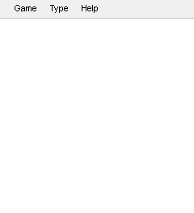
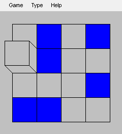
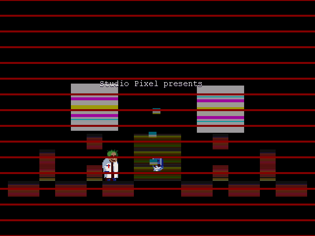
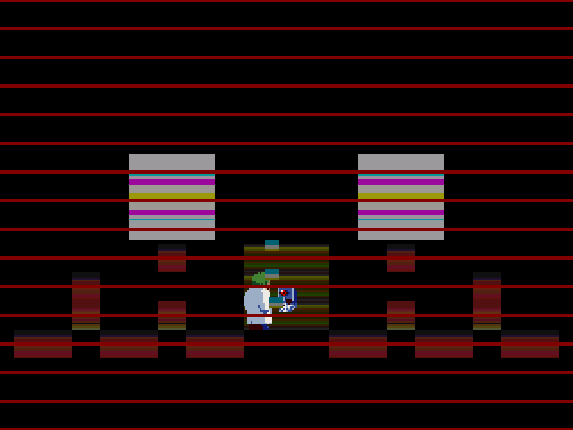
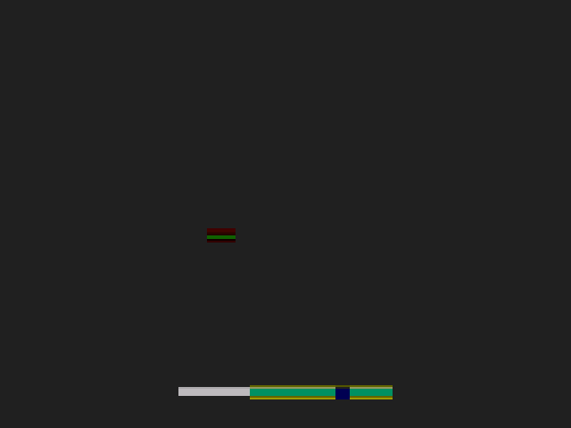

# Game screenshots and runtime evidence

Visual runtime evidence for each game with a captured frame. A frame proves the
rebuilt process rendered something; it is **not** gameplay-equivalence proof.
There is no original-Windows frame oracle on this host (#145/#171), so every
capture below is from a **native rebuilt binary** and is labelled PARTIAL or FAIL.

## Captured frames

<table>
<tr><td align="center"> Cube (new native rebuild)</td><td align="center">240×263 4 colours <code>4612755ca7d1</code></td></tr>
<tr><td align="center"> Cube (new native rebuild)</td><td align="center">240×263 4 colours <code>90b3fa0e8fa4</code></td></tr>
<tr><td align="center"> Cube (new native rebuild)</td><td align="center">240×263 4 colours <code>90b3fa0e8fa4</code></td></tr>
<tr><td align="center"> Cave Story (one-by-one sweep)</td><td align="center">640×480 5 colours <code>c921689ead26</code></td></tr>
<tr><td align="center"> Cave Story blank control</td><td align="center">640×480 1 colours <code>9347fe86f6b4</code></td></tr>
<tr><td align="center"> Ikachan (blank FAIL example)</td><td align="center">351×238 1 colours <code>bbe32c0f170a</code></td></tr>
<tr><td align="center"> Cave Story (earlier native build)</td><td align="center">640×480 47 colours <code>2bb1b42e7cd6</code></td></tr>
<tr><td align="center"> Cave Story (earlier native build)</td><td align="center">640×480 46 colours <code>503559ab2e1b</code></td></tr>
<tr><td align="center"> Cave Story (earlier native build)</td><td align="center">640×480 16 colours <code>8c9a36bf692b</code></td></tr>
</table>

## Frame inventory (all captured screenshots)

| File | Game / source | Size | Distinct RGB colours | SHA-256 | Verdict |
|---|---|---|---|---|---|
| `cube-native-frame-0000.png` | Cube (new native rebuild) | 240×263 | 4 | `4612755ca7d157200990c452459471be497591c51f56938ef54885f4db0963fa` | PARTIAL — real non-blank native render |
| `cube-native-frame-0001.png` | Cube (new native rebuild) | 240×263 | 4 | `90b3fa0e8fa4159a38a5f251d9ca6e9a3c619cd61a322d0e8beb3e9335e245ef` | PARTIAL — real non-blank native render |
| `cube-native-frame-0002.png` | Cube (new native rebuild) | 240×263 | 4 | `90b3fa0e8fa4159a38a5f251d9ca6e9a3c619cd61a322d0e8beb3e9335e245ef` | PARTIAL — real non-blank native render |
| `doukutsu-sweep-frame-0001.png` | Cave Story (one-by-one sweep) | 640×480 | 5 | `c921689ead26aa8966b9a88cc5fce73e7946bb3d73efa74bc40b764c5cd951cc` | PARTIAL — real non-blank native render |
| `doukutsu-sweep-frame-0000-blank.png` | Cave Story blank control | 640×480 | 1 | `9347fe86f6b448518e30d671057b4ece3e7f2cf3906488168f63736a4c990bc0` | FAIL — blank, never counted as evidence |
| `ikachan-blank-frame.png` | Ikachan (blank FAIL example) | 351×238 | 1 | `bbe32c0f170a633dda300f55f1c914041c6b1fcb0a58b9725eeab734ca582f39` | FAIL — blank, never counted as evidence |
| `cavestory-doukutsu-01-intro.png` | Cave Story (earlier native build) | 640×480 | 47 | `2bb1b42e7cd652851b5fd909eee365fb4a6d0c2db39c5e4d9f60c5e66f277204` | PARTIAL — real non-blank native render |
| `cavestory-doukutsu-02-intro.png` | Cave Story (earlier native build) | 640×480 | 46 | `503559ab2e1b95963dacbe03b6533012e3ed852a18a339925a058ccfb1d59ba0` | PARTIAL — real non-blank native render |
| `cavestory-doukutsu-03-screen.png` | Cave Story (earlier native build) | 640×480 | 16 | `8c9a36bf692ba0cd4fc20fc7802b2c4eeccb9464625d82dce01e236cc48d86d0` | PARTIAL — real non-blank native render |
| `igi-window-level5-splash.png` | Project I.G.I. (native splash) | 640×480 | 6814 | `02500b672883205a89c27388c8505cfb6efb6cd5824eccf5e5da3bcac04fde01` | PARTIAL — real non-blank native render |

## Tested games without captured frames

The following were executed but produced no frame (headless timeout, launcher
failure, no native binary, or no build); no screenshot can be shown for them.

- **100-game engine stress run**: 100 games executed as identical-binary
  Highball controls; 90 BLOCKED, 9 console PASS, 1 nondeterminism FAIL.
  Per-game evidence: `ENGINE100/FINAL_REPORT.md` (outside this repository).
- **AssaultCube / Teeworlds**: recompile retries produced no native binary
  (2-hour recover timeout / exit 2).
- **TrackMania ESWC / Forever / IGI**: engine controls returned BLOCKED.
- **New downloads** (Chocolate Strife, Crispy Strife, VCMI): controls BLOCKED.

See [verification methodology](VERIFICATION.md) and [game matrix](GAME_MATRIX.md).
