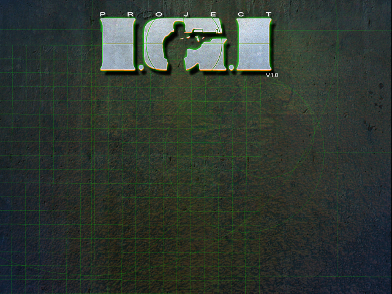

# IGI render fix evidence (honest)

The IGI rebuild exited with "IGI CD not found" when launched without the original game folder, and presented a black frame when Direct3D 7 rendering happened on the guest thread. Two fixes: pass the original data folder (`/Users/haseeb-mir/Downloads/IGI`) and allow GL viewport/swap from the guest render thread. Both are in the committed runtime source.

Run with the data folder stayed alive until the 18 s cap and produced 40 frames; frames 4+ are real non-blank renders. No original-Windows oracle was supplied, so the verdict remains PARTIAL.

| Frame | Size | Colours | SHA-256 |
| --- | --- | --- | --- |
| `igi-frame-0004.bmp` | 640x480 | 2886 | `a8f0a898c4c2df086cbe71fad771876e745ce2e4d791963e38ab94f74d8940e2` |
| `igi-frame-0010.bmp` | 640x480 | 3717 | `115555a9a05b19d9471f18ef40f21a1cf1d4f4fe9d2ea29337e2c3b98457408c` |

*IGI real render frame four; render evidence, not an oracle.*

## Honest limitation

CUA GUI capture was blocked by window-capture failures; the verification above is a direct run of the rebuilt binary with frame dumps, not a GUI screenshot.
