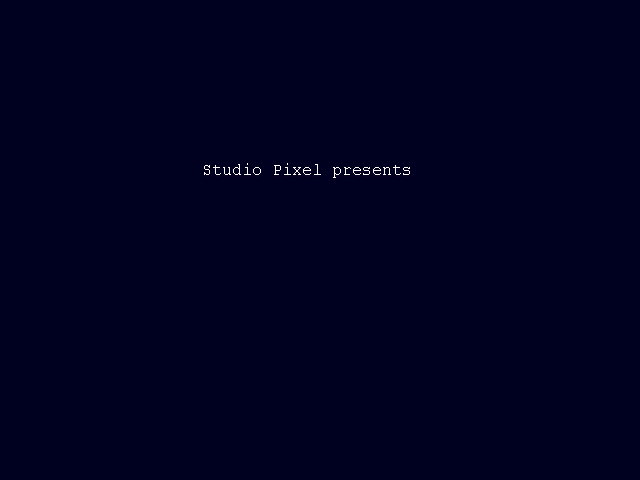
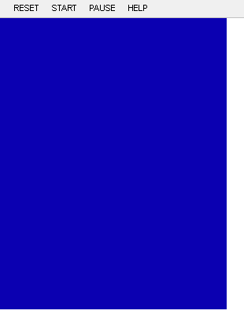

# Test evidence — native macOS ARM64 ports

This folder is the single index of what was actually built, launched and
measured. It contains the screenshots, machine-readable proofs and the app
definition. **No game binary or proprietary asset is committed** — the exact
paths, SHA-256 hashes and regeneration commands are recorded instead, following
the repository rule in `docs/GAME_MATRIX.md`.

## 1. Games with real render evidence (screenshots attached)

### Cave Story — `Doukutsu.exe`

- Original: `~/Downloads/recomp-apps/games/cavestory/Doukutsu.exe`
  SHA-256 `fa18379fe942ecb5fd69360ede81675ad6bb8b743bef2120305c4b439c732218`
- Recompiled native: `dist/macos/CaveStory-Native.app/Contents/MacOS/Doukutsu`
  SHA-256 `d56d5cba2e74c35788f4a9cddee4b66c7196066e5971a776f4ee8562028a64c0`
- macOS app bundle: `dist/macos/CaveStory-Native.app` (definition in `app-definition/`)
- Boot: 143 imports bound / 0 unresolved; Cocoa + OpenGL window; DirectSound
  44100 Hz; stayed alive 20 s; 3 frames at 640×480, 2 non-blank (5 colours).




Proof: `proofs/cavestory-frame-proof.json`. Full detail in
`docs/NATIVE_APP_EVIDENCE.md`.

### OUCC Tetris 1.3 — `tetris-win-32-en.exe` (freshly downloaded)

- Source: https://github.com/OUCC/tetris/releases/download/v1.3/tetris-win-32-en.exe
- Downloaded to `~/Downloads/recomp-new-tests/tetris-win-32-en.exe`
  SHA-256 `024dccd5e227ac4bfcf698e948b1682c4a42ddadde87ec5f18193ee16ca77b8d`
- Recompiled native: `.tetris-new/build/tetris_win_32_en` (1.7 MB)
- Boot: 97 imports bound / 0 unresolved; 15 s alive; 3 frames at 310×418,
  2 non-blank (4 and 5 colours).




Proof: `proofs/tetris-frame-proof.json`.

Both game rows are **PARTIAL**: real render evidence, but no Windows original
oracle and no gameplay/input verification.

## 2. Windows apps with full process-level proof

The original PE32 was executed by the local Highball/CrossOver Wine engine and
the recompiled native binary matched its exit code and deterministic output.
Each row has pipeline score 100, verification `scenario-pass`, and corpus
acceptance **PASS 1 / FAIL 0**.

| Original | SHA-256 (first 12) | Native result | Proof |
|---|---|---|---|
| `base64.exe` | `d805661c60b0` | exit 0, 6/6 output needles | `proofs/base64-oracle.json`, `proofs/base64-oracle-pass.json` |
| `arith-calc.exe` | `9b59ee613acc` | `fib(20)=6765`, `gcd=21`, `popcount=16`, `rotl=878082066` | `proofs/arith-calc-oracle.json`, `proofs/arith-calc-oracle-pass.json` |
| `busybox.exe` | `7bfee5309653` | exit 0, output reproduced by automated sweep | `proofs/sweep.json`, `proofs/busybox-oracle-pass.json` |

Wine is an independent execution of the original binary but **not retail
Windows**, and process-level matching is **not gameplay equivalence**. See
`docs/WINE_ORACLE_EVIDENCE.md`.

## 3. How to reproduce the binaries

```sh
# Cave Story native app (binary + assets bundled into a .app)
python3 tools/make_macos_app.py \
  --binary <project>/build/Doukutsu \
  --game-dir ~/Downloads/recomp-apps/games/cavestory \
  --out dist/macos --name CaveStory-Native

# Tetris: download, recompile, run with frame capture
curl -L -o ~/Downloads/recomp-new-tests/tetris-win-32-en.exe \
  https://github.com/OUCC/tetris/releases/download/v1.3/tetris-win-32-en.exe
./GameReComp ~/Downloads/recomp-new-tests/tetris-win-32-en.exe \
  --project-dir .tetris-new --assets-dir ~/Downloads/recomp-new-tests --no-table
python3 -m tools.game_runner --game tetris-new \
  --binary <abs project>/.tetris-new/build/tetris_win_32_en \
  --folder ~/Downloads/recomp-new-tests --out /tmp/frames --timeout 15
python3 -m tools.frame_proof --summary /tmp/frames/summary.json --out /tmp/proof

# CLI apps: Wine oracle + native build + acceptance (automated)
python3 -m tools.oracle_sweep --exe <original.exe> --out evidence/sweep --timeout 20
```

## 4. What is NOT proven here

- No issue in `docs/ISSUE_STATUS.md` has 100% acceptance: no retail-Windows
  oracle, no gameplay/input equivalence, no legal proprietary assets, no
  Linux runner. **No issue was closed.**
- IGI (`igi.exe`) rebuilt (128 imports / 0 unresolved) but still aborts on
  `Invalid texture format` — FAIL, not working. Its upstream fix in
  `igi-recomp` is a block hook against a different register ABI.
- Ikachan built but its frames were single-colour — BUILD-ONLY, screenshot
  deliberately not included as proof.
- noiz2sa / Pixeltetris builds were killed by host OOM (exit 137).
- `TmForever.exe` and other large titles were not rebuilt here (multi-GB
  generated C); `TmNationsESWC.exe` is the tractable untested target.
